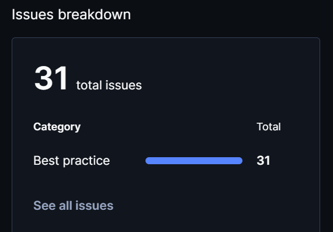
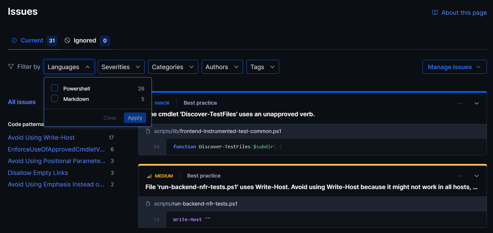

# Code Review

## 1. Change History

| **Change Date**   | **Modified Sections** | **Rationale** |
| ----------------- | --------------------- | ------------- |
| 2026-11-04 | 2.1-2.4 | CP2 updates: documented the Codacy automated code review results, including the remaining unfixed issues per category and code pattern, with justifications. |

---

## 2. Automated Code Review Results

### 2.1. Commit Hash Where Codacy Ran

`789779cac6ca121d2a434ce1f6286205c6793b98`

### 2.2. Unfixed Issues per Codacy Category

### 2.3. Unfixed Issues per Codacy Code Pattern

### 2.4. Justifications for Unfixed Issues

- **Markdown issues in Section 3 onwards**

  - **Code Patterns:** No empty links (MD042), Emphasis used instead of a heading (MD036)
  - **Location in Git:**
    - MD042: [`documentation/Code_Review.md#L53`](https://github.com/w-lin5/CPEN321_MeetFair/blob/main/documentation/Code_Review.md#L53), [`documentation/Code_Review.md#L78`](https://github.com/w-lin5/CPEN321_MeetFair/blob/main/documentation/Code_Review.md#L78), [`documentation/Code_Review.md#L101`](https://github.com/w-lin5/CPEN321_MeetFair/blob/main/documentation/Code_Review.md#L101)
    - MD036: [`documentation/Code_Review.md#L67`](https://github.com/w-lin5/CPEN321_MeetFair/blob/main/documentation/Code_Review.md#L67), [`documentation/Code_Review.md#L92`](https://github.com/w-lin5/CPEN321_MeetFair/blob/main/documentation/Code_Review.md#L92)
  - **Justification:** These issues are in Section 3 (Manual Code Review Results) onwards. The Checkpoint 2 deliverable does not require us to edit those sections, and they are left as provided in the course template version.

- **PowerShell script issues**

  - **Code Patterns:** Avoid Using Write-Host, Use Approved Verbs, Avoid Using Positional Parameters
  - **Location in Git:**
    - Avoid Using Write-Host: [`scripts/lib/frontend-instrumented-test-common.ps1#L17`](https://github.com/w-lin5/CPEN321_MeetFair/blob/main/scripts/lib/frontend-instrumented-test-common.ps1#L17), [`scripts/lib/frontend-instrumented-test-common.ps1#L18`](https://github.com/w-lin5/CPEN321_MeetFair/blob/main/scripts/lib/frontend-instrumented-test-common.ps1#L18), [`scripts/lib/frontend-instrumented-test-common.ps1#L19`](https://github.com/w-lin5/CPEN321_MeetFair/blob/main/scripts/lib/frontend-instrumented-test-common.ps1#L19), [`scripts/run-backend-interface-tests.ps1#L33`](https://github.com/w-lin5/CPEN321_MeetFair/blob/main/scripts/run-backend-interface-tests.ps1#L33), [`scripts/run-backend-interface-tests.ps1#L34`](https://github.com/w-lin5/CPEN321_MeetFair/blob/main/scripts/run-backend-interface-tests.ps1#L34), [`scripts/run-backend-interface-tests.ps1#L35`](https://github.com/w-lin5/CPEN321_MeetFair/blob/main/scripts/run-backend-interface-tests.ps1#L35), [`scripts/run-backend-interface-tests.ps1#L52`](https://github.com/w-lin5/CPEN321_MeetFair/blob/main/scripts/run-backend-interface-tests.ps1#L52), [`scripts/run-backend-nfr-tests.ps1#L22`](https://github.com/w-lin5/CPEN321_MeetFair/blob/main/scripts/run-backend-nfr-tests.ps1#L22), [`scripts/run-backend-nfr-tests.ps1#L23`](https://github.com/w-lin5/CPEN321_MeetFair/blob/main/scripts/run-backend-nfr-tests.ps1#L23), [`scripts/run-backend-nfr-tests.ps1#L24`](https://github.com/w-lin5/CPEN321_MeetFair/blob/main/scripts/run-backend-nfr-tests.ps1#L24), [`scripts/run-backend-nfr-tests.ps1#L74`](https://github.com/w-lin5/CPEN321_MeetFair/blob/main/scripts/run-backend-nfr-tests.ps1#L74), [`scripts/run-backend.ps1#L18`](https://github.com/w-lin5/CPEN321_MeetFair/blob/main/scripts/run-backend.ps1#L18), [`scripts/run-backend.ps1#L19`](https://github.com/w-lin5/CPEN321_MeetFair/blob/main/scripts/run-backend.ps1#L19), [`scripts/run-backend.ps1#L56`](https://github.com/w-lin5/CPEN321_MeetFair/blob/main/scripts/run-backend.ps1#L56), [`scripts/run-frontend.ps1#L26`](https://github.com/w-lin5/CPEN321_MeetFair/blob/main/scripts/run-frontend.ps1#L26), [`scripts/run-frontend.ps1#L27`](https://github.com/w-lin5/CPEN321_MeetFair/blob/main/scripts/run-frontend.ps1#L27), [`scripts/run-frontend.ps1#L145`](https://github.com/w-lin5/CPEN321_MeetFair/blob/main/scripts/run-frontend.ps1#L145)
    - Use Approved Verbs: [`scripts/lib/frontend-instrumented-test-common.ps1#L21`](https://github.com/w-lin5/CPEN321_MeetFair/blob/main/scripts/lib/frontend-instrumented-test-common.ps1#L21), [`scripts/lib/frontend-instrumented-test-common.ps1#L46`](https://github.com/w-lin5/CPEN321_MeetFair/blob/main/scripts/lib/frontend-instrumented-test-common.ps1#L46), [`scripts/lib/frontend-instrumented-test-common.ps1#L84`](https://github.com/w-lin5/CPEN321_MeetFair/blob/main/scripts/lib/frontend-instrumented-test-common.ps1#L84), [`scripts/lib/frontend-instrumented-test-common.ps1#L93`](https://github.com/w-lin5/CPEN321_MeetFair/blob/main/scripts/lib/frontend-instrumented-test-common.ps1#L93), [`scripts/lib/frontend-instrumented-test-common.ps1#L111`](https://github.com/w-lin5/CPEN321_MeetFair/blob/main/scripts/lib/frontend-instrumented-test-common.ps1#L111), [`scripts/run-backend-interface-tests.ps1#L48`](https://github.com/w-lin5/CPEN321_MeetFair/blob/main/scripts/run-backend-interface-tests.ps1#L48)
    - Avoid Using Positional Parameters: [`scripts/run-backend-interface-tests.ps1#L123`](https://github.com/w-lin5/CPEN321_MeetFair/blob/main/scripts/run-backend-interface-tests.ps1#L123), [`scripts/run-backend-interface-tests.ps1#L127`](https://github.com/w-lin5/CPEN321_MeetFair/blob/main/scripts/run-backend-interface-tests.ps1#L127), [`scripts/run-backend-interface-tests.ps1#L131`](https://github.com/w-lin5/CPEN321_MeetFair/blob/main/scripts/run-backend-interface-tests.ps1#L131)
  - **Justification:** These scripts were provided by the course in the template repository (the `scripts/` folder is course-owned), so we did not modify them.

---

## 3. Manual Code Review Results

### 3.1. Review You Performed

- **Peer group reviewed:** [WRITE_HERE]
- **Commit SHA reviewed:** `[Insert Commit SHA here]`
- **Date the artifacts were exchanged:** [WRITE_HERE]
- **Review report submitted:** [`<CP#>_<YourPeerGroupName>_Review.pdf`](#)

| **Section**          | **Item**                                                                                                                                             | **Score** |
| -------------------- | ---------------------------------------------------------------------------------------------------------------------------------------------------- | --------- |
| Manual code review   | Code is maintainable (well-documented, uses self-explanatory variable names, does not have complicated and long methods, magic numbers, etc.), efficient, handles error cases well | x/10      |
| Manual test review   | Tests are complete (all APIs exposed to the front-end are tested, three main features are tested), errors and edge cases are thoroughly tested, correct assertions are used | x/10      |
| Manual test review   | Test code is maintainable and well-structured                                                                                                          | x/10      |
| Manual test review   | Test implementation matches the requirements and design                                                                                                | x/10      |
| Manual test review   | Non-functional requirements are tested well                                                                                                            | x/10      |
| Manual test review   | Tests achieve high coverage and cases of < 100% coverage are well-justified                                                                            | x/10      |
| Manual test review   | All back-end tests can be run automatically                                                                                                            | x/10      |
| Automated code review| Codacy runs with the required setup                                                                                                                    | x/10      |
| Automated code review| All remaining Codacy issues are well-justified                                                                                                          | x/10      |

**Major fault reported**

- **Description:** ...
- **Steps to reproduce:** ...
- **Screenshots:** _(Placeholder for screenshots of the reported fault)_
- **Severity:** ...

### 3.2. Review You Received

- **Reviewing group:** [WRITE_HERE]
- **Commit SHA that was reviewed:** `[Insert Commit SHA here]`
- **Review report received:** [`<CP#>_<YourGroupName>_Review.pdf`](#)

| **Section**          | **Item**                                                                                                                                             | **Score** |
| -------------------- | ---------------------------------------------------------------------------------------------------------------------------------------------------- | --------- |
| Manual code review   | Code is maintainable, efficient, handles error cases well                                                                                               | x/10      |
| Manual test review   | Tests are complete, errors and edge cases are thoroughly tested, correct assertions are used                                                            | x/10      |
| Manual test review   | Test code is maintainable and well-structured                                                                                                          | x/10      |
| Manual test review   | Test implementation matches the requirements and design                                                                                                | x/10      |
| Manual test review   | Non-functional requirements are tested well                                                                                                            | x/10      |
| Manual test review   | Tests achieve high coverage and cases of < 100% coverage are well-justified                                                                            | x/10      |
| Manual test review   | All back-end tests can be run automatically                                                                                                            | x/10      |
| Automated code review| Codacy runs with the required setup                                                                                                                    | x/10      |
| Automated code review| All remaining Codacy issues are well-justified                                                                                                          | x/10      |

**Major fault reported against your project**

- **Description:** ...
- **Severity:** ...

### 3.3. Actions Taken in Response to the Review

| **Finding** | **Action Taken** | **Commit / Location in Git** |
| ----------- | ---------------- | ---------------------------- |
| ...         | ...              | [`src/...`](#)               |
| ...         | ...              | ...                          |

- **Findings not acted on.** For each finding you decided not to address, give the reason:
  1. **Finding:** ...
     - **Justification:** ...
