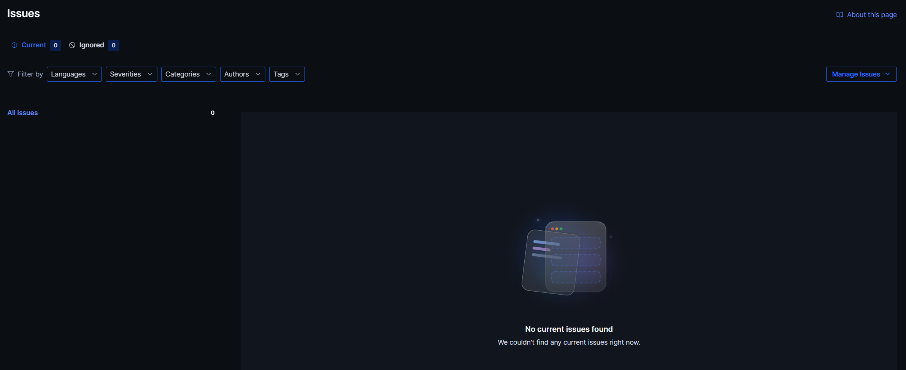

# Code Review

## 1. Change History

| **Change Date**   | **Modified Sections** | **Rationale** |
| ----------------- | --------------------- | ------------- |
| 2026-11-04 | 2.1-2.4 | CP2 updates: documented the Codacy automated code review results, including the remaining unfixed issues per category and code pattern, with justifications. |
| 2026-11-19 | 3.3 | Recorded fixes, regression tests and commit references for the two major faults reported by Ledger. |
| 2026-11-19 | 3.1 | Recorded the review of Ledger, including scores and the two reported faults, from the supplied review report text. |

---

## 2. Automated Code Review Results

### 2.1. Commit Hash Where Codacy Ran

`789779cac6ca121d2a434ce1f6286205c6793b98`

### 2.2. Unfixed Issues per Codacy Category

### 2.3. Unfixed Issues per Codacy Code Pattern

### 2.4. Justifications for Unfixed Issues

- **Markdown issues in Section 3 onwards**

  - **Code Patterns:** No empty links (MD042), Emphasis used instead of a heading (MD036)
  - **Location in Git:**
    - MD042: [`documentation/Code_Review.md#L53`](https://github.com/w-lin5/CPEN321_MeetFair/blob/main/documentation/Code_Review.md#L53), [`documentation/Code_Review.md#L78`](https://github.com/w-lin5/CPEN321_MeetFair/blob/main/documentation/Code_Review.md#L78), [`documentation/Code_Review.md#L101`](https://github.com/w-lin5/CPEN321_MeetFair/blob/main/documentation/Code_Review.md#L101)
    - MD036: [`documentation/Code_Review.md#L67`](https://github.com/w-lin5/CPEN321_MeetFair/blob/main/documentation/Code_Review.md#L67), [`documentation/Code_Review.md#L92`](https://github.com/w-lin5/CPEN321_MeetFair/blob/main/documentation/Code_Review.md#L92)
  - **Justification:** These issues are in Section 3 (Manual Code Review Results) onwards. The Checkpoint 2 deliverable does not require us to edit those sections, and they are left as provided in the course template version.

- **PowerShell script issues**

  - **Code Patterns:** Avoid Using Write-Host, Use Approved Verbs, Avoid Using Positional Parameters
  - **Location in Git:**
    - Avoid Using Write-Host: [`scripts/lib/frontend-instrumented-test-common.ps1#L17`](https://github.com/w-lin5/CPEN321_MeetFair/blob/main/scripts/lib/frontend-instrumented-test-common.ps1#L17), [`scripts/lib/frontend-instrumented-test-common.ps1#L18`](https://github.com/w-lin5/CPEN321_MeetFair/blob/main/scripts/lib/frontend-instrumented-test-common.ps1#L18), [`scripts/lib/frontend-instrumented-test-common.ps1#L19`](https://github.com/w-lin5/CPEN321_MeetFair/blob/main/scripts/lib/frontend-instrumented-test-common.ps1#L19), [`scripts/run-backend-interface-tests.ps1#L33`](https://github.com/w-lin5/CPEN321_MeetFair/blob/main/scripts/run-backend-interface-tests.ps1#L33), [`scripts/run-backend-interface-tests.ps1#L34`](https://github.com/w-lin5/CPEN321_MeetFair/blob/main/scripts/run-backend-interface-tests.ps1#L34), [`scripts/run-backend-interface-tests.ps1#L35`](https://github.com/w-lin5/CPEN321_MeetFair/blob/main/scripts/run-backend-interface-tests.ps1#L35), [`scripts/run-backend-interface-tests.ps1#L52`](https://github.com/w-lin5/CPEN321_MeetFair/blob/main/scripts/run-backend-interface-tests.ps1#L52), [`scripts/run-backend-nfr-tests.ps1#L22`](https://github.com/w-lin5/CPEN321_MeetFair/blob/main/scripts/run-backend-nfr-tests.ps1#L22), [`scripts/run-backend-nfr-tests.ps1#L23`](https://github.com/w-lin5/CPEN321_MeetFair/blob/main/scripts/run-backend-nfr-tests.ps1#L23), [`scripts/run-backend-nfr-tests.ps1#L24`](https://github.com/w-lin5/CPEN321_MeetFair/blob/main/scripts/run-backend-nfr-tests.ps1#L24), [`scripts/run-backend-nfr-tests.ps1#L74`](https://github.com/w-lin5/CPEN321_MeetFair/blob/main/scripts/run-backend-nfr-tests.ps1#L74), [`scripts/run-backend.ps1#L18`](https://github.com/w-lin5/CPEN321_MeetFair/blob/main/scripts/run-backend.ps1#L18), [`scripts/run-backend.ps1#L19`](https://github.com/w-lin5/CPEN321_MeetFair/blob/main/scripts/run-backend.ps1#L19), [`scripts/run-backend.ps1#L56`](https://github.com/w-lin5/CPEN321_MeetFair/blob/main/scripts/run-backend.ps1#L56), [`scripts/run-frontend.ps1#L26`](https://github.com/w-lin5/CPEN321_MeetFair/blob/main/scripts/run-frontend.ps1#L26), [`scripts/run-frontend.ps1#L27`](https://github.com/w-lin5/CPEN321_MeetFair/blob/main/scripts/run-frontend.ps1#L27), [`scripts/run-frontend.ps1#L145`](https://github.com/w-lin5/CPEN321_MeetFair/blob/main/scripts/run-frontend.ps1#L145)
    - Use Approved Verbs: [`scripts/lib/frontend-instrumented-test-common.ps1#L21`](https://github.com/w-lin5/CPEN321_MeetFair/blob/main/scripts/lib/frontend-instrumented-test-common.ps1#L21), [`scripts/lib/frontend-instrumented-test-common.ps1#L46`](https://github.com/w-lin5/CPEN321_MeetFair/blob/main/scripts/lib/frontend-instrumented-test-common.ps1#L46), [`scripts/lib/frontend-instrumented-test-common.ps1#L84`](https://github.com/w-lin5/CPEN321_MeetFair/blob/main/scripts/lib/frontend-instrumented-test-common.ps1#L84), [`scripts/lib/frontend-instrumented-test-common.ps1#L93`](https://github.com/w-lin5/CPEN321_MeetFair/blob/main/scripts/lib/frontend-instrumented-test-common.ps1#L93), [`scripts/lib/frontend-instrumented-test-common.ps1#L111`](https://github.com/w-lin5/CPEN321_MeetFair/blob/main/scripts/lib/frontend-instrumented-test-common.ps1#L111), [`scripts/run-backend-interface-tests.ps1#L48`](https://github.com/w-lin5/CPEN321_MeetFair/blob/main/scripts/run-backend-interface-tests.ps1#L48)
    - Avoid Using Positional Parameters: [`scripts/run-backend-interface-tests.ps1#L123`](https://github.com/w-lin5/CPEN321_MeetFair/blob/main/scripts/run-backend-interface-tests.ps1#L123), [`scripts/run-backend-interface-tests.ps1#L127`](https://github.com/w-lin5/CPEN321_MeetFair/blob/main/scripts/run-backend-interface-tests.ps1#L127), [`scripts/run-backend-interface-tests.ps1#L131`](https://github.com/w-lin5/CPEN321_MeetFair/blob/main/scripts/run-backend-interface-tests.ps1#L131)
  - **Justification:** These scripts were provided by the course in the template repository (the `scripts/` folder is course-owned), so we did not modify them.

---

## 3. Manual Code Review Results

### 3.1. Review You Performed

- **Peer group reviewed:** Ledger
- **Commit SHA reviewed:** 761ad4dca5d56e874f47987992abf02ed576d6d1
- **Date the artifacts were exchanged:** 11/04
- **Review report submitted:** `CP3_Ledger_Review.pdf`

| **Section**          | **Item**                                                                                                                                             | **Score** |
| -------------------- | ---------------------------------------------------------------------------------------------------------------------------------------------------- | --------- |
| Manual code review   | Code is maintainable (well-documented, uses self-explanatory variable names, does not have complicated and long methods, magic numbers, etc.), efficient, handles error cases well | 7/10      |
| Manual test review   | Tests are complete for one end-to-end feature and all interfaces of one component, errors and edge cases are thoroughly tested, correct assertions are used | 6/10      |
| Manual test review   | Test code is maintainable and well-structured                                                                                                          | 6/10      |
| Manual test review   | Test implementation matches the requirements and design                                                                                                | 5/10      |
| Manual test review   | Non-functional requirements are tested well                                                                                                            | 5/10      |
| Manual test review   | Tests achieve high coverage and cases of < 100% coverage are well-justified                                                                            | 4/10      |
| Manual test review   | All back-end tests can be run automatically                                                                                                            | 8/10      |
| Automated code review| Codacy runs with the required setup                                                                                                                    | 6/10      |
| Automated code review| All remaining Codacy issues are well-justified                                                                                                          | 10/10     |

**Major faults reported**

#### Fault 1: Editing a historical expense requires changing its allocation after a member leaves

- **Description:** After member B leaves a group, member A cannot change only the description of an existing expense while preserving its original split. The editor requires removing the former participant before saving. For a CAD 60 expense originally split equally, this changes A's allocation from CAD 30 to CAD 60. Editing descriptive information should preserve the financial allocation of a historical expense.
- **Steps to reproduce:**
  1. Create a group with members A and B.
  2. Add a CAD 60 expense, paid by A and split equally: CAD 30 each.
  3. Have B leave the group.
  4. As A, edit the expense and change only its description.
  5. Observe that saving requires removing the former participant.
  6. Remove B from the draft and observe that A's allocated share changes from CAD 30 to CAD 60.
- **Screenshots:** The remaining member's share changes from CAD 30.00 (left) to CAD 60.00 (right) after removing the former participant from the draft.

  

- **Severity:** High.

#### Fault 2: Google sign-in fails after biometric unlock is enabled

- **Description:** With biometric unlock enabled, Google sign-in opens account selection, then displays "Ledger is locked" and "Sign-in request cancelled by Ledger". Unlocking returns the user to the sign-in page instead of completing Google sign-in. Username-and-password sign-in still works.
- **Steps to reproduce:**
  1. Navigate to Me -> Security -> Require biometric unlock and enable the setting.
  2. Ensure the user is signed out.
  3. Select Sign In with Google and choose a Google account.
  4. Observe the "Ledger is locked" screen requiring biometric unlock.
  5. Unlock and observe that the app returns to the sign-in page without completing Google sign-in.
- **Screenshots:** The biometric lock screen (left) and the sign-in page shown after unlocking (right).

  

- **Severity:** High.

### 3.2. Review You Received

- **Reviewing group:** Ledger
- **Commit SHA that was reviewed:** `5a1db43039f4dde53e37ae97aa2f3441e6749cc9`
- **Review report received:** `CP3_MeetFair_Review.pdf`

| **Section**          | **Item**                                                                                                                                             | **Score** |
| -------------------- | ---------------------------------------------------------------------------------------------------------------------------------------------------- | --------- |
| Manual code review   | Code is maintainable, efficient, handles error cases well                                                                                               | 7/10      |
| Manual test review   | Tests are complete, errors and edge cases are thoroughly tested, correct assertions are used                                                            | 7/10      |
| Manual test review   | Test code is maintainable and well-structured                                                                                                          | 8/10      |
| Manual test review   | Test implementation matches the requirements and design                                                                                                | 8/10      |
| Manual test review   | Non-functional requirements are tested well                                                                                                            | 6/10      |
| Manual test review   | Tests achieve high coverage and cases of < 100% coverage are well-justified                                                                            | 6/10      |
| Manual test review   | All back-end tests can be run automatically                                                                                                            | 4/10      |
| Automated code review| Codacy runs with the required setup                                                                                                                    | 6/10      |
| Automated code review| All remaining Codacy issues are well-justified                                                                                                          | 8/10      |

**Major faults reported against your project**

**Fault 1**
- **Description:** A closed restaurant can be selected as the final meetup venue. MeetFair recommended a restaurant (in our example, Ding Tai Feng at 1132 Alberni St,vVancouver) for a meetup scheduled at 01:03 a.m. Vancouver Time, which would bevclosed at the time. Both participants were subsequently able to vote for the restaurantvand have it become the meetup venue. This is a functional expectation arising from MeetFair’s goal of recommending feasible
meeting locations.
- **Severity:** High (core functional requirement failure)

**Fault 2**
- **Description:** MeetFair allows members to leave a group while a meetup is FINALIZED (Section 3.4, Requirements and Design) and describes Fair Credit settlement after trips are completed (Section 4.1, Requirements and Design). In implementation, leaving the group disables location sharing but does not end the ACTIVE trip. Settlement rejects any meetup containing an ACTIVE trip, and the member cannot click “Arrival” after leaving the group.
- **Severity:** High (blocks a core backend business process for all members)

### 3.3. Actions Taken in Response to the Review

| **Finding** | **Action Taken** | **Commit / Location in Git** |
| ----------- | ---------------- | ---------------------------- |
| **Fault 1: A closed restaurant can become the final meetup venue.** | Passed the meetup's scheduled time to the Places client and filtered venues before scoring using their local timezone, business status and structured opening hours. The filter handles overnight periods, closing boundaries and available dated exceptions; closed venues and venues with unknown availability are excluded. Fewer than three confirmed-open venues produce a clear error and leave the meetup in SETUP. Regression tests reproduce the 01:03 Vancouver case and verify that the excluded restaurant cannot receive votes or be finalized. | Commit [`1e4e379`](https://github.com/w-lin5/CPEN321_MeetFair/commit/1e4e379). |
| **Fault 2: Leaving a group during an ACTIVE trip can prevent settlement.** | Kept the existing permission to leave after voting ends. Leaving now revokes membership before trip cleanup, marks only the departing member's unfinished trips in that group as CANCELLED, and clears sharing and coordinates. It does not fabricate arrival or a completed commute duration; settlement uses the existing estimated-duration fallback. Completed ARRIVED trips retain their tracked durations. Settlement also repairs legacy ACTIVE trips belonging to former members, while still blocking on current members' ACTIVE trips, including paused sharing. The app explains cancellation and prevents restarting or marking arrival on a cancelled trip after rejoining. | Commit [`d330d1c`](https://github.com/w-lin5/CPEN321_MeetFair/commit/d330d1c). |

**Findings not acted on:** None of the two major faults listed in Section 3.2 was left unaddressed.
