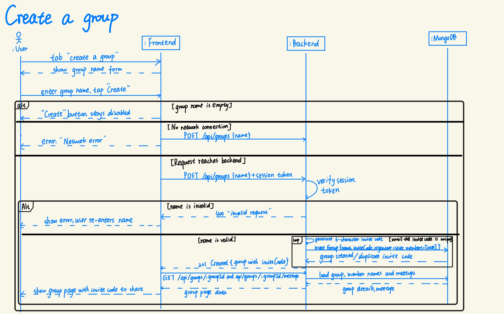
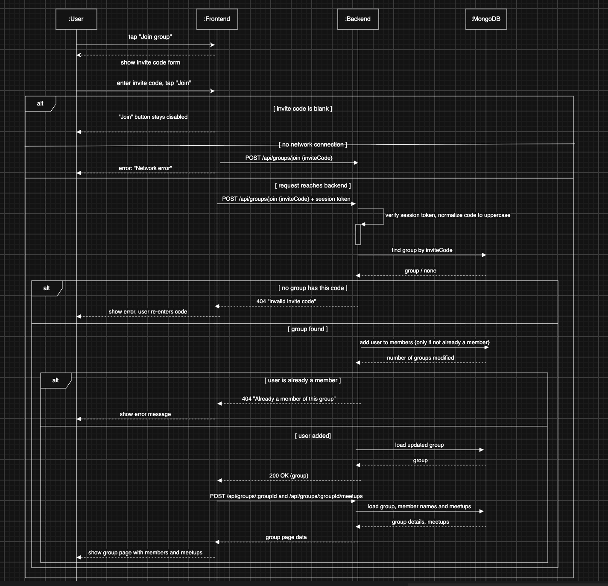

# Requirements and Design

## 1. Change History

| **Change Date**   | **Modified Sections** | **Rationale** |
| ----------------- | --------------------- | ------------- |
| _Nothing to show_ |

---

## 2. Project Description

[WRITE_PROJECT_DESCRIPTION_HERE]

---

## 3. Requirements Specification

### **3.1. List of Features**
1. **Sign in with Google**: Users log in with their Google account.
2. **Groups and meetups**: Any user can create a group and invite others; each user enters start location, meeting purpose (meal, study, coffee chat, outdoors, fun) and optional place types.
3. **Fair spot recommendation**: Backend collects candidate places (Places API), gets each user's travel time (Distance Matrix), then scores every candidate with our own fairness + preference algorithm and returns the top 3 (if there exist 3).
4. **Weighted voting**: Users vote on the top 3, weighted by each user's fairness debt (how much extra they actually travelled in past meetups). Votes appear live; the winner becomes a Google Calendar event.
5. **Live commute tracking**: On meetup day, members tap "I'm leaving" and share live location; the group sees who is on the way. The commute ends when they tap "I'm here," or automatically when their location reaches the venue. The actual commute time updates their fairness debt for the next meetup. If someone never starts tracking, we fall back to the Google Maps estimate.
### **3.2. Use Case Diagram**

### **3.3. Actors Description**
1. **User**: A signed-in user who creates or joins a meetup, enters start location and preferences, votes, and shares live location on the way so their actual commute time is recorded.

### **3.4. Use Case Description**
- Use cases for feature 1: Sign In
1. **Sign In**: A user authenticates into the app using their Google account to access their groups and past fairness history.
2. **Sign out**: A user securely ends their active session on the device.
- Use cases for feature 2: Groups and Meetups
1. **Create Group**: An Organizer creates a new group in the app and generates a code to invite other members.
2. **Create Meetup**: An organizer creates a new meetup associated with their group, allowing members to add their preferences.
3. **Join Group**: A member uses a code to associate their account with an existing group.
4. **Enter Start Location & Preferences**: A member inputs their starting address, transit mode, and meetup preferences (e.g., cafe, library) for an upcoming meetup.
4. **Import Calendar**: A member syncs their Google Calendar with ther user profile to automatically block out busy periods.
- Use cases for feature 3: Fair Spot Recommendation
1. **Get Recommendations**: The system collects all group member's locations and preferences, calculates commute fairness, and outputs the top 3 candidate locations.
- Use cases for feature 4: Voting and Fairness
1. **Vote on a Candidate**: A member casts a vote for their preferred spot from the top 3 recommendations, with their vote's weight adjusted by their current fairness debt.
2. **Finalize Meetup**: The organizer closes the voting, the system logs the winning location as a Google Calendar event.
3. **View Fairness History**: A member checks their profile for a specific group to see their accumulated fairness debt and past travel sacrifices.
- Use cases for feature 5: Live Location
1. **Share Live Location**: A member opts in on the day of the event to broadcast their real-time device location to the group via WebSockets and to keep track of their actual commute time.
2. **View Members' Location**: A member opens the live map to check the current transit progress of other group members heading to the finalized spot.

### **3.5. Formal Use Case Specifications (5 Most Major Use Cases)**

#### Use Case 1: Sign In

**Description**: ...

**Primary actor(s)**: ... 
    
**Main success scenario**:
1. ...
2. ...

**Failure scenario(s)**:
- 1a. ...
    - 1a1. ...
    - 1a2. ...

- 1b. ...
    - 1b1. ...
    - 1b2. ...
                
- 2a. ...
    - 2a1. ...
    - 2a2. ...

#### Use Case 2: Create or Join Group

**Description**: A user creates a new group and receives an invite code to share, or joins an existing group by entering an invite code, associating their account with that group so they can participate in future meetups.

**Primary actor(s)**: User

**Main success scenario (Create)**:
1. The user selects the option to create a group.
2. The user enters a group name.
3. The system creates the group in the database and assigns the user as a member.
4. The system generates a unique invite code that serves as the group's identifier.
5. The system displays the group page with the invite code for sharing.

**Main success scenario (Join)**:
1. The user selects the option to join a group.
2. The user enters the invite code shared by the group creator.
3. The system validates the invite code against the database.
4. The system adds the user to the group's member list.
5. If the user already has a group with the same name, the system displays both groups as "Group Name (distinct member name)" to differentiate them.
6. The system displays the group page with existing members and any active meetups.

**Failure scenario(s)**:
- Create 2a. The user enters an empty group name.
    - 2a1. The system displays an error message and prompts the user to enter a valid name.

- Create 2b. The user already has a group with the same name.
    - 2b1. The system creates the group and displays both groups as "Group Name (distinct member name)" to differentiate them.

- Create 3a. The user's device has no network connection.
    - 3a1. The system displays a "No network connection" error and prompts the user to try again when reconnected.

- Join 2a. The user enters an invalid invite code.
    - 2a1. The system displays an error message indicating the code is invalid.
    - 2a2. The system prompts the user to re-enter a valid code.

- Join 3a. The user is already a member of this group.
    - 3a1. The system displays a message informing the user they are already in the group.
    - 3a2. The system navigates the user to the existing group page.

- Join 3b. The user's device has no network connection.
    - 3b1. The system displays a "No network connection" error and prompts the user to try again when reconnected.

- Join 4a. The group has reached its maximum member limit.
    - 4a1. The system displays an error message that the group is full.
    - 4a2. The system returns the user to the join group screen.

#### Use Case 3: Get Recommendations

**Description**: ...

**Primary actor(s)**: ... 
    
**Main success scenario**:
1. ...
2. ...

**Failure scenario(s)**:
- 1a. ...
    - 1a1. ...
    - 1a2. ...

- 1b. ...
    - 1b1. ...
    - 1b2. ...
                
- 2a. ...
    - 2a1. ...
    - 2a2. ...

#### Use Case 4: Finalize Meetup

**Description**: The Organizer closes the voting process, allowing the system to determine the winning location, update each member's fairness debt based on their finalized commute, and export the event to the members' calendars.

**Primary actor(s)**: Organizer (User)
    
**Main success scenario**:
1. The Organizer selects the option to close voting and finalize the meetup.
2. The system tallies the weighted votes and determines the winning location.
3. The system saves the winning location as the finalized destination in the database.
4. The system sends the meetup details (location, time, attendees) to the Google Calendar API to create a calendar event.
5. The system marks the meetup as finalized and sends a notification to all group members with the final result.

**Failure scenario(s)**:
- 1a. The Organizer attempts to finalize with zero votes cast.
    - 1a1. The system blocks finalization and displays an error prompt, requiring the Organizer to either cast a vote themselves or manually select a winner to proceed.
- 1b. The Organizer attempts to finalize meetup before all members have voted.
    - 1b1. The system presents a warning prompt asking the Organizer to confirm they want to force-close the poll early. If confirmed, the system proceeds to step 2. If cancelled, the system returns to the active voting screen.
- 1c. The Organizer's device has no network connection.
    - 1c1. The system displays a "No network connection" error and leaves the poll open, prompting the Organizer to try again when reconnected.
- 2a. A tie occurs in the weighted voting tally.
    - 2a1. The system reviews the members who voted for the tied locations and selects the candidate chosen by the member with the highest individual fairness debt.
    - 2a2. If there is more than one member with the same fairness debt, the system prompts the Organizer to manually select the final winner to break the tie.
- 3a. The data fails to upload to the database.
    - 3a1. The system aborts the finalization, rolls back any partial database changes to prevent data corruption, and alerts the Organizer to retry.
- 4a. The external calendar sync fails for one or more members.
    - 4a1. The system successfully creates the calendar event for all other authorized members and sends a targeted notification to the affected member with a prompt to re-authenticate and sync manually.
    - 4a2. The finalized event remains in the user's database and is available for a manual sync later.
- 5a. Push notification service fails.
    - 5a1. The system updates the meetup status to "Finalized" within the app UI so active users see it, queues the notification payload, and silently retries sending the push notification in the background.

#### Use Case 5: Share Live Location

**Description**: ...

**Primary actor(s)**: ... 
    
**Main success scenario**:
1. ...
2. ...

**Failure scenario(s)**:
- 1a. ...
    - 1a1. ...
    - 1a2. ...

- 1b. ...
    - 1b1. ...
    - 1b2. ...
                
- 2a. ...
    - 2a1. ...
    - 2a2. ...
    
### **3.6. Screen Mock-ups**

### **3.7. Non-Functional Requirements**

1. **[WRITE_NAME_HERE]**
    - **Description**: ...
    - **Justification**: ...
2. ...

---

## 4. Designs Specification
### **4.1. Main Components**
1. **Users & Groups**
    - **Purpose**: Owns users, groups and meetups (the `users`, `groups` and `meetups` collections): Google sign-in and MeetFair sessions, profiles, groups and invite codes, meetups, each member's participation entry and the meetup status (SETUP -> VOTING -> FINALIZED -> SETTLED). We kept users, groups and meetups in one component rather than three, because every membership check needs all three and splitting them would create circular dependencies. Every other component depends on this one for access control.
    - **Interfaces**: 
        1. `POST /api/auth/google` — body `{ idToken: String }` -> `200 { token: String, user: User }`
            - **Purpose**: Verifies the Google ID token, creates or updates the user and returns a 7-day MeetFair session token.
        2. `GET /api/users/me` -> `200 User`
            - **Purpose**: Returns the signed-in user's account.
        3. `POST /api/groups` — body `{ name: String }` -> `201 Group`
            - **Purpose**: Creates a group with the caller as organizer and a unique 6-character invite code.
        4. `GET /api/groups` -> `200 List<Group>`
            - **Purpose**: Lists the caller's groups, newest first.
        5. `GET /api/groups/:groupId` -> `200 GroupDetail`
            - **Purpose**: Returns one group with each member's display name and role (members only).
        6. `POST /api/groups/join` — body `{ inviteCode: String }` -> `200 Group`
            - **Purpose**: Adds the caller to the group with that invite code.
        7. `POST /api/groups/:groupId/meetups` — body `{ title: String, scheduledAt: ISO-8601 String }` -> `201 Meetup`
            - **Purpose**: Creates a meetup in SETUP; the caller becomes its organizer.
        8. `GET /api/groups/:groupId/meetups` -> `200 List<Meetup>`
            - **Purpose**: Lists the group's meetups.
        9. `GET /api/meetups/:meetupId` -> `200 Meetup`
            - **Purpose**: Returns one meetup with its participants, status and winner.
        10. `PUT /api/meetups/:meetupId/participation` — body `{ startLocation: { lat, lng, label }, travelMode: WALK | TRANSIT | DRIVE, preferences: List<Preference> }` -> `200 Meetup`
            - **Purpose**: Adds or replaces the caller's participation entry while the meetup is in SETUP.
        11. `Group requireMembership(String groupId, String userId)`
            - **Purpose**: Loads a group and checks that the user belongs to it (not found / forbidden otherwise); the access check used by every component.
        12. `Meetup getForMember(String meetupId, String userId)`
            - **Purpose**: Loads a meetup and checks that the user belongs to its group.
        13. `boolean transitionStatus(String meetupId, MeetupStatus from, MeetupStatus to)`
            - **Purpose**: Atomically moves a meetup from one status to the next; returns false if it was no longer in `from`, so concurrent requests cannot both succeed.
        14. `Meetup finalize(String meetupId, Place winner)`
            - **Purpose**: Atomically stores the winner and moves the meetup from VOTING to FINALIZED; returns null if it was no longer in VOTING.
        15. `boolean recordCalendarEvent(String meetupId, String userId, String eventId)`
            - **Purpose**: Records the Google Calendar event created for one participant; returns false if one was already recorded.
        16. `List<User> findByIds(List<String> userIds)` / `String displayNameOf(User user)`
            - **Purpose**: Resolves members' names for other components.
        17. `Profile getProfile(String userId)` / `Profile updateProfile(String userId, String displayName)`
            - **Purpose**: Account information and groups for the profile screen; a null display name returns to the Google name.
2. **Recommendation Engine**
    - **Purpose**: Owns the `recommendations` collection. It builds the meetup's candidate places from Google Places and Google Routes, scores them with our fairness algorithm, stores the top 3 and opens voting. All slow and failure-prone Google Maps calls are kept in this one component, and the scoring itself is pure functions (search area, preference mapping, scoring) that can be tested without Google.
    - **Interfaces**:
        1. `POST /api/meetups/:meetupId/recommendations` -> `201 Recommendation`
            - **Purpose**: Organizer only; generates and stores the top 3 candidates and moves the meetup from SETUP to VOTING. *At CP1 the request body carries the organizer's three places: `{ candidates: [ { placeId, name, address, location: { lat, lng } } ×3 ] }`.*
        2. `GET /api/meetups/:meetupId/recommendations` -> `200 Recommendation`
            - **Purpose**: Returns the meetup's candidates with their score breakdown (members only).
        3. `Recommendation getByMeetupId(String meetupId)`
            - **Purpose**: Gives Voting & Fairness the candidates a vote must refer to and the data of the winning place.
3. **Voting & Fairness**
    - **Purpose**: Owns the `votes`, `fairCredits`, `fairCreditEntries` and `trips` collections: casting, changing and locking votes, the weighted tally, finalizing, adding the meetup to Google Calendar, commute trips, and Fair Credit (balances plus a ledger explaining every change). Vote weights come from Fair Credit and settlement changes Fair Credit, so keeping both in one component keeps all fairness rules in one place. The rules themselves (vote weight, tally, credit change, arrival) are pure functions.
    - **Interfaces**:
        1. `PUT /api/meetups/:meetupId/vote` — body `{ placeId: String }` -> `200 Vote`
            - **Purpose**: Creates or changes the caller's vote while it is unlocked and the meetup is in VOTING.
        2. `POST /api/meetups/:meetupId/vote/lock` -> `200 Vote`
            - **Purpose**: Locks the caller's vote and stores its weight from their Fair Credit.
        3. `GET /api/meetups/:meetupId/votes` -> `200 { meetupId, candidates: [ { placeId, voteCount, weight, share } ], totalWeight, lockedCount, participantCount, myVote }`
            - **Purpose**: The current tally plus the caller's own vote.
        4. `POST /api/meetups/:meetupId/finalize` — optional body `{ placeId: String }` -> `200 Meetup`
            - **Purpose**: Organizer only; picks the winner by locked weight (the body names the winner only when nobody locked a vote or a tie remains) and moves the meetup to FINALIZED.
        5. `POST /api/meetups/:meetupId/calendar-event` — body `{ accessToken: String }` -> `201 { eventId, htmlLink }`
            - **Purpose**: Creates the finalized meetup in the caller's primary Google Calendar using their short-lived token, which is never stored.
        6. `GET /api/users/me/profile` / `PUT /api/users/me/profile` — body `{ displayName: String | null }` -> `200 Profile`
            - **Purpose**: The profile with the caller's Fair Credit in each group; updating changes the display name.
        7. `GET /api/groups/:groupId/fairness` -> `200 { groupId, members: [ { userId, name, balance } ], ledger: List<FairCreditEntry> }`
            - **Purpose**: Every member's Fair Credit in the group and the group's ledger, newest first.
        8. *(planned)* `POST /api/meetups/:meetupId/trip/start`, `POST /api/meetups/:meetupId/trip/arrive`, `GET /api/meetups/:meetupId/trips`, `POST /api/meetups/:meetupId/settle`
            - **Purpose**: Start and end the caller's trip, list the meetup's trips, and let the organizer settle the meetup.
        9. `double getVoteWeight(String userId, String groupId)` / `double getBalance(String userId, String groupId)`
            - **Purpose**: A member's Fair Credit in a group and the resulting vote weight; the Recommendation Engine uses the balance for fairness scoring.
        10. `List<FairCreditEntry> settleMeetup(String groupId, String meetupId, List<Trip> trips)`
            - **Purpose**: Turns each member's actual trip time into a credit change against the group average; a meetup can be settled only once.
        11. *(planned)* `Trip recordLocation(String meetupId, String userId, LatLng position)`
            - **Purpose**: Called by the Realtime Gateway for each live location; detects arrival within the arrival radius.
4. **Realtime Gateway**
    - **Purpose**: The Socket.IO server on the same host and port as the REST API. It authenticates each connection with the MeetFair session token, lets only group members join a meetup's room, and delivers the other components' updates to the members of that room. We chose a persistent socket over polling (slower and more wasteful) and over Firebase push notifications, which change the phone's state rather than the app's and may not be used for major functionality. Components publish through a small publisher interface, so they do not depend on Socket.IO.
    - **Interfaces**:
        1. Client -> server `meetup:join` / `meetup:leave` — `{ meetupId }`, acknowledged with `{ ok: true }` or `{ ok: false, error }`
            - **Purpose**: Start or stop receiving a meetup's live updates (members of its group only).
        2. *(planned)* Client -> server `location:update` — `{ meetupId, lat, lng, accuracyM, timestamp }`
            - **Purpose**: A member's live position during an active trip.
        3. Server -> client `vote:updated` (the tally), `meetup:status` (`{ meetupId, status, winner? }`), `recommendations:ready` (`{ meetupId }`), *(planned)* `location:updated`, `trip:arrived`
            - **Purpose**: Live changes pushed to everyone in the meetup's room.
        4. `void publish(String room, String event, Object payload)`
            - **Purpose**: Lets the other components send an update to a meetup's room.

### **4.2. Databases**
1. **MongoDB 7** (self-hosted, the `mongo` service in `docker-compose.yml`)
    - **Purpose**: Stores users, groups, meetups (with participants and winner), recommendations, votes, Fair Credit balances, the Fair Credit ledger and trips. Unique indexes enforce one vote per member per meetup, one recommendation per meetup, unique invite codes and settling a meetup at most once. MongoDB's nested documents (members in a group, participants in a meetup, candidates in a recommendation) match our data better than relational tables, and Mongoose provides schemas and validation.

### **4.3. External Modules**
1. **Google Sign-In / Google Identity Services**
    - **Purpose**: Signs users in. The Android Credential Manager returns a Google ID token, which the back end verifies with `google-auth-library`. The Identity `AuthorizationClient` also gives the app a short-lived `calendar.events` access token. We use Google because every target user has a Google account and we need the same account for Google Calendar.
2. **Google Maps Platform (Places API (New), Routes API)**
    - **Purpose**: Nearby Search finds candidate places that match the meetup type; Routes `computeRouteMatrix` returns every member's travel time to every candidate in one batched request per travel mode. It provides travel times for all three modes, including transit.
3. **Google Calendar API**
    - **Purpose**: `events.insert` adds the finalized meetup to the member's own primary calendar, using the member's token, so MeetFair never needs calendar credentials of its own.

### **4.4. Frameworks and Libraries**
1. **Express 5**
    - **Purpose**: HTTP server and routing for the REST API.
    - **Reason**: Minimal and widely used. Version 5 forwards errors from async handlers to our error handler, so routes need no try/catch.
2. **Mongoose**
    - **Purpose**: MongoDB access, schemas and indexes.
    - **Reason**: Schemas and validation over a schemaless database; atomic conditional updates for status changes.
3. **Socket.IO** (server) and **socket.io-client** (Android, Java client)
    - **Purpose**: Live updates over WebSockets with rooms per meetup.
    - **Reason**: Rooms, acknowledgements and automatic reconnection, on the same port as the REST API.
4. **google-auth-library**
    - **Purpose**: Verifies Google ID tokens (signature, expiry, audience).
    - **Reason**: Google's official library, so we do not implement token verification ourselves.
5. **googleapis** (Calendar only)
    - **Purpose**: Calls Google Calendar `events.insert`.
    - **Reason**: Google's official client: typed requests and error codes.
6. **dotenv**
    - **Purpose**: Loads `backend/.env`.
    - **Reason**: Keeps secrets out of the code.
7. **Jest, ts-jest, Supertest, @shelf/jest-mongodb**
    - **Purpose**: Back-end unit and API tests against a real in-memory MongoDB.
    - **Reason**: Required by the course; jest-mongodb removes the need for a separate test database.
8. **Kotlin, Jetpack Compose, Material Design 3**
    - **Purpose**: Android UI.
    - **Reason**: Required by the course; declarative UI with unidirectional data flow.
9. **OkHttp**
    - **Purpose**: HTTP client for the REST API (JSON built and parsed with the Android SDK's `org.json`).
    - **Reason**: Small and reliable; an interceptor adds the session token and signs the user out on 401.
10. **androidx.credentials, credentials-play-services-auth, googleid**
    - **Purpose**: Google Sign-In with Credential Manager.
    - **Reason**: Google's current recommended sign-in API.
11. **play-services-auth (Identity AuthorizationClient), kotlinx-coroutines-play-services**
    - **Purpose**: Gets the Google Calendar access token and awaits Play Services tasks from coroutines.
    - **Reason**: The official way to request an OAuth scope on Android without handling credentials ourselves.
12. **Docker Compose, GitHub Actions**
    - **Purpose**: Runs the back end with MongoDB on the cloud VM; runs every back-end test on each push to main.
    - **Reason**: One-command deployment for the team and TAs; the course requires CI.

### **4.5. Dependencies Diagram**

### **4.6. Use Case Sequence Diagram (5 Most Major Use Cases)**
1. [**[WRITE_NAME_HERE]**](#uc1)\
[SEQUENCE_DIAGRAM_HERE]
2. [**Create or Join Group**](#uc2)

    **Create Group**

    

    **Join Group**

    

### **4.7. Design of Non-Functional Requirements**
1. [**[WRITE_NAME_HERE]**](#nfr1)
    - **Implementation**: ...
2. ...
