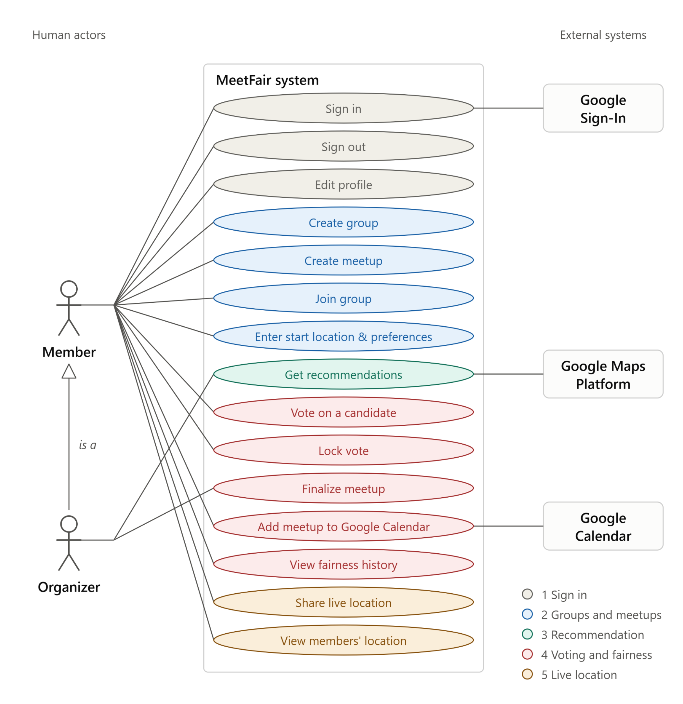
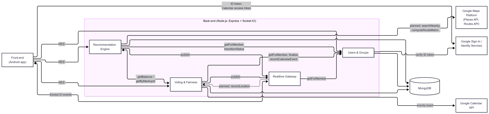
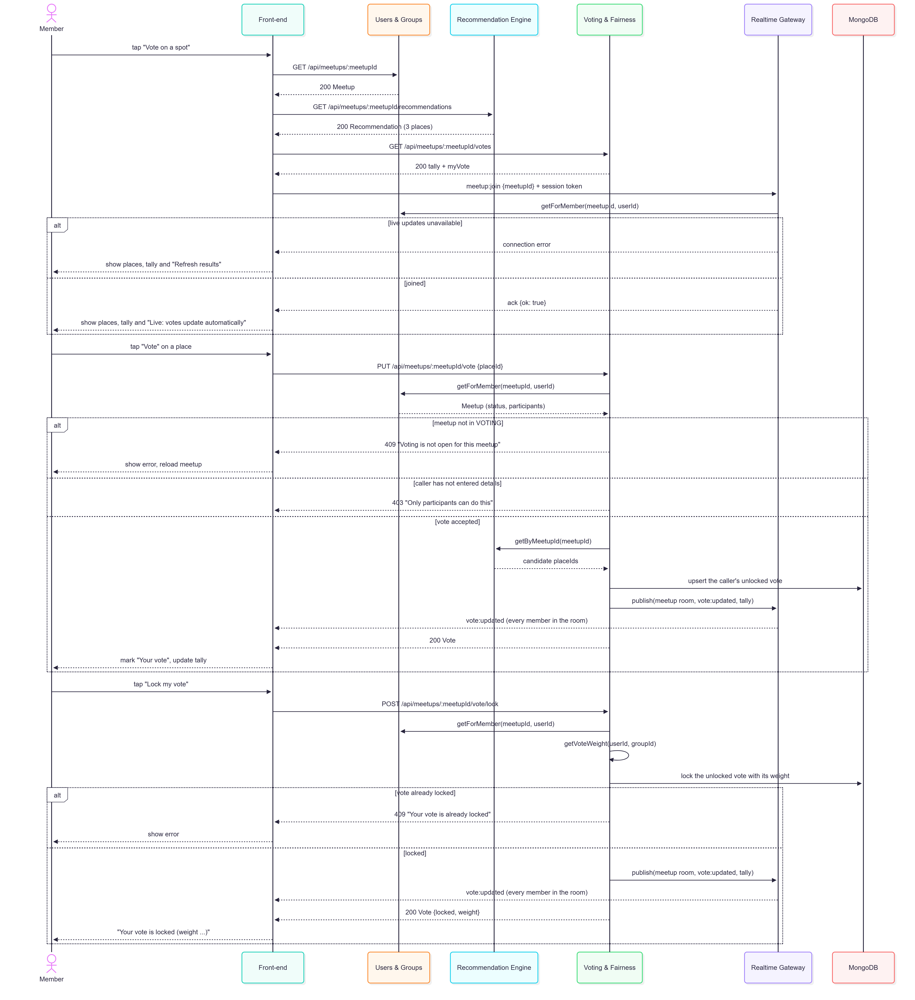
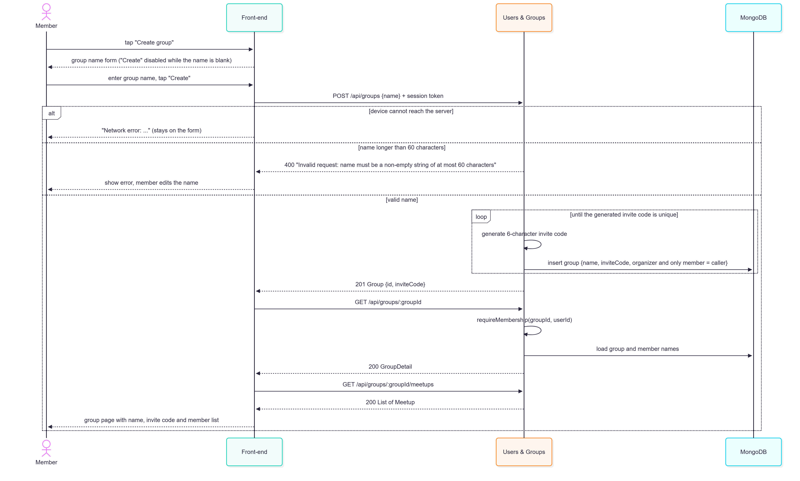
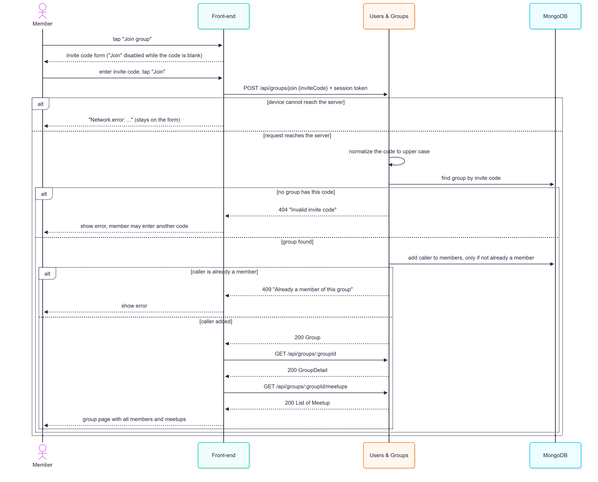
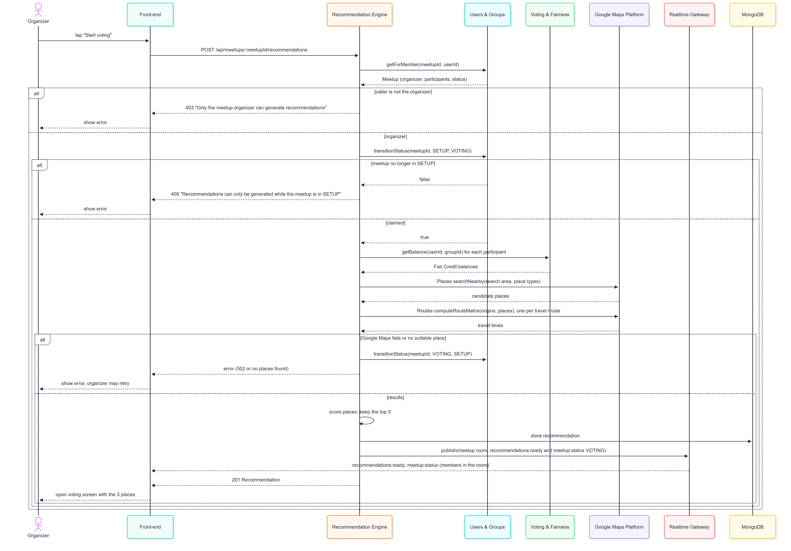
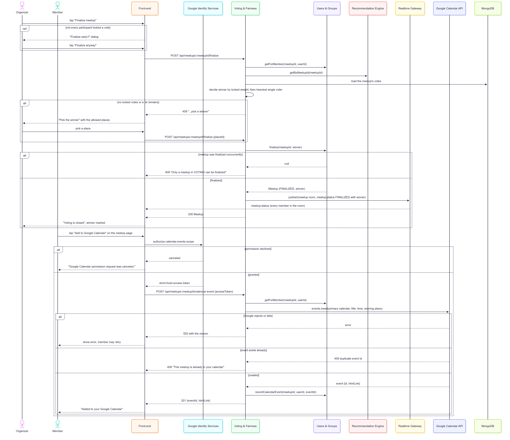
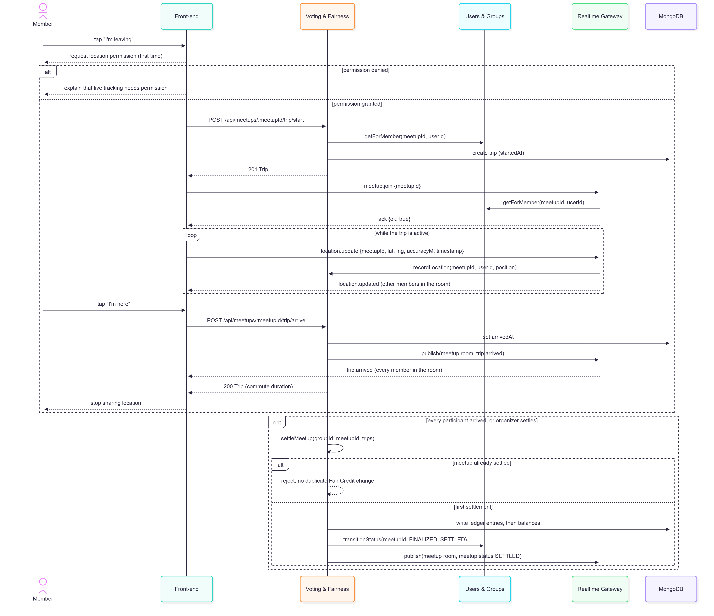

# Requirements and Design

## 1. Change History

| **Change Date**   | **Modified Sections** | **Rationale** |
| ----------------- | --------------------- | ------------- |
| 2026-10-19 | All Sections | Initial submission for CP1 |
---

## 2. Project Description

MeetFair is a group meetup planning app designed to make repeated meetups more convenient and fair. It recommends feasible meeting locations using travel-time estimates and user preferences, lets the group vote on the final choice, and tracks actual travel burden during the meetup. Over time, the app converts that burden into Fair Credit, giving users who previously travelled more greater influence in future decisions.

---

## 3. Requirements Specification

### **3.1. List of Features**
1. **Sign in with Google**: Users sign in with their Google account. The back end verifies the Google ID token and issues a MeetFair session that lasts 7 days or until the user signs out.
2. **Groups and meetups**: Any user can create a group and invite others with its 6-character invite code. Any member can create a meetup with a title and the time the group already agreed on. Each member enters their start location, travel mode (walk, transit or drive) and the type of meetup they prefer (study, coffee, food, outdoors, social).
3. **Fair spot recommendation**: The back end collects candidate places (Google Places API), gets each member's travel time to each candidate (Google Routes API), then scores every candidate with our own fairness and preference algorithm and returns the top 3 (if there are 3). *Status at CP1: until the Google Maps integration is complete, the organizer enters the three candidate places by hand to open voting.*
4. **Weighted voting**: Members vote on the top 3 and lock their vote. A locked vote is weighted by the member's Fair Credit in the group (how much more than the group average they travelled in past meetups): 1 + 0.1 per hour of credit, between 1 and 1.5. Votes appear live; the organizer finalizes the vote, and each member can add the meetup at the winning place to their own Google Calendar.
5. **Live commute tracking**: On meetup day, members tap "I'm leaving" and share live location; the group sees who is on the way. The commute ends when they tap "I'm here," or automatically when their location reaches the venue. The actual commute time updates their Fair Credit for the next meetup. If someone never starts tracking, we fall back to the Google Maps estimate. *Status at CP1: planned.*
### **3.2. Use Case Diagram**

### **3.3. Actors Description**
1. **Member**: A signed-in user who belongs to a group. A member creates or joins groups, creates meetups, enters their start location and preferences, votes, adds finalized meetups to their calendar and shares their live location on the way so their actual commute time is recorded.
2. **Organizer**: The member who created a meetup. Besides everything a member can do, the organizer starts voting on the meetup's recommended places and finalizes the vote.
3. **Google Sign-In**: Google's identity service. It authenticates the user for sign-in and, with the user's consent, issues the short-lived access token used to add events to their Google Calendar.
4. **Google Maps Platform**: Finds candidate places (Places API) and returns every member's travel time to every candidate (Routes API).
5. **Google Calendar**: Stores the finalized meetup as an event in the member's own calendar.

### **3.4. Use Case Description**
- Use cases for feature 1: Sign In
1. **Sign In**: A user authenticates into the app using their Google account to access their groups and past fairness history.
2. **Sign out**: A user securely ends their active session on the device.
3. **Edit Profile**: A member changes the name other members see, or goes back to their Google name.
- Use cases for feature 2: Groups and Meetups
1. **Create Group**: A member creates a new group in the app and receives a code to invite other members.
2. **Create Meetup**: A member creates a new meetup in their group with a title and the agreed time, and becomes its organizer; members can then add their details.
3. **Join Group**: A member uses a code to associate their account with an existing group.
4. **Enter Start Location & Preferences**: A member enters their start location, travel mode and meetup preferences (e.g., study, coffee) for a meetup that is still being set up.
- Use cases for feature 3: Fair Spot Recommendation
1. **Get Recommendations**: The organizer starts voting; the system collects the members' locations and preferences, calculates commute fairness, and outputs the top 3 candidate locations.
- Use cases for feature 4: Voting and Fairness
1. **Vote on a Candidate**: A member casts a vote for their preferred spot from the top 3 recommendations and may change it; every member sees the tally update live.
2. **Lock Vote**: A member makes their vote final; it then counts with a weight based on their current Fair Credit.
3. **Finalize Meetup**: The organizer closes the voting and the system determines the winning location.
4. **Add Meetup to Google Calendar**: A member adds the finalized meetup at the winning location to their own Google Calendar.
5. **View Fairness History**: A member checks their profile and, for a specific group, every member's Fair Credit and their own past credit changes.
- Use cases for feature 5: Live Location
1. **Share Live Location**: A member opts in on the day of the event to broadcast their real-time device location to the group via WebSockets and to keep track of their actual commute time.
2. **View Members' Location**: A member opens the live map to check the current transit progress of other group members heading to the finalized spot.

### **3.5. Formal Use Case Specifications (5 Most Major Use Cases)**

#### Use Case 1: Vote on a Candidate

**Description**: A member votes for one of the three candidate places of a meetup and may change the vote until they lock it. A locked vote counts with a weight from the member's Fair Credit, and every member sees the tally update live.

**Primary actor(s)**: Member
    
**Main success scenario**:
1. The member opens a meetup in VOTING and selects "Vote on a spot".
2. The app shows the three places, each with its number of picks, locked weight and share, and how many participants have locked their vote. While live updates are connected it shows "Live: votes update automatically".
3. The member selects "Vote" on one place.
4. The system records the vote and sends the updated tally to every member who has the voting screen open.
5. The member may select "Change vote" on another place; the system replaces the vote and step 4 repeats.
6. The member selects "Lock my vote".
7. The system sets the vote's weight from the member's Fair Credit in the group (1 + 0.1 per hour of credit, between 1 and 1.5), locks the vote and sends the updated tally to every member who has the voting screen open.
8. The app shows "Your vote is locked" with the vote's weight.

**Failure scenario(s)**:
- 1a. The member has not entered their details for this meetup.
    - 1a1. The app shows the places and the tally without vote buttons, with "Only members who entered their details can vote."

- 2a. Live updates cannot be connected.
    - 2a1. The app shows a "Refresh results" button instead of the live indicator.
    - 2a2. The tally is refreshed after each of the member's own votes and whenever they select "Refresh results".

- 3a. The organizer finalized the meetup before the vote arrived.
    - 3a1. The app shows "Voting is not open for this meetup" and reloads the meetup, which shows that voting is closed.

- 3b. The member's device has no network connection.
    - 3b1. The app shows a "Network error" message and the member's previous vote stays unchanged.
    - 3b2. The member may vote again when connectivity is restored.

- 6a. The vote was already locked, for example from another device.
    - 6a1. The app shows "Your vote is already locked".

#### Use Case 2: Create or Join Group

**Description**: A user creates a new group and receives an invite code to share, or joins an existing group by entering an invite code, associating their account with that group so they can participate in future meetups.

**Primary actor(s)**: Member

**Main success scenario (Create)**:
1. The user selects "Create group" on the group list.
2. The user enters a group name and selects "Create".
3. The system creates the group in the database with the user as its only member and organizer.
4. The system generates a unique 6-character invite code for the group.
5. The system displays the group page with the group name, the invite code for sharing and the member list.

**Main success scenario (Join)**:
1. The user selects "Join group" on the group list.
2. The user enters the invite code shared by a group member and selects "Join".
3. The system finds the group with this invite code in the database (letter case does not matter).
4. The system adds the user to the group's member list.
5. The system displays the group page with all members and the group's meetups.

**Failure scenario(s)**:
- Create 2a. The user enters an empty group name (or only spaces).
    - 2a1. The "Create" button stays disabled until the name contains a non-space character.

- Create 2b. The user enters a group name longer than 60 characters.
    - 2b1. The system displays "Invalid request: name must be a non-empty string of at most 60 characters".
    - 2b2. The user shortens the name and selects "Create" again.

- Create 3a. The user's device has no network connection.
    - 3a1. The system displays a "Network error" message and stays on the form so the user can try again when reconnected.

- Join 2a. The user enters an invite code that does not belong to any group.
    - 2a1. The system displays "Invalid invite code".
    - 2a2. The user stays on the join screen and may enter another code.

- Join 3a. The user is already a member of this group.
    - 3a1. The system displays "Already a member of this group" and the member list is unchanged.

- Join 3b. The user's device has no network connection.
    - 3b1. The system displays a "Network error" message and stays on the form so the user can try again when reconnected.

#### Use Case 3: Get Recommendations

**Description**: The meetup organizer requests candidate meeting locations based on participants' starting locations, travel modes, preferences, and Fair Credit. The system provides candidate locations and opens voting.

**Primary actor(s)**: Organizer, Google Maps Platform
    
**Main success scenario (Planned)**:

1. The organizer opens a meetup in SETUP and selects "Start voting".
2. The system loads participants' starting locations, travel modes, preferences, and group-specific Fair Credit.
3. The system searches for suitable candidate places using Google Places.
4. The system obtains estimated travel times for the participants and candidates using Google Routes.
5. The system evaluates feasible candidates using the fairness and preference scoring rules.
6. The system selects up to three highest-ranked candidates.
7. The system stores the recommendations, moves the meetup to VOTING and publishes the change to the meetup's live updates; the organizer's app opens the voting screen with the candidates.

**Failure scenario(s)**:
- 1a. The user is not the meetup's organizer.
    - 1a1. The app does not offer "Start voting", and the system rejects such a request with "Only the meetup organizer can generate recommendations".

- 1b. The meetup is no longer in SETUP.
    - 1b1. The system rejects the request with "Recommendations can only be generated while the meetup is in SETUP" to prevent replacing candidates after voting has started.
    - 1b2. The organizer may reload the meetup to view its current state.

- 2a. No participant has submitted valid participation details.
    - 2a1. The system does not generate recommendations.
    - 2a2. The organizer is prompted to ask members to submit their details.

- 3a. The place search returns no suitable candidates.
    - 3a1. The system explains that no suitable locations were found.
    - 3a2. The meetup remains in SETUP so participants can revise their inputs.

- 4a. The external service fails or returns insufficient usable travel-time data.
    - 4a1. The system reports that recommendations could not be generated.
    - 4a2. The meetup remains in SETUP, and the organizer may retry.

- 7a. Storing the recommendations fails.
    - 7a1. The system reports an error and returns the meetup from VOTING to SETUP so the organizer can retry.

*Status at CP1: steps 2–6 and failures 2a, 3a and 4a are planned. Until the Google Maps integration is complete, after step 1 the organizer enters the three candidate places (name, optional address, latitude and longitude) and selects "Start voting"; if an entry is incomplete or invalid, the app shows the validation error and the organizer corrects it. Step 7 and failures 1a, 1b and 7a are implemented.*

#### Use Case 4: Finalize Meetup

**Description**: The Organizer closes the voting process, allowing the system to determine the winning location from the locked, weighted votes. Each member can then add the finalized meetup at the winning location to their own Google Calendar.

**Primary actor(s)**: Organizer, Member, Google Calendar
    
**Main success scenario**:
1. The Organizer selects "Finalize meetup" on the voting screen.
2. The system tallies the locked, weighted votes and determines the winning location (the largest share of locked vote weight).
3. The system saves the winning location as the finalized destination in the database and marks the meetup as finalized.
4. The system sends the result to every member who has the voting screen open, which then shows "Voting is closed" and marks the winner; the meetup page shows "Meeting at: <winning location>".
5. A member who entered their details selects "Add to Google Calendar" on the meetup page.
6. The app obtains a short-lived Google Calendar access token for the member from Google, asking for the member's consent the first time, and sends it to the system.
7. The system sends the meetup details (title, time, winning location) to the Google Calendar API, which creates the event in the member's primary calendar; the token is not stored.
8. The app displays "Added to your Google Calendar".

**Failure scenario(s)**:
- 1a. Not every participant has locked their vote.
    - 1a1. The system presents a "Finalize early?" prompt explaining that unlocked votes do not count. If the Organizer selects "Finalize anyway", the system proceeds to step 2. If they select "Keep voting", the system returns to the active voting screen.
- 1b. The Organizer's device has no network connection.
    - 1b1. The system displays a "Network error" message and leaves the poll open so the Organizer can try again when reconnected.
- 2a. Nobody has locked a vote.
    - 2a1. The system displays "Cannot finalize with no locked votes; pick a winner" and shows all three locations under "Pick the winner".
    - 2a2. The Organizer picks a location and the system proceeds to step 3 with it.
- 2b. A tie occurs in the weighted voting tally.
    - 2b1. The system selects, among the tied locations, the one whose single heaviest locked vote has the highest weight, which favours the members with more Fair Credit.
    - 2b2. If the locations are still tied, the system shows only the tied locations under "Pick the winner"; the Organizer picks one and the system proceeds to step 3.
- 3a. The meetup was already finalized, for example from another device at the same time.
    - 3a1. The system displays "Only a meetup in VOTING can be finalized" and keeps the first result.
- 6a. The member does not grant Google Calendar permission.
    - 6a1. The app displays "Google Calendar permission request was canceled." and keeps the "Add to Google Calendar" button so the member can try again.
- 7a. The Google Calendar API rejects the request or is unavailable (for example, the permission was revoked or the rate limit was reached).
    - 7a1. The system displays the reason, e.g. "Google Calendar API rate limit reached. Please retry in a few minutes.", and records nothing; the member may try again.
- 7b. The meetup is already in the member's calendar.
    - 7b1. The system displays "This meetup is already in your calendar" and does not create a second event.

#### Use Case 5: Share Live Location

**Description**: On the meetup day, a participant shares their location while travelling. The system shows their progress to other group members and records commute duration for later Fair Credit settlement.

**Primary actor(s)**: Member
    
**Main success scenario (Planned)**:
1. The participant opens the finalized meetup on the meetup day.
2. The participant selects "I'm leaving."
3. The system requests location permission if it has not already been granted.
4. The participant grants permission.
5. The system records the commute start time and begins receiving location updates.
6. The system verifies the participant's access and shares location updates with authorized group members viewing the meetup.
7. Other group members view the participant's latest location and travel status.
8. The participant selects "I'm here," and  the system records the arrival time, calculates commute duration, and stops location sharing.
9. During settlement, the system compares each participant's travel burden with the group average and updates Fair Credit.

**Failure scenario(s)**:
- 4a. The participant denies location permission.
    - 4a1. The system explains that live tracking requires permission.
    - 4a2. The participant may grant permission later.

- 6a. The network or realtime connection is lost.
    - 6a1. The system indicates that live updates are unavailable.
    - 6a2. The system attempts to reconnect and resumes sharing while the trip is still active.

- 9a. Settlement is requested more than once.
    - 9a1. The system prevents duplicate Fair Credit changes for the same participant and meetup.
    
### **3.6. Screen Mock-ups**
None. The screens are standard Material Design 3 forms and lists and are described in the use cases above.

### **3.7. Non-Functional Requirements**

1. **Security and Access Control**
    - **Description**: All requests containing user data must use HTTPS in deployment. The backend must verify the user's session token and check group or meetup membership before returning protected data or accepting changes. Only the meetup organizer may start or finalize voting. Google access tokens must not be stored in the database.
    - **Justification**: MeetFair handles account information, group membership, travel details, and potentially live locations. Unauthorized users must not be able to view or change this information.

2. **Location Privacy**
    - **Description**: Live location sharing must require the user's explicit action and device permission. Only authorized members of the relevant group may receive location updates. Sharing must stop when the trip ends, and the app must make the sharing state visible to the user.
    - **Justification**: A person's current location is sensitive. Users need control over when it is shared and who can see it.

3. **Response Time**
    - **Description**: Under normal network conditions, at least 95% of ordinary API requests, such as loading groups, meetups, and vote totals, should complete within 2 seconds. A vote update should appear on other connected members' screens within 3 seconds. Recommendation generation may take longer because it depends on external Google services; the app should show progress while the request is running.
    - **Justification**: Members need timely feedback when planning a meetup and voting. Longer operations must remain understandable rather than appearing frozen.

4. **Usability and Accessibility**
    - **Description**: The Android app should clearly show the current meetup status, the user's selected candidate, whether their vote is locked, and the finalized winner. Important actions and errors must be expressed in text, not only through color. Controls should remain usable with Android's font scaling and accessibility services.
    - **Justification**: Users must understand whether their vote will count and be able to complete the main tasks on different devices and with different accessibility needs.

---

## 4. Designs Specification
### **4.1. Main Components**
1. **Users & Groups**
    - **Purpose**: Owns users, groups and meetups (the `users`, `groups` and `meetups` collections): Google sign-in and MeetFair sessions, profiles, groups and invite codes, meetups, each member's participation entry and the meetup status (SETUP -> VOTING -> FINALIZED -> SETTLED). We kept users, groups and meetups in one component rather than three, because every membership check needs all three and splitting them would create circular dependencies. Every other component depends on this one for access control.
    - **Interfaces**: 
        1. `POST /api/auth/google` — body `{ idToken: String }` -> `200 { token: String, user: User }`
            - **Purpose**: Verifies the Google ID token, creates or updates the user and returns a 7-day MeetFair session token.
        2. `GET /api/users/me` -> `200 User`
            - **Purpose**: Returns the signed-in user's account.
        3. `POST /api/groups` — body `{ name: String }` -> `201 Group`
            - **Purpose**: Creates a group with the caller as organizer and a unique 6-character invite code.
        4. `GET /api/groups` -> `200 List<Group>`
            - **Purpose**: Lists the caller's groups, newest first.
        5. `GET /api/groups/:groupId` -> `200 GroupDetail`
            - **Purpose**: Returns one group with each member's display name and role (members only).
        6. `POST /api/groups/join` — body `{ inviteCode: String }` -> `200 Group`
            - **Purpose**: Adds the caller to the group with that invite code.
        7. `POST /api/groups/:groupId/meetups` — body `{ title: String, scheduledAt: ISO-8601 String }` -> `201 Meetup`
            - **Purpose**: Creates a meetup in SETUP; the caller becomes its organizer.
        8. `GET /api/groups/:groupId/meetups` -> `200 List<Meetup>`
            - **Purpose**: Lists the group's meetups.
        9. `GET /api/meetups/:meetupId` -> `200 Meetup`
            - **Purpose**: Returns one meetup with its participants, status and winner.
        10. `PUT /api/meetups/:meetupId/participation` — body `{ startLocation: { lat, lng, label }, travelMode: WALK | TRANSIT | DRIVE, preferences: List<Preference> }` -> `200 Meetup`
            - **Purpose**: Adds or replaces the caller's participation entry while the meetup is in SETUP.
        11. `Group requireMembership(String groupId, String userId)`
            - **Purpose**: Loads a group and checks that the user belongs to it (not found / forbidden otherwise); the access check used by every component.
        12. `Meetup getForMember(String meetupId, String userId)`
            - **Purpose**: Loads a meetup and checks that the user belongs to its group.
        13. `boolean transitionStatus(String meetupId, MeetupStatus from, MeetupStatus to)`
            - **Purpose**: Atomically moves a meetup from one status to the next; returns false if it was no longer in `from`, so concurrent requests cannot both succeed.
        14. `Meetup finalize(String meetupId, Place winner)`
            - **Purpose**: Atomically stores the winner and moves the meetup from VOTING to FINALIZED; returns null if it was no longer in VOTING.
        15. `boolean recordCalendarEvent(String meetupId, String userId, String eventId)`
            - **Purpose**: Records the Google Calendar event created for one participant; returns false if one was already recorded.
        16. `List<User> findByIds(List<String> userIds)` / `String displayNameOf(User user)`
            - **Purpose**: Resolves members' names for other components.
        17. `Profile getProfile(String userId)` / `Profile updateProfile(String userId, String displayName)`
            - **Purpose**: Account information and groups for the profile screen; a null display name returns to the Google name.
2. **Recommendation Engine**
    - **Purpose**: Owns the `recommendations` collection. It builds the meetup's candidate places from Google Places and Google Routes, scores them with our fairness algorithm, stores the top 3 and opens voting. All slow and failure-prone Google Maps calls are kept in this one component, and the scoring itself is pure functions (search area, preference mapping, scoring) that can be tested without Google.
    - **Interfaces**:
        1. `POST /api/meetups/:meetupId/recommendations` -> `201 Recommendation`
            - **Purpose**: Organizer only; generates and stores the top 3 candidates and moves the meetup from SETUP to VOTING. *At CP1 the request body carries the organizer's three places: `{ candidates: [ { placeId, name, address, location: { lat, lng } } ×3 ] }`.*
        2. `GET /api/meetups/:meetupId/recommendations` -> `200 Recommendation`
            - **Purpose**: Returns the meetup's candidates with their score breakdown (members only).
        3. `Recommendation getByMeetupId(String meetupId)`
            - **Purpose**: Gives Voting & Fairness the candidates a vote must refer to and the data of the winning place.
3. **Voting & Fairness**
    - **Purpose**: Owns the `votes`, `fairCredits`, `fairCreditEntries` and `trips` collections: casting, changing and locking votes, the weighted tally, finalizing, adding the meetup to Google Calendar, commute trips, and Fair Credit (balances plus a ledger explaining every change). Vote weights come from Fair Credit and settlement changes Fair Credit, so keeping both in one component keeps all fairness rules in one place. The rules themselves (vote weight, tally, credit change, arrival) are pure functions.
    - **Interfaces**:
        1. `PUT /api/meetups/:meetupId/vote` — body `{ placeId: String }` -> `200 Vote`
            - **Purpose**: Creates or changes the caller's vote while it is unlocked and the meetup is in VOTING.
        2. `POST /api/meetups/:meetupId/vote/lock` -> `200 Vote`
            - **Purpose**: Locks the caller's vote and stores its weight from their Fair Credit.
        3. `GET /api/meetups/:meetupId/votes` -> `200 { meetupId, candidates: [ { placeId, voteCount, weight, share } ], totalWeight, lockedCount, participantCount, myVote }`
            - **Purpose**: The current tally plus the caller's own vote.
        4. `POST /api/meetups/:meetupId/finalize` — optional body `{ placeId: String }` -> `200 Meetup`
            - **Purpose**: Organizer only; picks the winner by locked weight (the body names the winner only when nobody locked a vote or a tie remains) and moves the meetup to FINALIZED.
        5. `POST /api/meetups/:meetupId/calendar-event` — body `{ accessToken: String }` -> `201 { eventId, htmlLink }`
            - **Purpose**: Creates the finalized meetup in the caller's primary Google Calendar using their short-lived token, which is never stored.
        6. `GET /api/users/me/profile` / `PUT /api/users/me/profile` — body `{ displayName: String | null }` -> `200 Profile`
            - **Purpose**: The profile with the caller's Fair Credit in each group; updating changes the display name.
        7. `GET /api/groups/:groupId/fairness` -> `200 { groupId, members: [ { userId, name, balance } ], ledger: List<FairCreditEntry> }`
            - **Purpose**: Every member's Fair Credit in the group and the group's ledger, newest first.
        8. *(planned)* `POST /api/meetups/:meetupId/trip/start`, `POST /api/meetups/:meetupId/trip/arrive`, `GET /api/meetups/:meetupId/trips`, `POST /api/meetups/:meetupId/settle`
            - **Purpose**: Start and end the caller's trip, list the meetup's trips, and let the organizer settle the meetup.
        9. `double getVoteWeight(String userId, String groupId)` / `double getBalance(String userId, String groupId)`
            - **Purpose**: A member's Fair Credit in a group and the resulting vote weight; the Recommendation Engine uses the balance for fairness scoring.
        10. `List<FairCreditEntry> settleMeetup(String groupId, String meetupId, List<Trip> trips)`
            - **Purpose**: Turns each member's actual trip time into a credit change against the group average; a meetup can be settled only once.
        11. *(planned)* `Trip recordLocation(String meetupId, String userId, LatLng position)`
            - **Purpose**: Called by the Realtime Gateway for each live location; detects arrival within the arrival radius.
4. **Realtime Gateway**
    - **Purpose**: The Socket.IO server on the same host and port as the REST API. It authenticates each connection with the MeetFair session token, lets only group members join a meetup's room, and delivers the other components' updates to the members of that room. We chose a persistent socket over polling (slower and more wasteful) and over Firebase push notifications, which change the phone's state rather than the app's and may not be used for major functionality. Components publish through a small publisher interface, so they do not depend on Socket.IO.
    - **Interfaces**:
        1. Client -> server `meetup:join` / `meetup:leave` — `{ meetupId }`, acknowledged with `{ ok: true }` or `{ ok: false, error }`
            - **Purpose**: Start or stop receiving a meetup's live updates (members of its group only).
        2. *(planned)* Client -> server `location:update` — `{ meetupId, lat, lng, accuracyM, timestamp }`
            - **Purpose**: A member's live position during an active trip.
        3. Server -> client `vote:updated` (the tally), `meetup:status` (`{ meetupId, status, winner? }`), `recommendations:ready` (`{ meetupId }`), *(planned)* `location:updated`, `trip:arrived`
            - **Purpose**: Live changes pushed to everyone in the meetup's room.
        4. `void publish(String room, String event, Object payload)`
            - **Purpose**: Lets the other components send an update to a meetup's room.

### **4.2. Databases**
1. **MongoDB 7** (self-hosted, the `mongo` service in `docker-compose.yml`)
    - **Purpose**: Stores users, groups, meetups (with participants and winner), recommendations, votes, Fair Credit balances, the Fair Credit ledger and trips. Unique indexes enforce one vote per member per meetup, one recommendation per meetup, unique invite codes and settling a meetup at most once. MongoDB's nested documents (members in a group, participants in a meetup, candidates in a recommendation) match our data better than relational tables, and Mongoose provides schemas and validation.

### **4.3. External Modules**
1. **Google Sign-In / Google Identity Services**
    - **Purpose**: Signs users in. The Android Credential Manager returns a Google ID token, which the back end verifies with `google-auth-library`. The Identity `AuthorizationClient` also gives the app a short-lived `calendar.events` access token. We use Google because every target user has a Google account and we need the same account for Google Calendar.
2. **Google Maps Platform (Places API (New), Routes API)**
    - **Purpose**: Nearby Search finds candidate places that match the meetup type; Routes `computeRouteMatrix` returns every member's travel time to every candidate in one batched request per travel mode. It provides travel times for all three modes, including transit.
3. **Google Calendar API**
    - **Purpose**: `events.insert` adds the finalized meetup to the member's own primary calendar, using the member's token, so MeetFair never needs calendar credentials of its own.

### **4.4. Frameworks and Libraries**
1. **Express 5**
    - **Purpose**: HTTP server and routing for the REST API.
    - **Reason**: Minimal and widely used. Version 5 forwards errors from async handlers to our error handler, so routes need no try/catch.
2. **Mongoose**
    - **Purpose**: MongoDB access, schemas and indexes.
    - **Reason**: Schemas and validation over a schemaless database; atomic conditional updates for status changes.
3. **Socket.IO** (server) and **socket.io-client** (Android, Java client)
    - **Purpose**: Live updates over WebSockets with rooms per meetup.
    - **Reason**: Rooms, acknowledgements and automatic reconnection, on the same port as the REST API.
4. **google-auth-library**
    - **Purpose**: Verifies Google ID tokens (signature, expiry, audience).
    - **Reason**: Google's official library, so we do not implement token verification ourselves.
5. **googleapis** (Calendar only)
    - **Purpose**: Calls Google Calendar `events.insert`.
    - **Reason**: Google's official client: typed requests and error codes.
6. **dotenv**
    - **Purpose**: Loads `backend/.env`.
    - **Reason**: Keeps secrets out of the code.
7. **Jest, ts-jest, Supertest, @shelf/jest-mongodb**
    - **Purpose**: Back-end unit and API tests against a real in-memory MongoDB.
    - **Reason**: Required by the course; jest-mongodb removes the need for a separate test database.
8. **Kotlin, Jetpack Compose, Material Design 3**
    - **Purpose**: Android UI.
    - **Reason**: Required by the course; declarative UI with unidirectional data flow.
9. **OkHttp**
    - **Purpose**: HTTP client for the REST API (JSON built and parsed with the Android SDK's `org.json`).
    - **Reason**: Small and reliable; an interceptor adds the session token and signs the user out on 401.
10. **androidx.credentials, credentials-play-services-auth, googleid**
    - **Purpose**: Google Sign-In with Credential Manager.
    - **Reason**: Google's current recommended sign-in API.
11. **play-services-auth (Identity AuthorizationClient), kotlinx-coroutines-play-services**
    - **Purpose**: Gets the Google Calendar access token and awaits Play Services tasks from coroutines.
    - **Reason**: The official way to request an OAuth scope on Android without handling credentials ourselves.
12. **Docker Compose**
    - **Purpose**: Runs the back end with MongoDB on the cloud VM.
    - **Reason**: One-command deployment for the team and TAs.

### **4.5. Dependencies Diagram**

Solid arrows are implemented; dashed arrows are planned (features 3 and 5). The Mermaid source is [`res/Dependency_Diagram.mmd`](res/Dependency_Diagram.mmd).

### **4.6. Use Case Sequence Diagram (5 Most Major Use Cases)**
1. [**Vote on a Candidate**](#uc1)\

2. [**Create or Join Group**](#uc2)\
**Create Group**\
\
**Join Group**\

3. [**Get Recommendations**](#uc3)\

4. [**Finalize Meetup**](#uc4)\

5. [**Share Live Location**](#uc5)\

The Mermaid sources of these diagrams are in [`res/`](res/).

### **4.7. Design of Non-Functional Requirements**

1. [**Security and Access Control**](#nfr1)
    - **Implementation**: The back end serves HTTPS (and Socket.IO over WSS) on its port when a TLS certificate and private key are installed in `backend/certs/`; for deployment, the app's `API_BASE_URL` is set to the server's `https://` address. The Android app sends the MeetFair session token with protected API requests; the backend verifies the token and checks group or meetup membership before accessing protected resources. Organizer-only operations perform an additional role check. Google Calendar access tokens are used for individual requests and are not stored in the database.

2. [**Location Privacy**](#nfr2)
    - **Implementation (planned)**: Request Android location permission only when a participant starts sharing their commute. Send location updates through an authenticated Socket.IO connection and restrict each meetup room to authorized group members. Show when sharing is active, stop updates when the trip ends, and avoid retaining a continuous location history beyond the data needed to calculate travel time.

3. [**Response Time**](#nfr3)
    - **Implementation**: Use Socket.IO to push vote totals and meetup status changes to connected members instead of requiring repeated requests. Run network calls outside the Android main thread and show loading or progress states. **Planned**: measure API response times and realtime delivery against the targets in Section 3.7; keep Google Places and Routes requests outside the UI thread and handle their longer response times explicitly.

4. [**Usability and Accessibility**](#nfr4)
    - **Implementation**: Show the selected candidate, locked-vote state, current vote totals, meetup status, and winner in text. Display loading and error messages near the relevant action, and ask for confirmation before the organizer finalizes while some participants have not locked their votes. **Planned**: check the main screens with Android font scaling, screen readers, and different screen sizes.
