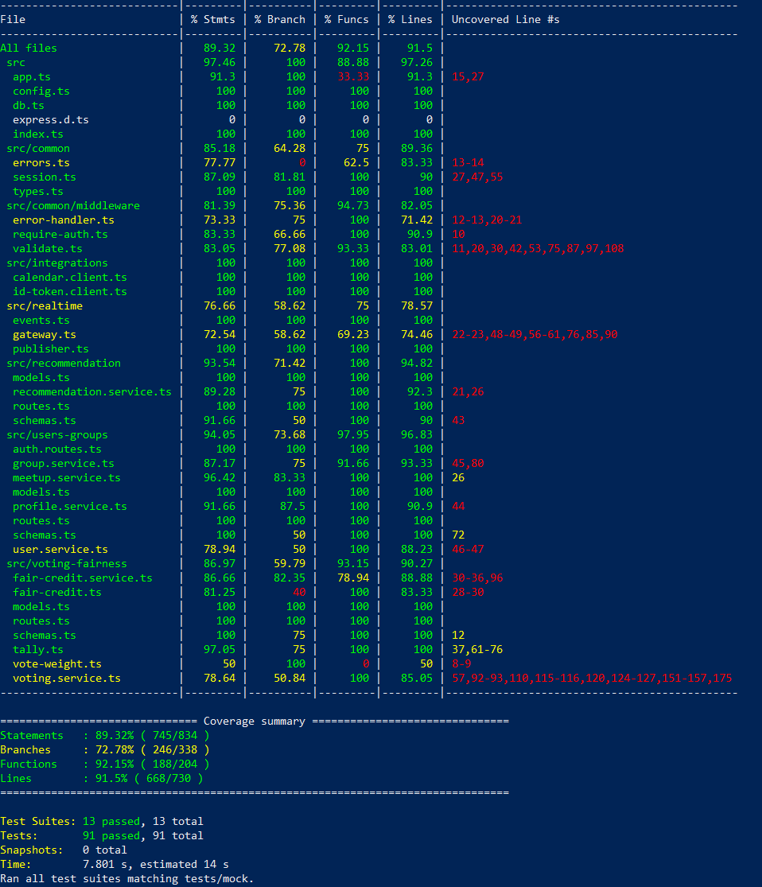
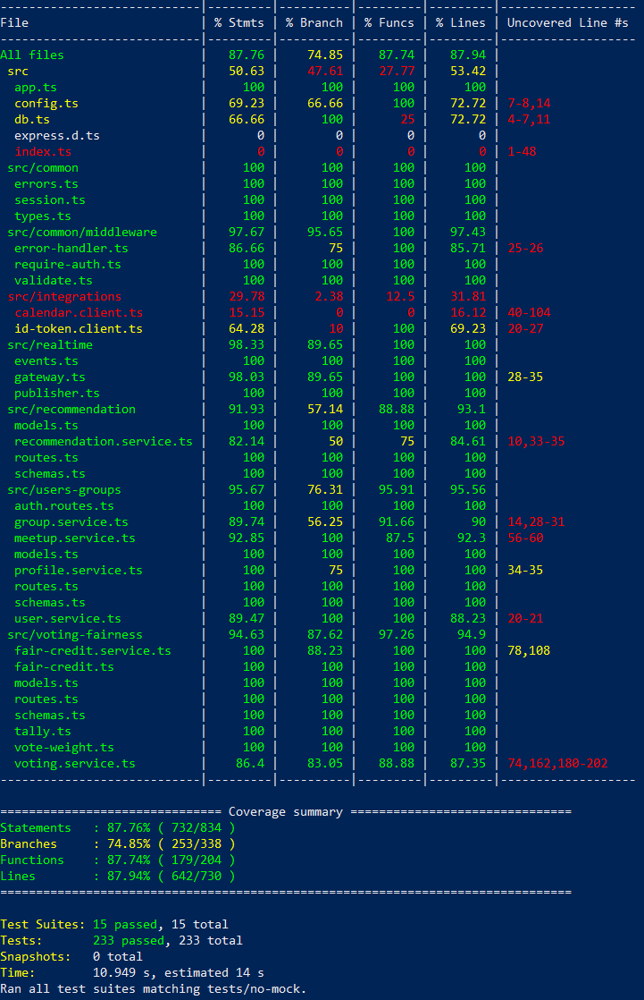

# Testing

## 1. Change History

| **Change Date** | **Modified Sections** | **Rationale** |
| --------------- | --------------------- | ------------- |
| 2026-10-19 | All Sections | Initial submission for CP1 |
---

## 2. Back-end Test Specification: APIs

### 2.1. Locations of Back-end Tests and Instructions to Run Them

#### 2.1.1. Tests

| **Interface**                                    | **Describe Group Location, No Mocks**                     | **Describe Group Location, With Mocks**                 | **Mocked Components**                                                                                                            |
| ------------------------------------------------ | --------------------------------------------------------- | ------------------------------------------------------- | -------------------------------------------------------------------------------------------------------------------------------- |
| **GET /health**                                  | [`backend/tests/no-mock/health.test.ts#L6`](#)            | N/A *(no external dependencies)*                        | None                                                                                                                             |
| **POST /api/auth/google**                        | [`backend/tests/no-mock/auth.test.ts#L14`](#)             | [`backend/tests/mock/auth.test.ts#L21`](#)               | Google OAuth ID Token Client (`idTokenClient`), MongoDB User Collection (`UserModel`)                                           |
| **GET /api/users/me**                            | [`backend/tests/no-mock/auth.test.ts#L63`](#)             | [`backend/tests/mock/auth.test.ts#L147`](#)             | MongoDB User Collection (`UserModel`), Session Token Auth Middleware (`requireAuth`)                                             |
| **POST /api/groups**                             | [`backend/tests/no-mock/groups.test.ts#L14`](#)           | [`backend/tests/mock/groups.test.ts#L27`](#)             | MongoDB Group & Member Collections (`GroupModel`, `MemberModel`), Unique Invite Code Generation                                  |
| **GET /api/groups**                              | [`backend/tests/no-mock/groups.test.ts#L72`](#)           | [`backend/tests/mock/groups.test.ts#L79`](#)             | MongoDB Group & Member Collections (`GroupModel`, `MemberModel`), Session Token Auth Middleware (`requireAuth`)                    |
| **POST /api/groups/join**                        | [`backend/tests/no-mock/groups.test.ts#L170`](#)          | [`backend/tests/mock/groups.test.ts#L149`](#)            | MongoDB Group & Member Collections (`GroupModel`, `MemberModel`), Session Token Auth Middleware (`requireAuth`)                    |
| **GET /api/groups/:groupId**                     | [`backend/tests/no-mock/groups.test.ts#L112`](#)          | [`backend/tests/mock/groups.test.ts#L99`](#)             | MongoDB Group, Member, and User Collections (`GroupModel`, `MemberModel`, `UserModel`)                                           |
| **POST /api/groups/:groupId/meetups**            | [`backend/tests/no-mock/meetups.test.ts#L30`](#)          | [`backend/tests/mock/meetups.test.ts#L31`](#)            | MongoDB Meetup & Member Collections (`MeetupModel`, `MemberModel`), Session Token Auth Middleware (`requireAuth`)                 |
| **GET /api/groups/:groupId/meetups**             | [`backend/tests/no-mock/meetups.test.ts#L118`](#)         | [`backend/tests/mock/meetups.test.ts#L70`](#)            | MongoDB Meetup & Member Collections (`MeetupModel`, `MemberModel`), Session Token Auth Middleware (`requireAuth`)                 |
| **GET /api/meetups/:meetupId**                   | [`backend/tests/no-mock/meetups.test.ts#L167`](#)         | [`backend/tests/mock/meetups.test.ts#L90`](#)            | MongoDB Meetup, Participation, & Member Collections, Session Token Auth Middleware (`requireAuth`)                               |
| **PUT /api/meetups/:meetupId/participation**     | [`backend/tests/no-mock/meetups.test.ts#L214`](#)         | [`backend/tests/mock/meetups.test.ts#L123`](#)           | MongoDB Participation & Meetup Collections (`ParticipationModel`, `MeetupModel`)                                                 |
| **POST /api/meetups/:meetupId/recommendations**  | [`backend/tests/no-mock/recommendations.test.ts#L43`](#)  | [`backend/tests/mock/recommendations.test.ts#L32`](#)    | Recommendation Service (`recommendationService.generate`), MongoDB Meetup Collection (`MeetupModel`)                            |
| **GET /api/meetups/:meetupId/recommendations**   | [`backend/tests/no-mock/recommendations.test.ts#L117`](#) | [`backend/tests/mock/recommendations.test.ts#L65`](#)    | Recommendation Service (`recommendationService.getForMember`), MongoDB Meetup Collection (`MeetupModel`)                         |
| **PUT /api/meetups/:meetupId/vote**              | [`backend/tests/no-mock/voting.test.ts#L73`](#)           | [`backend/tests/mock/voting.test.ts#L37`](#)             | Voting Service (`votingService.castVote`), MongoDB Vote Collection (`VoteModel`)                                                 |
| **POST /api/meetups/:meetupId/vote/lock**        | [`backend/tests/no-mock/voting.test.ts#L166`](#)          | [`backend/tests/mock/voting.test.ts#L57`](#)             | Voting Service (`votingService.lockVote`), Fair Credit Service, MongoDB Vote Collection (`VoteModel`)                            |
| **GET /api/meetups/:meetupId/votes**             | [`backend/tests/no-mock/voting.test.ts#L206`](#)          | [`backend/tests/mock/voting.test.ts#L76`](#)             | Voting Service (`votingService.getVotes`), MongoDB Vote, Member, and User Collections                                            |
| **POST /api/meetups/:meetupId/finalize**         | [`backend/tests/no-mock/voting.test.ts#L271`](#)          | [`backend/tests/mock/voting.test.ts#L111`](#)            | Voting Service (`votingService.finalize`), Tally Algorithm, Fair Credit Ledger, MongoDB Meetup Collection                         |
| **POST /api/meetups/:meetupId/calendar-event**   | [`backend/tests/no-mock/calendar.test.ts#L29`](#)         | [`backend/tests/mock/calendar.test.ts#L46`](#)           | Google Calendar API Client (`calendarClient.createEvent`), MongoDB Meetup Collection (`MeetupModel`)                            |
| **GET /api/users/me/profile**                    | [`backend/tests/no-mock/profile.test.ts#L39`](#)          | [`backend/tests/mock/profile.test.ts#L24`](#)            | Fair Credit Service (`fairCreditService.getProfile`), MongoDB User, Member, and Fairness Credit Collections                      |
| **PUT /api/users/me/profile**                    | [`backend/tests/no-mock/profile.test.ts#L88`](#)          | [`backend/tests/mock/profile.test.ts#L63`](#)            | Fair Credit Service (`fairCreditService.updateProfile`), MongoDB User Collection (`UserModel`)                                   |
| **GET /api/groups/:groupId/fairness**            | [`backend/tests/no-mock/fairness.test.ts#L38`](#)         | [`backend/tests/mock/fairness.test.ts#L20`](#)           | Fair Credit Service (`fairCreditService.getGroupFairness`), MongoDB Fair Credit Ledger Collection (`FairCreditLedgerModel`)      |

#### 2.1.2. Commit Hash Where Tests Run

`153b864e91dcc6c5d1831e7f95a5489ddfa15501`

#### 2.1.3. Explanation on How to Run the Tests

1. **Clone the Repository**:
   - Open your terminal and clone the repository:
     ```bash
     git clone https://github.com/w-lin5/CPEN321_MeetFair.git
     cd CPEN321_MeetFair
     ```

2. **Configure Environment Variables**:
   - In the `backend/` directory, copy `.env.example` to `.env` and set any required environment variables:
     ```bash
     cp backend/.env.example backend/.env
     ```

3. **Run the Automated Interface Test Scripts**:
   - From the repository root, execute the dedicated interface test runner script for your platform. This script automatically validates prerequisites, installs dependencies if needed, and runs the mock, no-mock, and combined suites while exporting coverage reports to `backend/coverage/mock`, `backend/coverage/no-mock`, and `backend/coverage/interface`:
     - **Windows (PowerShell)**:
       ```powershell
       .\scripts\run-backend-interface-tests.ps1
       ```
       *(Note: If script execution is restricted, run `Set-ExecutionPolicy -Scope Process -ExecutionPolicy Bypass` or launch with `pwsh -ExecutionPolicy Bypass -File .\scripts\run-backend-interface-tests.ps1`)*
     - **Linux / macOS (Bash)**:
       ```bash
       chmod +x scripts/run-backend-interface-tests.sh
       ./scripts/run-backend-interface-tests.sh
       ```

4. **Alternative: Run Manually via npm / Jest**:
   - Navigate to the `backend/` directory:
     ```bash
     cd backend
     npm install
     ```
   - Run all tests with coverage:
     ```bash
     npm test
     ```
   - Run only unit tests with mocks:
     ```bash
     npx jest tests/mock --coverage --coverageDirectory=coverage/mock
     ```
   - Run only unmocked integration tests against MongoDB:
     ```bash
     npx jest tests/no-mock --coverage --coverageDirectory=coverage/no-mock
     ```
   - Run a specific test suite file:
     ```bash
     npx jest tests/mock/voting.test.ts
     npx jest tests/no-mock/groups.test.ts
     npx jest tests/no-mock/calendar.test.ts
     ```

### 2.2. GitHub Actions Configuration Location

(*not yet implemented*)
`.github/workflows/backend-tests.yml`

### 2.3. Jest Coverage Report Screenshots With Mocks



### 2.4. Jest Coverage Report Screenshots Without Mocks



---

## 3. Tests of Non-Functional Requirements

### 3.1. Test Locations in Git

| **Non-Functional Requirement** | **Existing Test Locations** | **Current Coverage** |
| ------------------------------ | --------------------------- | -------------------- |
| [Security and Access Control](Requirements_and_Design.md#nfr1) | `backend/tests/no-mock/auth.test.ts`; `backend/tests/no-mock/groups.test.ts`; `backend/tests/no-mock/meetups.test.ts`; `backend/tests/no-mock/voting.test.ts`; `backend/tests/no-mock/realtime.test.ts`; `backend/tests/no-mock/calendar.test.ts`; `backend/tests/mock/index.test.ts` | Tests session-token rejection, membership and organizer restrictions, Socket.IO room access, and server HTTPS startup logic. Does not test the deployed TLS configuration or prove that access tokens are absent from all stored data. |

### 3.2. Test Verification and Logs

- **Security and Access Control**

  - **Verification:** The existing backend tests check that requests with missing or invalid session tokens are rejected; users outside a group cannot access its protected meetup data; non-participants cannot vote; and only the meetup organizer can finalize voting. Realtime tests check that an invalid token cannot establish a socket connection and that a user outside the group cannot join its meetup room. Calendar API tests check authentication and membership restrictions. A mocked startup test checks that the server uses HTTPS when both certificate files are present and refuses to start when only one is present.

- **Placeholder**
  - **Verification:** ...
  - **Log Output**
    ```
    [Placeholder for chat security test logs]
    ```

---

### 4. Front-end Test Specification

### 4.1. Location in Git of Front-end Test Suite:

`frontend/app/src/androidTest/java/com/example/cpen321application/e2e/`

The suite is run with `./scripts/run-frontend-e2e-tests.sh` (macOS/Linux) or `./scripts/run-frontend-e2e-tests.ps1` (Windows), with an emulator running, a Google test account added to the emulator, and the back end reachable at `API_BASE_URL`. UI elements are located by the test tags defined in `ui/common/TestTags.kt`; the Google account picker is a system window and is driven with UI Automator.

### 4.2. Tests

- **Use Case: Sign In**

  - **Expected Behaviors:**
    | **Scenario Steps** | **Test Case Steps** |
    | ------------------ | ------------------- |
    | 1. The user opens the app while signed out. | Clear the saved session.<br>Launch the app. |
    | 2. The app shows the sign-in screen with the app name, the tagline and a "Sign in with Google" button. | Check that a text "MeetFair" is present on screen.<br>Check that a text "Equal effort, this meetup and the next" is present on screen.<br>Check that the button with test tag `sign_in_button` and text "Sign in with Google" is present and enabled.<br>Check that no node with test tag `error_text` is present. |
    | 3. The user taps "Sign in with Google". | Click the button with test tag `sign_in_button`. |
    | 4. The app shows the Google account picker. | Check that the Google account picker is displayed. |
    | 4a. The user dismisses the account picker without choosing an account. | Press the back button to dismiss the account picker. |
    | 4a1. The app stays on the sign-in screen and shows an error message; the user can try again. | Check that a node with test tag `error_text` is displayed.<br>Check that the button with test tag `sign_in_button` is present and enabled. |
    | 5. The user selects their Google account. | Select the Google test account in the account picker. |
    | 6. The app sends the Google ID token to the back end; the sign-in button is disabled while the request is in progress. | Check that the button with test tag `sign_in_button` is disabled. |
    | 6a. The back end rejects the Google ID token. | Start the back end with a `GOOGLE_CLIENT_ID` that does not match the app's client ID.<br>Repeat steps 3 and 5. |
    | 6a1. The app stays on the sign-in screen and shows "Invalid Google ID token". | Check that a node with test tag `error_text` has the text "Invalid Google ID token".<br>Check that the button with test tag `sign_in_button` is enabled. |
    | 6b. The device cannot reach the back end. | Stop the back end.<br>Repeat steps 3 and 5. |
    | 6b1. The app stays on the sign-in screen and shows a network error message. | Check that a node with test tag `error_text` has text starting with "Network error".<br>Check that the button with test tag `sign_in_button` is enabled. |
    | 7. The app saves the session and shows the group list with the user's name. | Check that a text "Signed in as <test account name>" is present on screen.<br>Check that the button with test tag `sign_out_button` is present.<br>Check that no node with test tag `sign_in_button` is present. |
    | 8. The user closes and reopens the app and is still signed in. | Close and relaunch the app.<br>Check that a text "Signed in as <test account name>" is present on screen.<br>Check that no node with test tag `sign_in_button` is present. |

  - **Test Logs:**
    ```
    [Placeholder for Espresso test execution logs]
    ```


- **Use Case: ...**

  - **Expected Behaviors:**

    | **Scenario Steps** | **Test Case Steps** |
    | ------------------ | ------------------- |
    | ...                | ...                 |

  - **Test Logs:**
    ```
    [Placeholder for Espresso test execution logs]
    ```

- **...**
