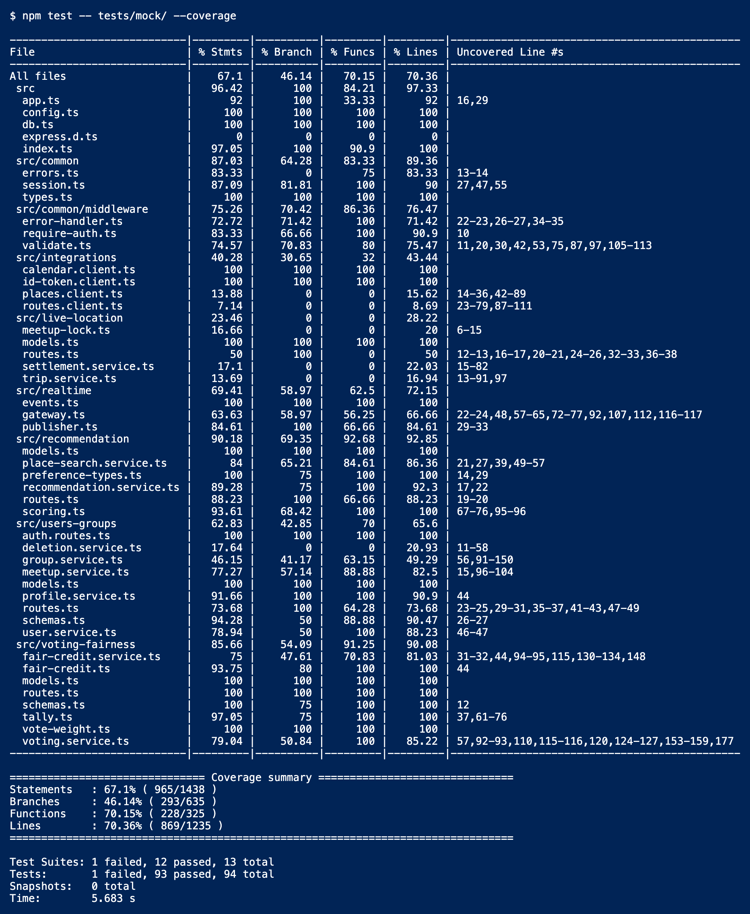
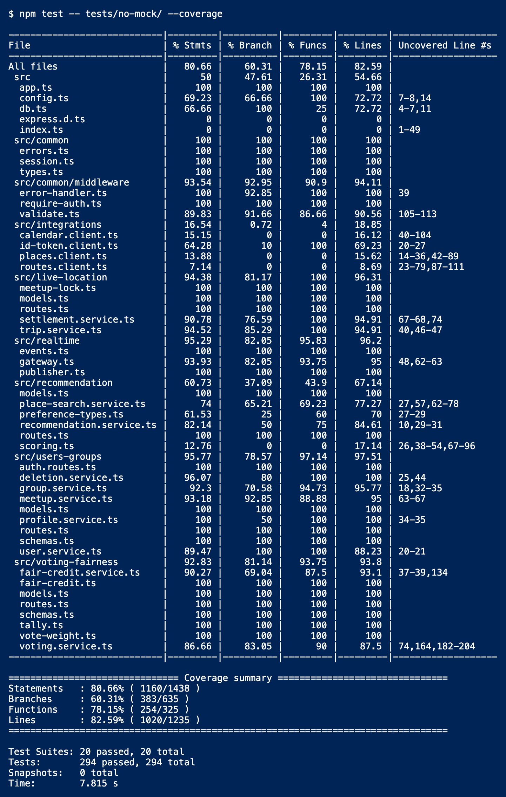

# Testing

## 1. Change History

| **Change Date** | **Modified Sections** | **Rationale** |
| --------------- | --------------------- | ------------- |
| 2026-10-19 | All Sections | Initial submission for CP1 |
| 2026-11-03 | 2.1.1, 2.1.2, 2.1.3, 4.1, 4.2 | CP2 updates: documented the current Recommendation Engine interfaces and test commands; updated Create or Join Group and Vote on a Candidate front-end test scenarios, including their automated coverage and manual multi-user cases. |
| 2026-11-04 | 2.1.1, 2.1.2, 2.3, 2.4, 3.2, 4.2 | Match the current repository: listed what each mocked test actually mocks and removed names of models that do not exist; updated the commit hash and coverage reports; removed the leftover placeholder from 3.2; added the automated no-network Create or Join Group test to 4.2. |
---

## 2. Back-end Test Specification: APIs

### 2.1. Locations of Back-end Tests and Instructions to Run Them

#### 2.1.1. Tests

| **Interface**                                    | **Describe Group Location, No Mocks**                     | **Describe Group Location, With Mocks**                 | **Mocked Components**                                                                                                            |
| ------------------------------------------------ | --------------------------------------------------------- | ------------------------------------------------------- | -------------------------------------------------------------------------------------------------------------------------------- |
| **GET /health**                                  | [`backend/tests/no-mock/health.test.ts#L6`](../backend/tests/no-mock/health.test.ts#L6)            | N/A *(no external dependencies)*                        | None                                                                                                                             |
| **POST /api/auth/google**                        | [`backend/tests/no-mock/auth.test.ts#L14`](../backend/tests/no-mock/auth.test.ts#L14)             | [`backend/tests/mock/auth.test.ts#L21`](../backend/tests/mock/auth.test.ts#L21)               | Google ID Token Client (`idTokenClient.verifyIdToken`), MongoDB User Collection (`UserModel.findOneAndUpdate`) |
| **GET /api/users/me**                            | [`backend/tests/no-mock/auth.test.ts#L63`](../backend/tests/no-mock/auth.test.ts#L63)             | [`backend/tests/mock/auth.test.ts#L147`](../backend/tests/mock/auth.test.ts#L147)             | MongoDB User Collection (`UserModel.findById`) |
| **POST /api/groups**                             | [`backend/tests/no-mock/groups.test.ts#L14`](../backend/tests/no-mock/groups.test.ts#L14)           | [`backend/tests/mock/groups.test.ts#L27`](../backend/tests/mock/groups.test.ts#L27)             | MongoDB Group Collection (`GroupModel.create`) |
| **GET /api/groups**                              | [`backend/tests/no-mock/groups.test.ts#L72`](../backend/tests/no-mock/groups.test.ts#L72)           | [`backend/tests/mock/groups.test.ts#L79`](../backend/tests/mock/groups.test.ts#L79)             | MongoDB Group Collection (`GroupModel.find`) |
| **POST /api/groups/join**                        | [`backend/tests/no-mock/groups.test.ts#L170`](../backend/tests/no-mock/groups.test.ts#L170)          | [`backend/tests/mock/groups.test.ts#L149`](../backend/tests/mock/groups.test.ts#L149)            | MongoDB Group Collection (`GroupModel.findOne`, `GroupModel.updateOne`) |
| **GET /api/groups/:groupId**                     | [`backend/tests/no-mock/groups.test.ts#L112`](../backend/tests/no-mock/groups.test.ts#L112)          | [`backend/tests/mock/groups.test.ts#L99`](../backend/tests/mock/groups.test.ts#L99)             | MongoDB Group and User Collections (`GroupModel.findById`, `UserModel.find`) |
| **POST /api/groups/:groupId/meetups**            | [`backend/tests/no-mock/meetups.test.ts#L30`](../backend/tests/no-mock/meetups.test.ts#L30)          | [`backend/tests/mock/meetups.test.ts#L31`](../backend/tests/mock/meetups.test.ts#L31)            | MongoDB Group and Meetup Collections (`GroupModel.findById`, `MeetupModel.create`) |
| **GET /api/groups/:groupId/meetups**             | [`backend/tests/no-mock/meetups.test.ts#L138`](../backend/tests/no-mock/meetups.test.ts#L138)         | [`backend/tests/mock/meetups.test.ts#L70`](../backend/tests/mock/meetups.test.ts#L70)            | MongoDB Meetup Collection (`MeetupModel.find`) |
| **GET /api/meetups/:meetupId**                   | [`backend/tests/no-mock/meetups.test.ts#L187`](../backend/tests/no-mock/meetups.test.ts#L187)         | [`backend/tests/mock/meetups.test.ts#L90`](../backend/tests/mock/meetups.test.ts#L90)            | MongoDB Group and Meetup Collections (`GroupModel.findById`, `MeetupModel.findById`) |
| **PUT /api/meetups/:meetupId/participation**     | [`backend/tests/no-mock/meetups.test.ts#L234`](../backend/tests/no-mock/meetups.test.ts#L234)         | [`backend/tests/mock/meetups.test.ts#L123`](../backend/tests/mock/meetups.test.ts#L123)           | MongoDB Meetup Collection (`MeetupModel.updateOne`) |
| **POST /api/meetups/:meetupId/recommendations/from-places** | [`backend/tests/no-mock/recommendations.test.ts#L129`](../backend/tests/no-mock/recommendations.test.ts#L129) | [`backend/tests/mock/recommendations.test.ts#L45`](../backend/tests/mock/recommendations.test.ts#L45), [`#L123`](../backend/tests/mock/recommendations.test.ts#L123); [`backend/tests/unit/place-search.routes.test.ts#L176`](../backend/tests/unit/place-search.routes.test.ts#L176) | Google Places Client (`searchNearby`), Google Routes Client (`travelSeconds`), MongoDB Recommendation Collection (`RecommendationModel.create`); in the `unit` file also Meetup Service (`meetupService.getForMember`), Fair Credit Service (`fairCreditService.getBalances`), Recommendation Service (`recommendationService.generate`) |
| **POST /api/meetups/:meetupId/places/search** | [`backend/tests/no-mock/recommendations.test.ts#L134`](../backend/tests/no-mock/recommendations.test.ts#L134) | [`backend/tests/unit/place-search.routes.test.ts#L36`](../backend/tests/unit/place-search.routes.test.ts#L36) | Google Places Client (`searchNearby`), Meetup Service (`meetupService.getForMember`) |
| **GET /api/meetups/:meetupId/recommendations** | [`backend/tests/no-mock/recommendations.test.ts#L153`](../backend/tests/no-mock/recommendations.test.ts#L153) | [`backend/tests/mock/recommendations.test.ts#L78`](../backend/tests/mock/recommendations.test.ts#L78) | MongoDB Recommendation Collection (`RecommendationModel.findOne`) |
| **recommendationService.getByMeetupId** *(internal; used by Voting & Fairness)* | [`backend/tests/no-mock/recommendations.test.ts#L139`](../backend/tests/no-mock/recommendations.test.ts#L139) | [`backend/tests/mock/recommendations.test.ts#L78`](../backend/tests/mock/recommendations.test.ts#L78) *(through the GET route)* | MongoDB Recommendation Collection (`RecommendationModel.findOne`) |
| **PUT /api/meetups/:meetupId/vote**              | [`backend/tests/no-mock/voting.test.ts#L73`](../backend/tests/no-mock/voting.test.ts#L73)           | [`backend/tests/mock/voting.test.ts#L37`](../backend/tests/mock/voting.test.ts#L37)             | MongoDB Vote Collection (`VoteModel.findOneAndUpdate`) |
| **POST /api/meetups/:meetupId/vote/lock**        | [`backend/tests/no-mock/voting.test.ts#L166`](../backend/tests/no-mock/voting.test.ts#L166)          | [`backend/tests/mock/voting.test.ts#L57`](../backend/tests/mock/voting.test.ts#L57)             | Fair Credit Service (`fairCreditService.getVoteWeight`) |
| **GET /api/meetups/:meetupId/votes**             | [`backend/tests/no-mock/voting.test.ts#L206`](../backend/tests/no-mock/voting.test.ts#L206)          | [`backend/tests/mock/voting.test.ts#L76`](../backend/tests/mock/voting.test.ts#L76)             | MongoDB Vote Collection (`VoteModel.find`), Recommendation Service (`recommendationService.getByMeetupId`) |
| **POST /api/meetups/:meetupId/finalize**         | [`backend/tests/no-mock/voting.test.ts#L271`](../backend/tests/no-mock/voting.test.ts#L271)          | [`backend/tests/mock/voting.test.ts#L111`](../backend/tests/mock/voting.test.ts#L111)            | MongoDB Meetup Collection (`MeetupModel.findOneAndUpdate`), Recommendation Service (`recommendationService.getByMeetupId`) |
| **POST /api/meetups/:meetupId/calendar-event**   | [`backend/tests/no-mock/calendar.test.ts#L29`](../backend/tests/no-mock/calendar.test.ts#L29)         | [`backend/tests/mock/calendar.test.ts#L46`](../backend/tests/mock/calendar.test.ts#L46)           | Google Calendar Client (`calendarClient.createEvent`) |
| **GET /api/users/me/profile**                    | [`backend/tests/no-mock/profile.test.ts#L39`](../backend/tests/no-mock/profile.test.ts#L39)          | [`backend/tests/mock/profile.test.ts#L24`](../backend/tests/mock/profile.test.ts#L24)            | MongoDB Fair Credit Collection (`FairCreditModel.find`), Group Service (`groupService.listForUser`) |
| **PUT /api/users/me/profile**                    | [`backend/tests/no-mock/profile.test.ts#L89`](../backend/tests/no-mock/profile.test.ts#L89)          | [`backend/tests/mock/profile.test.ts#L64`](../backend/tests/mock/profile.test.ts#L64)            | MongoDB User Collection (`UserModel.findByIdAndUpdate`) |
| **GET /api/groups/:groupId/fairness**            | [`backend/tests/no-mock/fairness.test.ts#L39`](../backend/tests/no-mock/fairness.test.ts#L39)         | [`backend/tests/mock/fairness.test.ts#L20`](../backend/tests/mock/fairness.test.ts#L20)           | MongoDB Fair Credit Entry Collection (`FairCreditEntryModel.find`), User Service (`userService.findByIds`) |

The Recommendation Engine is the component specified in full for CP2. Its `from-places` and `places/search` no-mock tests cover the cases rejected before Google is called (authentication, invalid or unknown meetup, non-organizer, wrong status, missing participation details). Successful generation, Google failures and insufficient results are covered by the tests with mocks, because a successful run depends on paid Google APIs and live results that a test cannot assert on.

#### 2.1.2. Commit Hash Where Tests Run

`a298307574df79a49bead9d4145e6b480927c81f`

#### 2.1.3. Explanation on How to Run the Tests

1. **Clone the Repository**:
   - Open your terminal and clone the repository:
     ```bash
     git clone https://github.com/w-lin5/CPEN321_MeetFair.git
     cd CPEN321_MeetFair
     ```

2. **Configure Environment Variables**:
   - In the `backend/` directory, copy `.env.example` to `.env` and set any required environment variables:
     ```bash
     cp backend/.env.example backend/.env
     ```

3. **Run the Automated Interface Test Scripts**:
   - From the repository root, execute the dedicated interface test runner script for your platform. This script automatically validates prerequisites, installs dependencies if needed, and runs the mock, no-mock, and combined suites while exporting coverage reports to `backend/coverage/mock`, `backend/coverage/no-mock`, and `backend/coverage/interface`:
     - **Windows (PowerShell)**:
       ```powershell
       .\scripts\run-backend-interface-tests.ps1
       ```
       *(Note: If script execution is restricted, run `Set-ExecutionPolicy -Scope Process -ExecutionPolicy Bypass` or launch with `pwsh -ExecutionPolicy Bypass -File .\scripts\run-backend-interface-tests.ps1`)*
     - **Linux / macOS (Bash)**:
       ```bash
       chmod +x scripts/run-backend-interface-tests.sh
       ./scripts/run-backend-interface-tests.sh
       ```

   - The script does not run `backend/tests/unit/`, which holds the mocked `places/search` and `from-places` tests. Run them separately:
     ```bash
     cd backend
     npx jest tests/unit
     ```

4. **Alternative: Run Manually via npm / Jest**:
   - Navigate to the `backend/` directory:
     ```bash
     cd backend
     npm install
     ```
   - Run all tests with coverage:
     ```bash
     npm test
     ```
   - Run only unit tests with mocks:
     ```bash
     npx jest tests/mock --coverage --coverageDirectory=coverage/mock
     ```
   - Run only unmocked integration tests against MongoDB:
     ```bash
     npx jest tests/no-mock --coverage --coverageDirectory=coverage/no-mock
     ```
   - Run a specific test suite file:
     ```bash
     npx jest tests/mock/voting.test.ts
     npx jest tests/no-mock/groups.test.ts
     npx jest tests/no-mock/calendar.test.ts
     ```

### 2.2. GitHub Actions Configuration Location

(*not yet implemented*)
`.github/workflows/backend-tests.yml`

### 2.3. Jest Coverage Report Screenshots With Mocks



### 2.4. Jest Coverage Report Screenshots Without Mocks



---

## 3. Tests of Non-Functional Requirements

### 3.1. Test Locations in Git

*As of CP2, one non-functional requirement (Security and Access Control) is tested in the backend mock and unmocked tests, but are not yet in the dedicated* `nfr` *test directory.*

| **Non-Functional Requirement** | **Existing Test Locations** | **Current Coverage** |
| ------------------------------ | --------------------------- | -------------------- |
| [Security and Access Control](Requirements_and_Design.md#37-non-functional-requirements) | `backend/tests/no-mock/auth.test.ts`; `backend/tests/no-mock/groups.test.ts`; `backend/tests/no-mock/meetups.test.ts`; `backend/tests/no-mock/voting.test.ts`; `backend/tests/no-mock/realtime.test.ts`; `backend/tests/no-mock/calendar.test.ts`; `backend/tests/mock/index.test.ts` | Tests session-token rejection, membership and organizer restrictions, Socket.IO room access, and server HTTPS startup logic. Does not test the deployed TLS configuration or prove that access tokens are absent from all stored data. |

### 3.2. Test Verification and Logs

- **Security and Access Control**

  - **Verification:** The existing backend tests check that requests with missing or invalid session tokens are rejected; users outside a group cannot access its protected meetup data; non-participants cannot vote; and only the meetup organizer can finalize voting. Realtime tests check that an invalid token cannot establish a socket connection and that a user outside the group cannot join its meetup room. Calendar API tests check authentication and membership restrictions. A mocked startup test checks that the server uses HTTPS when both certificate files are present and refuses to start when only one is present.

---

### 4. Front-end Test Specification

### 4.1. Location in Git of Front-end Test Suite

`frontend/app/src/androidTest/java/com/example/cpen321application/e2e/`

The suite is run with `./scripts/run-frontend-e2e-tests.sh` (macOS/Linux) or `./scripts/run-frontend-e2e-tests.ps1` (Windows), with an emulator running and the back end reachable at `API_BASE_URL`. The script starts the back end and installs the app, then waits: sign in to MeetFair on the emulator, and press Enter once the group list is visible. Tests start signed in on the group list and fail with a setup message otherwise. UI elements are located by the test tags defined in `ui/common/TestTags.kt`. Each test creates its own uniquely named groups, so tests do not depend on each other or on existing data.

### 4.2. Tests

- **Use Case: Create or Join Group** ([`CreateJoinGroupTest.kt`](../frontend/app/src/androidTest/java/com/example/cpen321application/e2e/CreateJoinGroupTest.kt))

  - **Expected Behaviors (automated):**

    | **Scenario Steps** | **Test Case Steps** |
    | ------------------ | ------------------- |
    | **Create, main success scenario** (`createGroup_showsInviteCodeAndListsTheGroup`) | |
    | 1. The user selects "Create group" on the group list. | Click the button with test tag `create_group_button`. Check that the button with test tag `create_group_submit` is disabled. |
    | 2. The user enters a group name and selects "Create". | Input a unique group name in the field with test tag `group_name_input`. Check that the button with test tag `create_group_submit` is enabled, and click it. |
    | 3. The system creates the group with the user as its only member and organizer. | Wait for the node with test tag `invite_code_text`. Check that exactly one node with test tag `member_item` exists. Check that it contains "(organizer)". |
    | 4. The system generates a unique 6-character invite code. | Check that the text of `invite_code_text` matches `Invite code:` followed by 6 characters from the invite code alphabet. |
    | 5. The system displays the group page with the group name, invite code and member list. | Check that the group name is displayed. Click the button with test tag `back_button`. Wait for a node with test tag `group_item` and the group name on the group list. |
    | **Create, failure 2a** (`createGroup_blankNameCannotBeSubmitted`) | |
    | 2a. The user enters only spaces as the group name. | Click the button with test tag `create_group_button`. Input "   " in the field with test tag `group_name_input`. |
    | 2a1. The "Create" button stays disabled. | Check that the button with test tag `create_group_submit` is disabled. |
    | **Join, failure 2a** (`joinGroup_invalidCodeShowsErrorAndAllowsRetry`) | |
    | 2a. The user enters an invite code that does not belong to any group. | Click the button with test tag `join_group_button`. Input "000000" in the field with test tag `invite_code_input`. Click the button with test tag `join_group_submit`. |
    | 2a1. The system displays "Invalid invite code". | Wait for the node with test tag `error_text`. Check that its text is "Invalid invite code". |
    | 2a2. The user stays on the join screen and may enter another code. | Check that the field with test tag `invite_code_input` is displayed. Check that the button with test tag `join_group_submit` is enabled. |
    | **Join, failure 3a** (`joinGroup_alreadyMemberShowsError`) | |
    | 3a. The user is already a member of this group; letter case does not matter. | Create a group through the UI and read its invite code. Click `back_button`, then `join_group_button`. Input the code in lower case in `invite_code_input`. Click `join_group_submit`. |
    | 3a1. The system displays "Already a member of this group". | Wait for the node with test tag `error_text`. Check that its text is "Already a member of this group". |
    | **Create, failure 3a and Join, failure 3b: no network** (`createAndJoinGroup_offlineShowsNetworkError`) | |
    | Create 3a. The user's device has no network connection when creating a group. | Turn on airplane mode with UiDevice. Click `create_group_button`. Input a unique group name in `group_name_input`. Click `create_group_submit`. |
    | Create 3a1. The system displays a "Network error" message. | Wait for the node with test tag `error_text`. Check that its text contains "Network error". |
    | Join 3b. The user's device has no network connection when joining a group. | Click `back_button`. Wait for `join_group_button` and click it. Input an unused invite code in `invite_code_input`. Click `join_group_submit`. |
    | Join 3b1. The system displays a "Network error" message. | Wait for the node with test tag `error_text`. Check that its text contains "Network error". Airplane mode is turned off when the test ends, including if it fails. |

  - **Scenarios not covered by the automated suite:**

    | **Scenario** | **Reason** | **How It Is Checked Instead** |
    | ------------ | ---------- | ----------------------------- |
    | Join, main success scenario (steps 1-5) | Requires a second signed-in Google account. | Manual: account A creates a group; account B enters the code and sees the group page with both members. The back-end behavior is tested at `POST /api/groups/join`. |
    | Create, failure 2b (name longer than 60 characters) | No end-to-end test yet. | The back-end validation is tested at `POST /api/groups`. |

- **Use Case: Vote on a Candidate** ([`VotingTest.kt`](../frontend/app/src/androidTest/java/com/example/cpen321application/e2e/VotingTest.kt))

  - **Expected Behaviors (automated):**

    | **Scenario Steps** | **Test Case Steps** |
    | ------------------ | ------------------- |
    | **Main success scenario: open voting, vote, change vote, and lock vote** (`vote_castChangeAndLockVote`) | |
    | 1. The member opens a meetup in VOTING and selects "Vote on a spot". | Navigate to a meetup in `VOTING` status. Wait for the button with test tag `open_voting_button` ("Vote on a spot") and click it. |
    | 2. The app shows the three places, their picks and locked weights, the locked participant count, and the live update indicator. | Wait for `voting_status_text` ("Voting is open"). Check that exactly three `candidate_item_<placeId>` cards exist, that three "Picks:" labels and three "Locked weight:" labels are present, and that `voter_count_text` mentions participants who locked their vote. Check that `voting_live_text` says "Live: votes update automatically". |
    | 3. The member selects "Vote" on one place. | Click the button with test tag `vote_button_<placeId>` for the chosen candidate place. |
    | 4. The system records the vote; live tally updates are sent to members viewing the screen. | Wait for the vote request to complete. Check that the selected candidate's button says "Your vote" and that `lock_vote_button` ("Submit vote") is enabled and displayed. The update on another member's screen is checked manually. |
    | 5. The member may select "Change vote" on another place; the system replaces the vote. | Click another candidate's `vote_button_<placeId>` ("Change vote"). Wait for its button to say "Your vote" and check that the previous candidate's button says "Change vote". |
    | 6. The member selects "Submit vote" to lock their vote. | Click `lock_vote_button` ("Submit vote") and wait for the locked state or an error. The test accepts the transient "Locking…" state but does not assert that it is observed. |
    | 7. The system snapshots the member's Fair Credit as vote weight and locks the vote. 8. The app shows "Your vote is locked" with its weight. | Wait for `vote_locked_text` and check the displayed weight is between 1.0 and 1.5. Check that `voter_count_text` starts with "1 of ", all candidate vote buttons are absent, and "Your locked vote" is displayed on the selected candidate. |
    | **Failure 2a: live updates disconnected** (`vote_disconnectedLiveShowsManualRefresh`) | |
    | 2a. Live updates disconnect while the voting screen is open. | Use UiAutomator to turn on airplane mode on the emulator. |
    | 2a1. The screen switches to manual refresh. | Check that `voting_live_text` disappears and `refresh_results_button` is displayed. |
    | 2a2. An offline vote attempt fails without selecting a candidate. | Tap a candidate's `vote_button_<placeId>` while offline. Check for "Network error" and that its button remains labeled "Vote". |
    | 2a3. The member can request a results refresh. | Tap `refresh_results_button` and check that the voter count remains displayed. The test does not verify changed tally values after refreshing. |
    | **Failure 3b: offline voting preserves the previous choice** (`vote_offlineNetworkFailureKeepsPreviousVoteAndCanRetry`) | |
    | 3b. The member already has a vote when connectivity is lost. | Select a candidate, then use UiAutomator to turn on airplane mode. |
    | 3b1. A failed change does not replace the saved choice. | Tap "Change vote" for another candidate. Check for "Network error", "Your vote" on the original candidate, and "Change vote" on the attempted candidate. |
    | 3b2. The member can retry after restoring connectivity. | Turn airplane mode off, wait for Android to report a validated network, and tap "Change vote" again. Check that the replacement candidate is selected and the original candidate now says "Change vote". |
    | Finalizing voting closes the screen (`vote_finalizeClosesVoting`) | |
    | The organizer finalizes a meetup with no locked votes. | Click Finalize; if the early-finalization confirmation appears, confirm it. Choose a winner when prompted. |
    | The voting UI closes and removes voting controls. | Check that the status says "Voting is closed" and that candidate vote buttons and `lock_vote_button` are absent. |

  - **Scenarios not covered by the automated suite:**

    | **Scenario** | **Reason** | **How It Is Checked Instead** |
    | ------------ | ---------- | ----------------------------- |
    | Failure 1a: non-participant member viewing voting | The automated setup uses one signed-in account, which creates the group and enters meetup details. A different group member account is needed to view voting without participating. | Manual: use a second group member who has not submitted meetup participation details; open voting and check that no vote or lock controls appear and that the non-participant message is shown. |
    | Failure 3a: vote arrives after organizer finalizes | Reproducing the stale-screen request requires two users and coordinated timing; finalizing through the same screen immediately hides its vote controls. | Manual two-user check: User B organizes a meetup and starts voting. User A joins the group, enters meetup details, opens voting, and selects a candidate. Coordinate User B finalizing while User A's vote request is still in flight. On User A's device, check that the request error is shown and the screen updates to "Voting is closed" with voting controls hidden. |
    | Multi-member live tally broadcast (steps 4 & 7) | Testing that another user's screen updates in real time via Socket.IO without manual interaction requires two concurrent active client sessions running on separate emulators. | Manual: Member A and Member B open the voting screen simultaneously; Member A votes and locks; Member B's screen displays the updated picks, locked weight, and voter count automatically. Realtime socket event delivery is tested at `backend/tests/no-mock/realtime.test.ts` and `backend/tests/no-mock/voting.test.ts`. |

  - **Test Logs:**
    ```
    ==> Running frontend E2E tests (com.example.cpen321application.e2e.CreateJoinGroupTest,com.example.cpen321application.e2e.VotingTest) ...

    > Task :app:connectedDebugAndroidTest
    Starting 9 tests on Pixel_9(AVD) - 16

    Pixel_9(AVD) - 16 Tests 1/9 completed. (0 skipped) (0 failed)
    Pixel_9(AVD) - 16 Tests 2/9 completed. (0 skipped) (0 failed)
    Pixel_9(AVD) - 16 Tests 3/9 completed. (0 skipped) (0 failed)
    Pixel_9(AVD) - 16 Tests 5/9 completed. (0 skipped) (0 failed)
    Pixel_9(AVD) - 16 Tests 6/9 completed. (0 skipped) (0 failed)
    Pixel_9(AVD) - 16 Tests 7/9 completed. (0 skipped) (0 failed)
    Pixel_9(AVD) - 16 Tests 8/9 completed. (0 skipped) (0 failed)
    Finished 9 tests on Pixel_9(AVD) - 16

    BUILD SUCCESSFUL in 2m 20s
    71 actionable tasks: 3 executed, 68 up-to-date
    ==> Frontend E2E tests finished.
    ```
