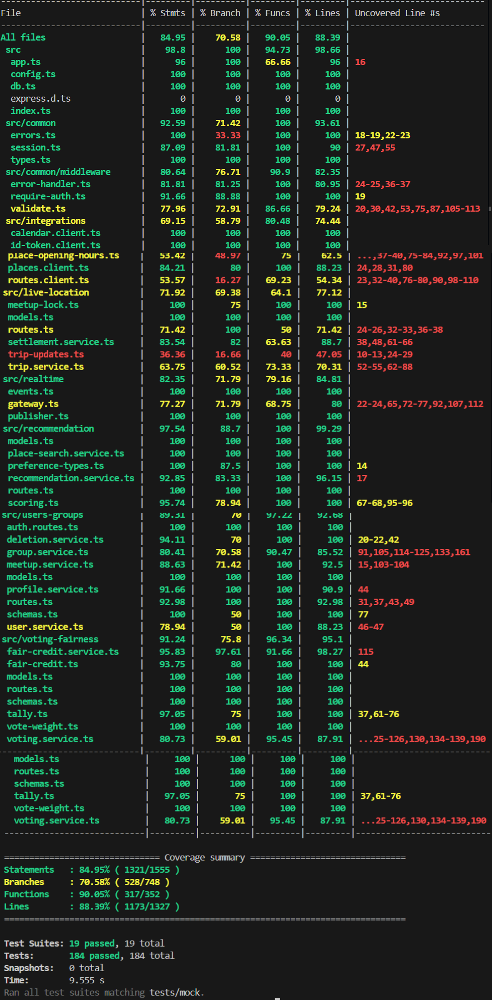
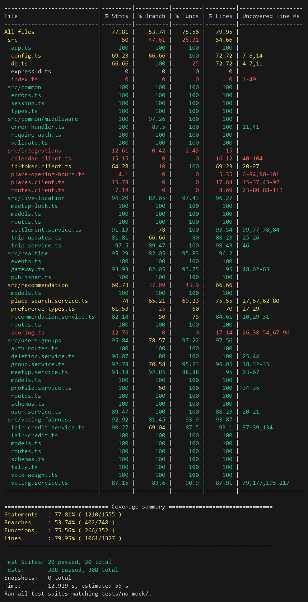
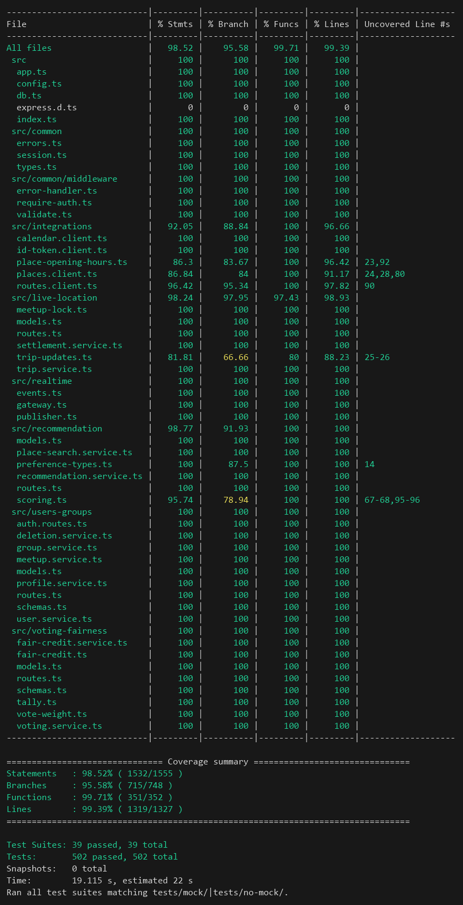
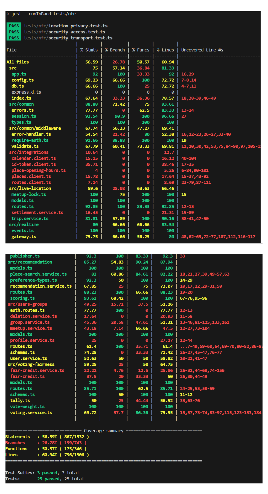

# Testing

## 1. Change History

| **Change Date** | **Modified Sections** | **Rationale** |
| --------------- | --------------------- | ------------- |
| 2026-10-19 | All Sections | Initial submission for CP1 |
| 2026-11-04 | 2.1.1, 2.1.2, 2.1.3, 2.3, 2.4, 3.2, 4.1, 4.2 | CP2: documented Recommendation Engine interfaces and test commands; updated Create or Join Group and Vote on a Candidate scenarios, automated coverage, and manual multi-user cases; clarified mocked tests and removed references to nonexistent models; updated the commit hash and coverage reports; removed a leftover placeholder and added the automated no-network Create or Join Group test. |
| 2026-11-19 | 2.1.1, 3.1, 3.2, 4.1, 4.2 | CP3: Added dedicated backend and Android NFR tests for Security and Access Control (HTTPS/WSS, session verification, role restrictions, Calendar token non-persistence) and Location Privacy (consent, authorization, point retention, coordinate-free realtime events, sharing notifications). Added missing backend test-file references. Updated front-end test specifications with the E2E suites covering all use cases and failure scenarios across Features 2, 4, and 5 with updated setup and run instructions. |
| 2026-11-27 | 2.1.1 | M3: Added live-trip API test references and clarified which interfaces have mocked cases, which dependencies those cases replace, and why some interfaces are verified through integration or unit tests alone. |
| 2026-11-27 | 2.1.2, 2.5 | M3: Added a combined mocked and unmocked interface coverage report and recorded its tested commit. |
| 2026-11-27 | 2.1.1, 2.5 | M3: Added Google provider and live-trip interface tests, updated the mocked dependency references, and documented the resulting coverage. |
---

## 2. Back-end Test Specification: APIs

### 2.1. Locations of Back-end Tests and Instructions to Run Them

#### 2.1.1. Tests

| **Interface**                                    | **Integration or Direct Unit Tests**                     | **Mocked Interface Tests or Reason**                   | **Mocked Components**                                                                                                            |
| ------------------------------------------------ | --------------------------------------------------------- | ------------------------------------------------------- | -------------------------------------------------------------------------------------------------------------------------------- |
| **GET /health**                                  | [`backend/tests/no-mock/health.test.ts`](../backend/tests/no-mock/health.test.ts) | No mocked case. The handler returns a static response and has no external dependencies. | None |
| **POST /api/auth/google**                        | [`backend/tests/no-mock/auth.test.ts`](../backend/tests/no-mock/auth.test.ts)             | [`backend/tests/mock/auth.test.ts`](../backend/tests/mock/auth.test.ts)               | Google ID Token Client (`idTokenClient.verifyIdToken`), MongoDB User Collection (`UserModel.findOneAndUpdate`) |
| **GET /api/users/me**                            | [`backend/tests/no-mock/auth.test.ts`](../backend/tests/no-mock/auth.test.ts)             | [`backend/tests/mock/auth.test.ts`](../backend/tests/mock/auth.test.ts)             | MongoDB User Collection (`UserModel.findById`) |
| **POST /api/groups**                             | [`backend/tests/no-mock/groups.test.ts`](../backend/tests/no-mock/groups.test.ts)           | [`backend/tests/mock/groups.test.ts`](../backend/tests/mock/groups.test.ts)             | MongoDB Group Collection (`GroupModel.create`) |
| **GET /api/groups**                              | [`backend/tests/no-mock/groups.test.ts`](../backend/tests/no-mock/groups.test.ts)           | [`backend/tests/mock/groups.test.ts`](../backend/tests/mock/groups.test.ts)             | MongoDB Group Collection (`GroupModel.find`) |
| **POST /api/groups/join**                        | [`backend/tests/no-mock/groups.test.ts`](../backend/tests/no-mock/groups.test.ts)          | [`backend/tests/mock/groups.test.ts`](../backend/tests/mock/groups.test.ts)            | MongoDB Group Collection (`GroupModel.findOne`, `GroupModel.updateOne`) |
| **GET /api/groups/:groupId**                     | [`backend/tests/no-mock/groups.test.ts`](../backend/tests/no-mock/groups.test.ts)          | [`backend/tests/mock/groups.test.ts`](../backend/tests/mock/groups.test.ts)             | MongoDB Group and User Collections (`GroupModel.findById`, `UserModel.find`) |
| **POST /api/groups/:groupId/meetups**            | [`backend/tests/no-mock/meetups.test.ts`](../backend/tests/no-mock/meetups.test.ts)          | [`backend/tests/mock/meetups.test.ts`](../backend/tests/mock/meetups.test.ts)            | MongoDB Group and Meetup Collections (`GroupModel.findById`, `MeetupModel.create`) |
| **GET /api/groups/:groupId/meetups**             | [`backend/tests/no-mock/meetups.test.ts`](../backend/tests/no-mock/meetups.test.ts)         | [`backend/tests/mock/meetups.test.ts`](../backend/tests/mock/meetups.test.ts)            | MongoDB Meetup Collection (`MeetupModel.find`) |
| **GET /api/meetups/:meetupId**                   | [`backend/tests/no-mock/meetups.test.ts`](../backend/tests/no-mock/meetups.test.ts)         | [`backend/tests/mock/meetups.test.ts`](../backend/tests/mock/meetups.test.ts)            | MongoDB Group and Meetup Collections (`GroupModel.findById`, `MeetupModel.findById`) |
| **PUT /api/meetups/:meetupId/participation**     | [`backend/tests/no-mock/meetups.test.ts`](../backend/tests/no-mock/meetups.test.ts)         | [`backend/tests/mock/meetups.test.ts`](../backend/tests/mock/meetups.test.ts)           | MongoDB Meetup Collection (`MeetupModel.updateOne`) |
| **DELETE /api/meetups/:meetupId/participation** | [`backend/tests/no-mock/leave.test.ts`](../backend/tests/no-mock/leave.test.ts) | [`backend/tests/mock/membership-races.test.ts`](../backend/tests/mock/membership-races.test.ts) | `MeetupModel.updateOne` simulates voting starting before the conditional leave write. |
| **POST /api/groups/:groupId/leave** | [`backend/tests/no-mock/leave.test.ts`](../backend/tests/no-mock/leave.test.ts) | [`backend/tests/mock/membership-races.test.ts`](../backend/tests/mock/membership-races.test.ts) | `GroupModel.updateOne` simulates a concurrent membership change before the leave write. |
| **DELETE /api/groups/:groupId/members/:memberId** | [`backend/tests/no-mock/remove-member.test.ts`](../backend/tests/no-mock/remove-member.test.ts) | [`backend/tests/mock/membership-races.test.ts`](../backend/tests/mock/membership-races.test.ts) | `GroupModel.updateOne` simulates a competing removal before cleanup. |
| **DELETE /api/meetups/:meetupId** and **DELETE /api/groups/:groupId** | [`backend/tests/no-mock/deletion.test.ts`](../backend/tests/no-mock/deletion.test.ts) | [`backend/tests/mock/membership-races.test.ts`](../backend/tests/mock/membership-races.test.ts) | `MeetupModel.deleteOne` and `GroupModel.deleteOne` simulate competing deletions. |
| **POST /api/meetups/:meetupId/recommendations/from-places** | [`backend/tests/no-mock/recommendations.test.ts`](../backend/tests/no-mock/recommendations.test.ts) | [`recommendations.test.ts`](../backend/tests/mock/recommendations.test.ts); [`place-search.routes.test.ts`](../backend/tests/mock/place-search.routes.test.ts); [`recommendation-google-failures.test.ts`](../backend/tests/mock/recommendation-google-failures.test.ts) | External Google clients or their HTTP boundary; database-write failures where specified. The route-isolation suite also mocks Meetup, Fair Credit and Recommendation services. The Google-failure suite keeps real clients, services and MongoDB. |
| **POST /api/meetups/:meetupId/places/search** | [`backend/tests/no-mock/recommendations.test.ts`](../backend/tests/no-mock/recommendations.test.ts) | [`place-search.routes.test.ts`](../backend/tests/mock/place-search.routes.test.ts); [`recommendation-google-failures.test.ts`](../backend/tests/mock/recommendation-google-failures.test.ts) | Route-isolation tests mock the Google Places client and Meetup service; provider-failure tests mock only Google HTTP. |
| **GET /api/meetups/:meetupId/recommendations** | [`backend/tests/no-mock/recommendations.test.ts`](../backend/tests/no-mock/recommendations.test.ts) | [`backend/tests/mock/recommendations.test.ts`](../backend/tests/mock/recommendations.test.ts) | MongoDB Recommendation Collection (`RecommendationModel.findOne`) |
| **recommendationService.getByMeetupId** *(internal; used by Voting & Fairness)* | [`backend/tests/no-mock/recommendations.test.ts`](../backend/tests/no-mock/recommendations.test.ts) | [`backend/tests/mock/recommendations.test.ts`](../backend/tests/mock/recommendations.test.ts) *(through the GET route)* | MongoDB Recommendation Collection (`RecommendationModel.findOne`) |
| **PUT /api/meetups/:meetupId/vote**              | [`backend/tests/no-mock/voting.test.ts`](../backend/tests/no-mock/voting.test.ts)           | [`backend/tests/mock/voting.test.ts`](../backend/tests/mock/voting.test.ts)             | MongoDB Vote Collection (`VoteModel.findOneAndUpdate`) |
| **POST /api/meetups/:meetupId/vote/lock**        | [`backend/tests/no-mock/voting.test.ts`](../backend/tests/no-mock/voting.test.ts)          | [`backend/tests/mock/voting.test.ts`](../backend/tests/mock/voting.test.ts)             | Fair Credit Service (`fairCreditService.getVoteWeight`) |
| **GET /api/meetups/:meetupId/votes**             | [`backend/tests/no-mock/voting.test.ts`](../backend/tests/no-mock/voting.test.ts)          | [`backend/tests/mock/voting.test.ts`](../backend/tests/mock/voting.test.ts)             | MongoDB Vote Collection (`VoteModel.find`), Recommendation Service (`recommendationService.getByMeetupId`) |
| **POST /api/meetups/:meetupId/finalize**         | [`backend/tests/no-mock/voting.test.ts`](../backend/tests/no-mock/voting.test.ts)          | [`backend/tests/mock/voting.test.ts`](../backend/tests/mock/voting.test.ts)            | MongoDB Meetup Collection (`MeetupModel.findOneAndUpdate`), Recommendation Service (`recommendationService.getByMeetupId`) |
| **tally / winner selection** *(internal)* | [`backend/tests/unit/tally.test.ts`](../backend/tests/unit/tally.test.ts); [`backend/tests/no-mock/voting.test.ts`](../backend/tests/no-mock/voting.test.ts) | No mocked case for the calculation itself. Direct unit tests supply inputs and verify the deterministic tally and tie-breaking rules. | None |
| **GET /api/meetups/:meetupId/trips** | [`tests/no-mock/trips.test.ts`](../backend/tests/no-mock/trips.test.ts); [`tests/nfr/location-privacy.test.ts`](../backend/tests/nfr/location-privacy.test.ts); [`tests/mock/trip-failures.test.ts`](../backend/tests/mock/trip-failures.test.ts) | [tests/mock/trip-failures.test.ts](../backend/tests/mock/trip-failures.test.ts) | `TripModel.find` fails once to verify a safe 500 and a successful retry. |
| **POST /api/meetups/:meetupId/trip/start** *(also resumes sharing)* | [`tests/no-mock/trips.test.ts`](../backend/tests/no-mock/trips.test.ts); [`tests/nfr/location-privacy.test.ts`](../backend/tests/nfr/location-privacy.test.ts) | [`tests/mock/trip-failures.test.ts`](../backend/tests/mock/trip-failures.test.ts); [`tests/no-mock/trips.test.ts`](../backend/tests/no-mock/trips.test.ts) *(start racing with group leave)* | `TripModel.updateOne` and its query execution simulate storage failure, a duplicate-key response, or an interleaved group leave. |
| **PUT /api/meetups/:meetupId/trip/location** | [`tests/no-mock/trips.test.ts`](../backend/tests/no-mock/trips.test.ts); [`tests/nfr/location-privacy.test.ts`](../backend/tests/nfr/location-privacy.test.ts) | [tests/mock/trip-failures.test.ts](../backend/tests/mock/trip-failures.test.ts) | `TripModel.findOneAndUpdate` fails before saving a new point. |
| **POST /api/meetups/:meetupId/trip/stop** *(pauses sharing)* | [`tests/no-mock/trips.test.ts`](../backend/tests/no-mock/trips.test.ts); [`tests/nfr/location-privacy.test.ts`](../backend/tests/nfr/location-privacy.test.ts) | [tests/mock/trip-failures.test.ts](../backend/tests/mock/trip-failures.test.ts) | `TripModel.updateOne` fails before pausing sharing. |
| **POST /api/meetups/:meetupId/trip/arrive** | [`tests/no-mock/trips.test.ts`](../backend/tests/no-mock/trips.test.ts); [`tests/nfr/location-privacy.test.ts`](../backend/tests/nfr/location-privacy.test.ts) | [tests/mock/trip-failures.test.ts](../backend/tests/mock/trip-failures.test.ts) | `TripModel.updateOne` fails before arrival is saved. |
| **POST /api/meetups/:meetupId/settle** | [`tests/no-mock/settlement.test.ts`](../backend/tests/no-mock/settlement.test.ts) | [`tests/mock/settlement-recovery.test.ts`](../backend/tests/mock/settlement-recovery.test.ts); [`tests/no-mock/settlement.test.ts`](../backend/tests/no-mock/settlement.test.ts)| Settlement snapshot and meetup status writes (`SettlementModel.findOneAndUpdate`, query execution, `MeetupModel.findOneAndUpdate`), Fair Credit balance writes (`FairCreditModel.updateOne`), and outbound HTTP (`fetch`, blocked in recovery tests). |
| **POST /api/meetups/:meetupId/calendar-event**   | [`backend/tests/no-mock/calendar.test.ts`](../backend/tests/no-mock/calendar.test.ts)         | [`backend/tests/mock/calendar.test.ts`](../backend/tests/mock/calendar.test.ts)           | Google Calendar Client (`calendarClient.createEvent`) |
| **GET /api/users/me/profile**                    | [`backend/tests/no-mock/profile.test.ts`](../backend/tests/no-mock/profile.test.ts)          | [`backend/tests/mock/profile.test.ts`](../backend/tests/mock/profile.test.ts)            | MongoDB Fair Credit Collection (`FairCreditModel.find`), Group Service (`groupService.listForUser`) |
| **PUT /api/users/me/profile**                    | [`backend/tests/no-mock/profile.test.ts`](../backend/tests/no-mock/profile.test.ts)          | [`backend/tests/mock/profile.test.ts`](../backend/tests/mock/profile.test.ts)            | MongoDB User Collection (`UserModel.findByIdAndUpdate`) |
| **GET /api/groups/:groupId/fairness**            | [`backend/tests/no-mock/fairness.test.ts`](../backend/tests/no-mock/fairness.test.ts)         | [`backend/tests/mock/fairness.test.ts`](../backend/tests/mock/fairness.test.ts)           | MongoDB Fair Credit Entry Collection (`FairCreditEntryModel.find`), User Service (`userService.findByIds`) |


All mocked recommendation HTTP interface tests now reside in `backend/tests/mock/`, including `place-search.routes.test.ts`, which was moved out of `tests/unit/`. The existing PowerShell and shell interface runners therefore include these cases in their mocked and combined phases without changes to the course-provided scripts. Pure client and opening-hours unit tests remain in `tests/unit/` and run with the complete Jest suite.

#### 2.1.2. Commit Hash Where Tests Run

Verified backend revision for the combined interface coverage in Section 2.5: `46884403bfe44e940c56596f258ff88e4f17ce12`.

#### 2.1.3. Explanation on How to Run the Tests

For a complete backend run with a strict 100% gate for statements, branches, functions and lines, run `npm run test:coverage` from `backend/`. It uses `jest.coverage.config.js`, inherits the unchanged `src/**/*.ts` collection scope, and writes text, HTML, LCOV and JSON reports under `backend/coverage/`. There are no business-source coverage exclusions or ignore annotations. The interface scripts keep using the base Jest configuration so their intentionally partial mock-only/no-mock-only reports are not required to reach 100% individually.

1. **Clone the Repository**:
   - Open your terminal and clone the repository:
     ```bash
     git clone https://github.com/w-lin5/CPEN321_MeetFair.git
     cd CPEN321_MeetFair
     ```

2. **Configure Environment Variables**:
   - In the `backend/` directory, copy `.env.example` to `.env` and set any required environment variables:
     ```bash
     cp backend/.env.example backend/.env
     ```

3. **Run the Automated Interface Test Scripts**:
   - From the repository root, execute the dedicated interface test runner script for your platform. This script automatically validates prerequisites, installs dependencies if needed, and runs the mock, no-mock, and combined suites while exporting coverage reports to `backend/coverage/mock`, `backend/coverage/no-mock`, and `backend/coverage/interface`:
     - **Windows (PowerShell)**:
       ```powershell
       .\scripts\run-backend-interface-tests.ps1
       ```
       *(Note: If script execution is restricted, run `Set-ExecutionPolicy -Scope Process -ExecutionPolicy Bypass` or launch with `pwsh -ExecutionPolicy Bypass -File .\scripts\run-backend-interface-tests.ps1`)*
     - **Linux / macOS (Bash)**:
       ```bash
       chmod +x scripts/run-backend-interface-tests.sh
       ./scripts/run-backend-interface-tests.sh
       ```

   - The script includes the mocked `places/search` and `from-places` interface tests in `backend/tests/mock/`. It does not run pure unit tests in `backend/tests/unit/` or the dedicated NFR suites in `backend/tests/nfr/`. To run every backend test with coverage, execute:
     ```bash
     cd backend
     npm test -- --runInBand --coverage
     ```

4. **Alternative: Run Manually via npm / Jest**:
   - Navigate to the `backend/` directory:
     ```bash
     cd backend
     npm install
     ```
   - Run all tests with coverage:
     ```bash
     npm test
     ```
   - Run only mocked interface tests:
     ```bash
     npx jest tests/mock --coverage --coverageDirectory=coverage/mock
     ```
   - Run only unmocked integration tests against MongoDB:
     ```bash
     npx jest tests/no-mock --coverage --coverageDirectory=coverage/no-mock
     ```
   - Run a specific test suite file:
     ```bash
     npx jest tests/mock/voting.test.ts
     npx jest tests/no-mock/groups.test.ts
     npx jest tests/no-mock/calendar.test.ts
     ```

### 2.2. GitHub Actions Configuration Location

[.github/workflows/backend-tests.yml](../.github/workflows/backend-tests.yml)

The workflow runs on pushes, pull requests and manual dispatch. It uses Node.js 22, installs dependencies with `npm ci`, runs TypeScript type checking and the backend build, checks OpenSSL availability for TLS tests, and runs the complete Jest suite with `npm test -- --ci --runInBand`.

### 2.3. Jest Coverage Report Screenshots With Mocks



### 2.4. Jest Coverage Report Screenshots Without Mocks



### 2.5. Combined Jest Coverage Report With and Without Mocks

The combined interface run executed `tests/mock/` and `tests/no-mock/`. All **502 tests across 39 suites** passed. The rerun reproduced the coverage shown below: **98.52% statements, 95.58% branches, 99.71% functions, and 99.39% lines**.



Both runs collect coverage from `src/**/*.ts`. The combined interface report covered 715 of 748 branches. The remaining 33 branches are in six files:

| Area | Why coverage is lower in the interface run |
| --- | --- |
| Google Places, Routes, and opening hours | **26 branches:** `place-opening-hours.ts` (16), `places.client.ts` (8), and `routes.client.ts` (2). The recommendation flow provides explicit search arguments and validates participant and candidate counts before requesting travel times. The [Places](../backend/tests/unit/places.client.test.ts), [Routes](../backend/tests/unit/routes.client.test.ts), and [opening-hours](../backend/tests/unit/place-opening-hours.test.ts) tests cover direct-call defaults, empty matrices, missing API keys, and additional malformed provider data, such as an impossible calendar date. |
| Recommendation scoring and preference mapping | **5 branches:** `scoring.ts` (4) and `preference-types.ts` (1). The HTTP flow requires participants and deduplicates places before ranking. Direct [scoring tests](../backend/tests/unit/scoring.test.ts) cover empty participant lists and tie-breaks, including duplicate place IDs. The [preference mapping tests](../backend/tests/unit/preference-types.test.ts) exercise retired stored preference values. |
| Live location | **2 branches and 1 function** in `trip-updates.ts`. The interface suite checks the visible state after pausing. The [trip update unit tests](../backend/tests/unit/trip-updates.test.ts) use a controlled clock to verify the delayed callback both when additional positions arrived and when no further notification is needed. |

The full suite also runs `tests/unit/` and `tests/nfr/`. The recorded run passed **626 tests across 50 suites** and reached **100%** for statements, branches, functions, and lines.

---

## 3. Tests of Non-Functional Requirements

### 3.1. Test Locations in Git

Security and Access Control and Location Privacy have dedicated suites in `backend/tests/nfr/`. Location Privacy also has Android instrumentation tests in `frontend/app/src/androidTest/java/com/example/cpen321application/nfr/`. 

| **Non-Functional Requirement** | **Existing Test Locations** | **Current Coverage** |
| ------------------------------ | --------------------------- | -------------------- |
| [Security and Access Control](Requirements_and_Design.md#37-non-functional-requirements) | [`security-access.test.ts`](../backend/tests/nfr/security-access.test.ts); [`security-transport.test.ts`](../backend/tests/nfr/security-transport.test.ts) | Exercises the production HTTPS bootstrap with real TLS/WSS, missing/tampered/expired sessions, protected reads and writes, membership and participant restrictions, separate group/meetup organizer roles, and raw-database checks for a Calendar access-token sentinel after successful and failed requests. Public deployment checks remain a separate manual procedure below. |
| [Location Privacy](Requirements_and_Design.md#37-non-functional-requirements) | [`location-privacy.test.ts`](../backend/tests/nfr/location-privacy.test.ts); [`LocationPrivacyConsentTest.kt`](../frontend/app/src/androidTest/java/com/example/cpen321application/nfr/LocationPrivacyConsentTest.kt); [`LocationPrivacyNotificationTest.kt`](../frontend/app/src/androidTest/java/com/example/cpen321application/nfr/LocationPrivacyNotificationTest.kt) | Backend authorization, identity, latest-point retention, clearing on pause/arrival/leave and coordinate-free realtime payloads; Android consent/denial flow and ongoing notification content. OS permission dialogs and the full location-service lifecycle still need the device checks below. |

Run all backend NFRs from `backend/`:

```bash
npm test -- --runInBand tests/nfr
```

### 3.2. Test Verification and Logs

#### Backend NFR Test Execution Log

The recorded run of `npm test -- --runInBand tests/nfr` passed all **3 test suites and 25 tests** for Security and Access Control and Location Privacy. 



- **Security and Access Control**

  | **Requirement** | **Test and procedure** | **Pass criterion** |
  | --------------- | ---------------------- | ------------------ |
  | SEC-1: user data uses HTTPS | `security-transport.test.ts` boots the production `index.ts` with generated PEMs, the real Express app and real Socket.IO gateway. Read the caller's account through certificate-verified HTTPS; probe the same listener with plaintext HTTP. | HTTPS with a valid session returns that user's account; HTTPS without a session returns the exact 401 error. Plaintext on the TLS port is rejected and returns no user data. WSS clients verify the certificate. |
  | SEC-2: validate session tokens | Send missing, signature-tampered and expired tokens to representative protected read/write endpoints; try missing/invalid/expired WSS sessions. Submit a forged `userId` in a vote body with a valid session. | Every unauthorized REST request returns 401 with the expected error body; socket handshakes fail with `Unauthorized`. Denied requests leave meetups, recommendations and votes unchanged. A valid request acts only as the token's identity. |
  | SEC-3: check membership and organizer role | Attempt group/meetup reads and changes as an outsider, vote as a non-participant member, and join a meetup room over WSS. Attempt start/finalize as an ordinary member and as the group organizer when someone else organized the meetup. Then perform the operations as the meetup organizer. | Outsiders receive the exact 403 membership error and are not subscribed to the room; non-participants cannot vote. Unauthorized start/finalize requests do not change status or call Google. The actual meetup organizer can start/finalize; authorized member reads and WSS joins succeed. |
  | SEC-4: Google access tokens are not persisted | Submit a recognizable fake Calendar access token; mock only the Google Calendar operation to succeed or fail. Read every collection directly through the MongoDB driver after each request. | The provider receives the token for that call, but no raw stored document or API response contains it. Success records only the event ID; failure does not record an event ID. |

- **Location Privacy**

  | **Requirement** | **Test and procedure** | **Pass criterion** |
  | --------------- | ---------------------- | ------------------ |
  | LOC-1: explicit action and device permission | Android `LocationPrivacyConsentTest` renders the real start-trip button with a test permission registry and denied location permissions. Open/cancel the confirmation, then separately confirm and return denial. Backend tests read trips/send a location without starting and attempt a start as a non-participant. | No permission request before confirmation; the dialog explains group visibility. Cancel/denial never navigates or starts the local sharing service; denial shows the specified message. A list read does not start a trip; unsolicited coordinates and an ineligible start do not create a trip. |
  | LOC-2: authorized group access on every read/update | Start a real trip and store a position. Attempt reads/updates without a session, with an invalid session and as an outsider. Send a forged userId; then have the sharing participant leave and retry reads/updates. | Exact 401/403 errors; stored coordinates remain unchanged after denied requests. A forged userId cannot update another person's trip. Leaving clears the position, revokes further access and removes the former member from other members' trip lists. Authorized group members can read the shared position. |
  | LOC-3: stop sharing and minimize retention | Send two different points; pause, try a late point, explicitly resume and then arrive. Read both API results and raw stored documents. Leave the group during an active or paused trip, then settle; also test legacy orphan trips, rejoining and a start racing with leave. | The second point replaces the first in the same trip; no route history remains. Pause clears the position and rejects updates; resume preserves the timer and starts with no old position. Arrival sets ARRIVED, clears sharing/coordinates, retains timing and rejects later updates/restart. Leaving sets unfinished trips to CANCELLED, clears coordinates and prevents restart/arrival after rejoining. Settlement repairs legacy orphan ACTIVE trips and uses estimated durations for cancelled trips, preserves completed tracked durations, and still rejects current members' ACTIVE trips. |
  | LOC-4: realtime events carry no coordinates | Capture published events for start, position, pause, resume and arrival. | Every event is exactly `trip:updated` with `{ meetupId }` for the meetup room; none contains a coordinate. Clients must reload through the protected REST endpoint. |
  | LOC-5: sharing state is visible | Android `LocationPrivacyNotificationTest` builds the real ongoing notification; existing `LiveSharingNotificationsTest` posts/dismisses the real notifications through NotificationManager. | The ongoing notification explicitly says live location sharing is active, points to arrival/pause, is marked ongoing, has a return action and uses private lock-screen visibility. Dismissing the short alert preserves the ongoing notification; clearing removes both. |

  - **Run backend privacy checks:** From the repository root:

    ```bash
    cd backend
    npm test -- --runInBand tests/nfr/location-privacy.test.ts
    ```

---

### 4. Front-end Test Specification

### 4.1. Location in Git of Front-end Test Suite

`frontend/app/src/androidTest/java/com/example/cpen321application/e2e/`

The frontend end-to-end (E2E) suite consists of four test classes covering the core user flows against the real back end and Google APIs:

- [`CreateJoinGroupTest.kt`](../frontend/app/src/androidTest/java/com/example/cpen321application/e2e/CreateJoinGroupTest.kt): Feature 2: Groups and Meetups
- [`VotingTest.kt`](../frontend/app/src/androidTest/java/com/example/cpen321application/e2e/VotingTest.kt): Feature 4: Voting and Fairness
- [`FinalizeMeetupTest.kt`](../frontend/app/src/androidTest/java/com/example/cpen321application/e2e/FinalizeMeetupTest.kt): Feature 4: Voting and Fairness
- [`ShareLiveLocationTest.kt`](../frontend/app/src/androidTest/java/com/example/cpen321application/e2e/ShareLiveLocationTest.kt): Feature 5: Live Location

#### Instructions to Run Front-end Tests

1. **Prerequisites**:
   - An Android emulator or connected physical device running API 26+ (e.g., Pixel 9 on Android 15 / API 35).
   - The back end running and reachable at the URL configured in `API_BASE_URL`.
   - MeetFair signed in with a valid Google account on the test device, with the group list displayed on screen.

2. **Automated Single-User Execution**:
   - Run the dedicated runner script from the repository root:
     - **Linux / macOS (Bash)**:
       ```bash
       chmod +x scripts/run-frontend-e2e-tests.sh
       ./scripts/run-frontend-e2e-tests.sh
       ```
     - **Windows (PowerShell)**:
       ```powershell
       .\scripts\run-frontend-e2e-tests.ps1
       ```
       *(Note: If execution policy blocks PowerShell scripts, run with `pwsh -ExecutionPolicy Bypass -File .\scripts\run-frontend-e2e-tests.ps1`)*
   - The script builds and installs the app and test APKs, checks that the user is signed in on the group list, and runs the 26 single-user automated E2E tests across all four test suites.
   - Multi-user test are skipped automatically during standard single-device runs without failing.

3. **Multi-User Interactive Execution**:
   - Keep Device B signed in to MeetFair as the manual companion. Run the hybrid script from the repository root. Like the standard E2E runner, it starts the backend, uses `run-frontend` to start the default `Pixel_9` emulator when none is connected, builds/installs/launches the app, and waits for Device A sign-in before running Gradle:
     - **Linux / macOS (Bash)**:
       ```bash
       chmod +x scripts/run-frontend-hybrid-tests.sh
       ./scripts/run-frontend-hybrid-tests.sh
       ```
     - **Windows (PowerShell)**:
       ```powershell
       .\scripts\run-frontend-hybrid-tests.ps1
       ```
   - The runner selects the nine test methods marked for multi-user execution across the four E2E classes. Device A runs the automated flow and pauses at coordinated steps to show a numbered `manualStep` dialog with explicit Device B actions. Follow the steps on Device B, then tap **Continue here on Device A**; the test checks that the shared state updated across both accounts.

4. **Test Isolation and Teardown**:
   - All tests extend `BaseE2ETest`.
   - Every test creates uniquely named groups with timestamp suffixes (`uniqueName`), preventing collisions and state pollution between runs.
   - UI elements are located by semantic test tags defined in `ui/common/TestTags.kt`.
   - `BaseE2ETest.setUp()` and `BaseE2ETest.tearDown()` stop active background location services (`LiveLocationService.stop`), restore network connectivity if airplane mode was enabled, and delete all test groups and their associated meetups/trips from the database via the backend API (`groupRepository.delete`).

### 4.2. Tests

#### 4.2.1. Feature 2: Groups and Meetups ([`CreateJoinGroupTest.kt`](../frontend/app/src/androidTest/java/com/example/cpen321application/e2e/CreateJoinGroupTest.kt))

Covers formal Use Case 2 (Create Group) and Section 3.4 use cases (Join Group, Meetup Creation, Participation Details, Leaving, and Deletion).

- **Expected Behaviors (Automated Single-User):**

  | **Scenario Steps** | **Test Case Steps** |
  | ------------------ | ------------------- |
  | **Create Group, Main Success (steps 1–5)** (`createGroup_showsInviteCodeAndListsTheGroup`) | |
  | 1. The user selects "Create group" on the group list. | Click the button with test tag `create_group_button`. Check that the button with test tag `create_group_submit` is disabled. |
  | 2. The user enters a group name and selects "Create". | Input a unique group name in the field with test tag `group_name_input`. Check that the button with test tag `create_group_submit` is enabled, and click it. |
  | 3. The system creates the group with the user as its only member and organizer. | Wait for the node with test tag `invite_code_text`. Check that exactly one node with test tag `member_item` exists. Check that it contains "(organizer)". |
  | 4. The system generates a unique 6-character invite code. | Check that the text of `invite_code_text` matches `Invite code:` followed by 6 characters from the unambiguous alphabet. |
  | 5. The system displays the group page with the group name, invite code and member list. | Check that the group name is displayed. Click the button with test tag `back_button`. Wait for a node with test tag `group_item` and the group name on the group list. |
  | **Create Group, Failure 2a: blank name** (`createGroup_blankNameCannotBeSubmitted`) | |
  | 2a. The user enters only spaces as the group name. | Click the button with test tag `create_group_button`. Input "   " in the field with test tag `group_name_input`. |
  | 2a1. The "Create" button stays disabled. | Check that the button with test tag `create_group_submit` is disabled. |
  | **Create Group, Failure 2b: name longer than 60 characters with retry** (`createGroup_nameLongerThan60Characters`) | |
  | 2b. The user enters a group name longer than 60 characters and selects "Create". | Click `create_group_button`. Input 61 characters in `group_name_input`. Click `create_group_submit`. |
  | 2b1. The system displays an error message and allows the user to correct the name. | Wait for `error_text`. Check that it displays "Invalid request: name must be a non-empty string of at most 60 characters". Clear input, enter a valid group name, and click `create_group_submit`. Verify the group is created and shows its invite code. |
  | **Join Group, Failure 2a: invalid code** (`joinGroup_invalidCodeShowsErrorAndAllowsRetry`) | |
  | 2a. The user enters an invite code that does not belong to any group. | Click the button with test tag `join_group_button`. Input "000000" in the field with test tag `invite_code_input`. Click the button with test tag `join_group_submit`. |
  | 2a1. The system displays "Invalid invite code". | Wait for the node with test tag `error_text`. Check that its text is "Invalid invite code". |
  | 2a2. The user stays on the join screen and may enter another code. | Check that the field with test tag `invite_code_input` is displayed. Check that the button with test tag `join_group_submit` is enabled. |
  | **Join Group, Failure 3a: already a member** (`joinGroup_alreadyMemberShowsError`) | |
  | 3a. The user is already a member of this group; letter case does not matter. | Create a group through the UI and read its invite code. Click `back_button`, then `join_group_button`. Input the code in lower case in `invite_code_input`. Click `join_group_submit`. |
  | 3a1. The system displays "Already a member of this group". | Wait for the node with test tag `error_text`. Check that its text is "Already a member of this group". |
  | **Create Group Failure 3a & Join Group Failure 3b: no network** (`createAndJoinGroup_offlineShowsNetworkError`) | |
  | Create 3a. The user's device has no network connection when creating a group. | Turn on airplane mode with UiDevice. Click `create_group_button`. Input a unique group name in `group_name_input`. Click `create_group_submit`. |
  | Create 3a1. The system displays a "Network error" message. | Wait for the node with test tag `error_text`. Check that its text contains "Network error". |
  | Join 3b. The user's device has no network connection when joining a group. | Click `back_button`. Wait for `join_group_button` and click it. Input an unused invite code in `invite_code_input`. Click `join_group_submit`. |
  | Join 3b1. The system displays a "Network error" message. | Wait for the node with test tag `error_text`. Check that its text contains "Network error". Airplane mode is turned off when the test ends, including if it fails. |
  | **Create Meetup: creator is organizer** (`createMeetup_creatorIsOrganizer`) | |
  | 1. The user creates a new meetup within their group. | Create a group and meetup. Wait for the meetup screen. |
  | 2. The system marks the creator as the organizer and displays the meetup. | Check that `meetup_organizer_text` contains "organized". Check that `meetup_title_text` displays the meetup title. Click `back_button` and verify the meetup is listed under the group details. |
  | **Submit Participation Details** (`participation_submitDetails`) | |
  | 1. A member enters their location, commute mode, and preferences for a meetup. | Open the meetup. Click `participation_button` ("Enter details"). Select a starting position with `location_picker_button` and confirm via `location_confirm`. Click `participation_submit`. |
  | 2. The system records the participant's details. | Wait for `participation_status_text` to show "Your details are in". Check that "1 member(s) have submitted their details" is displayed. Navigate back and verify the meetup remains listed. |
  | **Leave Meetup in SETUP** (`leaveMeetup_leave`) | |
  | 1. A member who submitted details decides to leave the meetup during setup. | Open the meetup with submitted participation details. Open the overflow menu ("Options") and click `leave_meetup`. Confirm "Leave". |
  | 2. The system clears participation and resets the member's status. | Wait for the meetup screen to reload. Check that `participation_button` ("Enter details") is displayed again and submitted status is cleared. |
  | **Delete Meetup in SETUP** (`deleteMeetup_deletesInSetup`) | |
  | 1. The organizer chooses to delete a meetup during setup. | Open the meetup screen. Open Options and click `delete_meetup`. Confirm "Delete". |
  | 2. The system removes the meetup from the group. | Wait for the group screen. Check that `meetups_empty` is displayed and that 0 nodes matching the meetup title exist. |
  | **Delete Group** (`deleteGroup_deletesGroup`) | |
  | 1. The organizer chooses to delete their group. | Create a group. Open Options on the group screen and click `delete_group`. Confirm "Delete". |
  | 2. The system removes the group from the user's group list. | Wait for the group list. Check that `create_group_button` is displayed and that 0 nodes matching the group name exist. |

- **Multi-User Interactive Scenarios (`--multi-user`):**

  | **Scenario Steps** | **Test Case Steps** |
  | ------------------ | ------------------- |
  | **Join Group, Main Success (steps 1–5)** (`joinGroup_success`) | |
  | 1. User A creates a group and shares the invite code. | User A creates a group on Device A and reads `invite_code_text`. |
  | 2. User B joins the group with the invite code on Device B. | Device A shows a numbered prompt: 1. Select **Join group**. 2. Enter the displayed invite code. 3. Tap **Join group**. 4. Verify the group opens. 5. Tap **Continue here** on Device A. |
  | 3. The system adds User B to the group; both members are visible. | Device A reloads the group page and asserts that exactly 2 `member_item` nodes are displayed. |
  | **Leave Group (non-organizer)** (`leaveGroup_nonOrganizerCanLeave`) | |
  | 1. User B joins User A's group. | Device A shows a numbered prompt: 1. Select **Join group**. 2. Enter the displayed invite code and tap **Join group**. |
  | 2. User B opens Options on Device B and selects "Leave group". | Continue the prompt: 3. In the group, open **Options**. 4. Select **Leave group** and confirm **Leave**. 5. Tap **Continue here** on Device A. |
  | 3. The system removes User B; User A remains the sole member. | Device A reloads the group page and asserts that exactly 1 `member_item` node remains. |
  | **Remove Member by Organizer** (`removeMember_success`) | |
  | 1. User B joins User A's group. | Device A shows a numbered prompt: 1. Select **Join group**. 2. Enter the displayed invite code. 3. Tap **Join group**. 4. Verify the group opens. 5. Tap **Continue here** on Device A. Device A reloads and verifies 2 members. |
  | 2. Organizer User A selects "Remove" next to User B's name and confirms. | User A clicks "Remove", verifies the "Remove member?" confirmation prompt is displayed, and clicks "Remove". |
  | 3. The system removes User B from the group. | Device A asserts that the member list updates to exactly 1 `member_item`. |

- **Manual Scenarios with Technical Justification:**

  | **Requirement / Use Case** | **Manual Test Procedure** | **Pass Criterion** | **Technical Justification for Manual Verification** |
  | -------------------------- | -------------------------- | ------------------ | --------------------------------------------------- |
  | **Create Meetup: Past time validation rejection** (Section 3.4 Use Case 2) | In the time picker, select today's date and a time earlier than now, then tap "Use this time". | The picker stays open and displays *"Please choose a time later than now."* | The UI behavior is visible in `MeetingDateTimePicker`; `MeetingDateTimePickerTest` covers the future-time predicate, but no Android GUI test currently checks this error. |
  | **Create Meetup: Time picker cancellation** (Section 3.4 Use Case 2) | Open the date/time picker, change the date or time, then tap "Cancel" or outside the dialog. | The picker closes without applying the changed value. | No test currently checks cancellation behavior; this remains a manual GUI check. |
  | **Enter Start Location: Google Maps gestures & place search** (Section 3.4 Use Case 4) | In the location picker, pan and pinch-to-zoom the Google Map, drag the pin marker, search for a venue by name, and select it. | The map responds to gestures, marker coordinates update, and the selected venue is populated. | `participation_submitDetails()` automates location confirmation. Direct gesture behavior on the Google Maps surface remains a manual GUI check. |
  | **Leave Meetup: Blocked in active voting** (Section 3.4 Use Case 5) | With a meetup in VOTING status, open the overflow Options menu as a participant. | "Leave meetup" option is absent from the menu; direct API request returns 400/409. | UI dynamically hides state-ineligible actions; backend integrity is verified in [`meetups.test.ts`](../backend/tests/no-mock/meetups.test.ts). |
  | **Leave Group: Blocked during active voting** (Section 3.4 Use Case 6) | User B joins a group, enters meetup details, and waits until voting starts. User B opens Options and selects "Leave group". | The dialog says *"A meetup you joined is still voting. Wait until its voting ends before leaving."* and offers only "OK"; membership remains. | The app displays this exact dialog text in `GroupDetailScreen`; the backend rule is covered in [`leave.test.ts`](../backend/tests/no-mock/leave.test.ts). |
  | **Remove Member: Blocked during active voting or finalized meetup** (Section 3.4 Use Case 7) | Member B submits details for a meetup that reaches VOTING or FINALIZED. The organizer attempts to remove B. | The dialog says *"This member submitted details for a meetup whose voting has started. Settle that meetup before removing them."* | The app displays this text in `GroupDetailScreen`; backend enforcement is covered in [`remove-member.test.ts`](../backend/tests/no-mock/remove-member.test.ts). |
  | **Delete Meetup / Delete Group: Prominent warning in VOTING** (Section 3.4 Use Cases 8 & 9) | Organizer opens Options on a meetup (or group) with an active vote in progress and selects "Delete". | Confirmation dialog displays an additional prominent warning that active voting is in progress and all votes will be discarded. | Deletion in SETUP is automated in `deleteMeetup_deletesInSetup` and `deleteGroup_deletesGroup`. Triggering active deletion in automated suites destroys shared test state; backend cascade is verified in [`deletion.test.ts`](../backend/tests/no-mock/deletion.test.ts). |

---

#### 4.2.2. Feature 4: Voting and Fairness (1) ([`VotingTest.kt`](../frontend/app/src/androidTest/java/com/example/cpen321application/e2e/VotingTest.kt))

Covers the Vote on a Candidate and Lock Vote use case.

- **Expected Behaviors (Automated Single-User):**

  | **Scenario Steps** | **Test Case Steps** |
  | ------------------ | ------------------- |
  | **Main Success Scenario: open voting, vote, change vote, and lock vote (steps 1–8)** (`vote_castChangeAndLockVote`) | |
  | 1. The member opens a meetup in VOTING and selects "Vote on a spot". | Navigate to a meetup in `VOTING` status. Wait for the button with test tag `open_voting_button` ("Vote on a spot") and click it. |
  | 2. The app shows the three places, their picks and locked weights, the locked participant count, and the live update indicator. | Wait for `voting_status_text` ("Voting is open"). Check that exactly three `candidate_item_<placeId>` cards exist, that three "Picks:" labels and three "Locked weight:" labels are present, and that `voter_count_text` mentions participants who locked their vote. Check that `voting_live_text` says "Live: votes update automatically". |
  | 3. The member selects "Vote" on one place. | Click the button with test tag `vote_button_<placeId>` for the chosen candidate place. |
  | 4. The system records the vote; live tally updates are sent to members viewing the screen. | Wait for the vote request to complete. Check that the selected candidate's button says "Your vote" and that `lock_vote_button` ("Submit vote") is enabled and displayed. |
  | 5. The member may select "Change vote" on another place; the system replaces the vote. | Click another candidate's `vote_button_<placeId>` ("Change vote"). Wait for its button to say "Your vote" and check that the previous candidate's button says "Change vote". |
  | 6. The member selects "Submit vote" to lock their vote. | Click `lock_vote_button` ("Submit vote") and wait for the locked state or an error. The test accepts the transient "Locking…" state. |
  | 7. The system snapshots the member's Fair Credit as vote weight and locks the vote. 8. The app shows "Your vote is locked" with its weight. | Wait for `vote_locked_text` and check the displayed weight is between 1.0 and 1.5. Check that `voter_count_text` starts with "1 of ", all candidate vote buttons are absent, and "Your locked vote" is displayed on the selected candidate. |
  | **Failure 2a: live updates disconnected** (`vote_disconnectedLiveShowsManualRefresh`) | |
  | 2a. Live updates disconnect while the voting screen is open. | Use UiAutomator to turn on airplane mode on the emulator. |
  | 2a1. The screen switches to manual refresh. | Check that `voting_live_text` disappears and `refresh_results_button` is displayed. |
  | 2a2. An offline vote attempt fails without selecting a candidate. | Tap a candidate's `vote_button_<placeId>` while offline. Check for "Network error" and that its button remains labeled "Vote". |
  | 2a3. The member can request a results refresh. | Tap `refresh_results_button` and check that the voter count remains displayed. |
  | **Failure 3b: offline voting preserves the previous choice and retries** (`vote_offlineNetworkFailure`) | |
  | 3b. The member already has a vote when connectivity is lost. | Select a candidate, then use UiAutomator to turn on airplane mode. |
  | 3b1. A failed change does not replace the saved choice. | Tap "Change vote" for another candidate. Check for "Network error", "Your vote" on the original candidate, and "Change vote" on the attempted candidate. |
  | 3b2. The member can retry after restoring connectivity. | Turn airplane mode off, wait for Android to report a validated network, and tap "Change vote" again. Check that the replacement candidate is selected ("Your vote") and the original candidate now says "Change vote". |

- **Multi-User Interactive Scenarios (`--multi-user`):**

  | **Scenario Steps** | **Test Case Steps** |
  | ------------------ | ------------------- |
  | **Multi-member live tally broadcast (steps 4 & 7)** (`vote_otherMemberVotesAppearLive`) | |
  | 1. User A starts voting on Device A. | User A creates a group and meetup, submits participation details, and starts voting. |
  | 2. User B joins on Device B, opens voting, votes for candidate 1, and submits vote. | Device A shows numbered prompts on Device B: 1. Join with the displayed invite code. 2. Open the named meetup. 3. Enter and save participation details. 4. Tap **Continue here** on Device A. Then: 1. Open **Vote on a spot**. 2. Vote for candidate 1. 3. Tap **Continue here** on Device A. Then: 1. Tap **Submit vote**. 2. Tap **Continue here** on Device A. |
  | 3. User A's screen reflects User B's locked vote automatically via WebSocket broadcast. | Device A waits for `voter_count_text` to update to "1 of 2" and asserts that candidate 1 displays positive locked weight without manual refresh. |
  | **Failure 1a: non-participant member cannot vote** (`vote_nonParticipantSeesNoVoteButtons`) | |
  | 1. User B joins the group but skips entering meetup participation details. | Device A shows a numbered prompt: 1. Join with the displayed invite code. 2. Open the named meetup. 3. Do not enter participation details. 4. Tap **Continue here** on Device A. Device A starts voting. |
  | 2. User B opens the voting screen on Device B. | Device A shows the next numbered prompt: 1. Open **Vote on a spot**. 2. Verify three places and tallies. 3. Verify there are no **Vote** or **Submit vote** buttons. 4. Verify "Only members who entered their details can vote." is displayed. 5. Tap **Continue here** on Device A. |
  | 3. System presents candidate cards but hides voting controls. | Device A verifies User B's non-participant state is reflected in the voting screen. |
  | **Failure 3a: vote submitted after organizer finalizes** (`vote_afterFinalizeShowsNotOpenAndClosesVoting`) | |
  | 1. User B opens the voting screen on Device B and disconnects network (stale screen). | Device A shows a numbered prompt: 1. Open **Vote on a spot**. 2. Turn on airplane mode. 3. Leave the voting screen open. 4. Tap **Continue here** on Device A. |
  | 2. User A locks their vote and finalizes the meetup on Device A. | User A votes, locks vote, clicks "Finalize meetup", confirms early prompt, and closes voting. |
  | 3. User B reconnects and taps "Vote" on the stale screen. | Device A shows a numbered prompt: 1. Turn airplane mode off. 2. Immediately tap **Vote** before the stale screen refreshes; repeat if it already refreshed. 3. Verify "Voting is not open for this meetup", closed status, and no vote buttons. 4. Tap **Continue here** on Device A. |

- **Manual Scenarios with Technical Justification:**

  | **Requirement / Use Case** | **Manual Test Procedure** | **Pass Criterion** | **Technical Justification for Manual Verification** |
  | -------------------------- | -------------------------- | ------------------ | --------------------------------------------------- |
  | **Failure 6a: Vote already locked from another device** (Use Case 1 Failure 6a) | Log in to the same user account on Device 1 and Device 2. Open the voting screen on both. Lock vote on Device 1. Immediately tap "Vote" or "Submit vote" on Device 2. | Device 2 receives rejection, displays *"Your vote is already locked"*, and refreshes to show the locked status badge and Fair Credit weight. | Simulating concurrent sessions of the exact same authenticated identity on multiple emulators with race-condition timing cannot be automated deterministically in Android single-runner tests. Backend concurrency safety is verified in [`voting.test.ts`](../backend/tests/no-mock/voting.test.ts). |

---

#### 4.2.3. Feature 4: Voting and Fairness (2) ([`FinalizeMeetupTest.kt`](../frontend/app/src/androidTest/java/com/example/cpen321application/e2e/FinalizeMeetupTest.kt))

Covers Feature 4 use cases Finalize Meetup, Add Meetup to Google Calendar, View Fairness History, and Settle Fair Credit. The settlement and populated-history E2E flow is in [`ShareLiveLocationTest.kt`](../frontend/app/src/androidTest/java/com/example/cpen321application/e2e/ShareLiveLocationTest.kt), because it exercises the completed live trip before settlement.

- **Expected Behaviors (Automated Single-User):**

  | **Scenario Steps** | **Test Case Steps** |
  | ------------------ | ------------------- |
  | **Finalize Meetup, Main Success: locked vote determines winner (steps 1–4)** (`finalize_finalizeMeetup`) | |
  | 1. The Organizer votes for and locks a candidate, then selects "Finalize meetup". | Cast and lock vote on the first candidate place. Click the button with test tag `finalize_button`. |
  | 2. The system tallies locked votes, determines the winner, and closes voting. | Wait for `voting_status_text` ("Voting is closed"). Check that the winning candidate displays `winner_text`, and all vote and submit buttons are removed. |
  | 3. The meetup screen displays the finalized meeting spot and calendar action. | Click `back_button`. Check that `meetup_winner_text` under "MEETING SPOT" displays the winning location name. Check that `add_to_calendar_button` is displayed. |
  | **Failure 1a: early finalization prompt cancelled** (`finalize_earlyPromptKeepVotingLeavesPollOpen`) | |
  | 1a. The Organizer selects "Finalize meetup" before all participants have locked votes. | Open voting with unlocked participants. Click `finalize_button`. |
  | 1a1. The system displays the "Finalize early?" confirmation dialog. | Check that "Finalize early?" is displayed with the warning that unlocked votes do not count. |
  | 1a2. The Organizer selects "Keep voting". | Click "Keep voting". Check that the dialog dismisses, `voting_status_text` remains "Voting is open", and `finalize_button` remains displayed. |
  | **Failure 2a: nobody locked a vote; manual winner selection** (`finalize_earlyPromptFinalizeAnyway`) | |
  | 2a. The Organizer attempts early finalization when 0 votes are locked. | Open voting with 0 locked votes. Click `finalize_button`. On the "Finalize early?" prompt, click `confirm_finalize_button` ("Finalize anyway"). |
  | 2a1. The system rejects automatic tally and prompts the Organizer to pick a winner. | Wait for `error_text`. Check that it displays "Cannot finalize with no locked votes; pick a winner". Check that all 3 candidates display `pick_winner_button_<placeId>`. |
  | 2a2. The Organizer picks a location. | Click `pick_winner_button_<placeId>` for one of the candidates. Check that voting closes with the chosen candidate marked as the winner on both the voting and meetup screens. |
  | **Failure 1b: offline finalization** (`finalize_offlineError`) | |
  | 1b. The Organizer's device has no network connection when finalizing. | Enable airplane mode with UiDevice. Click `finalize_button`, then confirm `confirm_finalize_button`. |
  | 1b1. The system displays a "Network error" message and leaves voting open. | Wait for `error_text`. Check that it contains "Network error". Check that `voting_status_text` remains "Voting is open". Airplane mode is restored in teardown. |
  | **Add to Google Calendar (steps 5–8)** (`calendar_addFinalizedMeetup`) | |
  | 1. A member selects "Add to Google Calendar" on a finalized meetup. | Navigate to the finalized meetup screen. Click `add_to_calendar_button`. |
  | 2. The app obtains Google Calendar authorization and creates the event. | Handle system permission/consent prompts (Allow/Continue/Next). Wait for `calendar_added_text` ("Added to your Google Calendar"). |
  | 3. The event is verified in Google Calendar. | If Google Calendar is installed, launch it via intent, search for the meetup title, and assert the event details open with the meetup title and finalized location. |
  | **View Fairness: Profile lists user's groups** (`fairness_profileListsGroups`) | |
  | 1. The user navigates to their profile screen. | Create a group. Navigate to the main screen and click `profile_button`. |
  | 2. The system displays the user's groups and past fairness context. | Check that the created group name is displayed on the profile page. |
  | **View Fairness: Group fair credits and balances** (`fairness_groupFairCredits`) | |
  | 1. The user views group Fair Credits. | From the group details screen, click `group_fair_credit_button` ("Fair Credits"). |
  | 2. The system displays member balances and settled history. | Check that `fair_credit_text` is displayed, "Group balances" is shown, `fairness_member_item` is displayed, and `fairness_history_empty` ("No settled meetups yet") is displayed. |

- **Multi-User Interactive Scenarios (`--multi-user`):**

  | **Scenario Steps** | **Test Case Steps** |
  | ------------------ | ------------------- |
  | **Failure 1a: finalize early excludes unlocked votes** (`finalize_earlyCountsOnlyLockedVotes`) | |
  | 1. User A votes and locks for candidate 1. User B votes for candidate 2 but does not lock it. | User A casts and locks vote for candidate 1. Device A shows a numbered prompt: 1. Open **Vote on a spot**. 2. Vote for candidate 2. 3. Verify the vote is recorded; do not tap **Submit vote**. 4. Tap **Continue here** on Device A. |
  | 2. Organizer User A selects "Finalize meetup" and confirms "Finalize anyway". | User A clicks `finalize_button`, confirms `confirm_finalize_button`. |
  | 3. The system tallies only locked votes; candidate 1 wins. | Check that voting closes and candidate 1 (the only locked vote) is declared the winner, ignoring User B's unlocked vote. |
  | **Failure 2b2: unresolved tie offers only tied candidates** (`finalize_unresolvedTieOffersOnlyTiedCandidates`) | |
  | 1. User A locks a vote for candidate 1; User B locks a vote for candidate 2 (equal Fair Credit). | User A locks vote for candidate 1. Device A shows a numbered prompt: 1. Open **Vote on a spot**. 2. Vote for candidate 2. 3. Tap **Submit vote** to lock it. 4. Tap **Continue here** on Device A. Device A verifies 2 of 2 locked votes. |
  | 2. Organizer User A selects "Finalize meetup". | User A clicks `finalize_button`. |
  | 3. The system detects an unbreakable tie and prompts manual selection for tied candidates only. | Wait for `error_text` containing "Tie between candidates". Check that manual pick buttons (`pick_winner_button_`) are presented for candidates 1 and 2, but NOT for untied candidate 3. |

- **Manual Scenarios with Technical Justification:**

  | **Requirement / Use Case** | **Manual Test Procedure** | **Pass Criterion** | **Technical Justification for Manual Verification** |
  | -------------------------- | -------------------------- | ------------------ | --------------------------------------------------- |
  | **Failure 2b1: Tie broken by single heaviest locked vote** (Use Case 4 Failure 2b1) | User A (weight 1.0) and User B (weight 1.2) participate. Votes result in tied vote totals (e.g. 2.4 vs 2.4), but Candidate 2 received User B's 1.2 vote. Organizer finalizes. | System automatically selects Candidate 2 as winner without presenting manual selection. | Pre-seeding exact historical Fair Credit accounts across multiple users to form fractional tie totals requires manual database fixture generation. Deterministically tested in [`tally.test.ts`](../backend/tests/unit/tally.test.ts) and [`voting.test.ts`](../backend/tests/no-mock/voting.test.ts). |
  | **Failure 3a: Meetup already finalized from another device** (Use Case 4 Failure 3a) | Organizer opens voting on two devices. Device 1 finalizes the meetup. Device 2 attempts to finalize. | Device 2 displays *"Only a meetup in VOTING can be finalized"*, hides vote controls, and displays the winner chosen on Device 1. | Concurrent organizer actions on duplicate sessions. Concurrency protection verified in [`voting.test.ts`](../backend/tests/no-mock/voting.test.ts). |
  | **Failure 6a: Google Calendar consent canceled** (Use Case 4 Failure 6a) | On finalized meetup, tap "Add to Google Calendar". When the Google account permission prompt opens, tap "Cancel" or system Back. | App displays *"Google Calendar permission request was canceled."* and keeps the button enabled for retry. | Google OAuth permission dialog is an external Google Play Services / Chrome Custom Tab activity outside Compose test inspection. |
  | **Failure 7a: Google Calendar API rate limit / server failure** (Use Case 4 Failure 7a) | Simulate Google API error (e.g. 429 quota exhaustion) and tap "Add to Google Calendar". | App displays the error reason (e.g. *"Google Calendar API rate limit reached. Please retry in a few minutes."*); no event ID is saved. | Live Google API quota exhaustion cannot be triggered in automated production tests without risking quota throttling. Verified via mocks in [`calendar.test.ts`](../backend/tests/mock/calendar.test.ts). |
  | **Calendar Failure 7b: duplicate event request** (Use Case 4 Failure 7b) | Add a finalized meetup once through the GUI and verify it appears as "In calendar". The app replaces `add_to_calendar_button` with this status, so the GUI cannot submit a second add request. For the duplicate-request check, submit the same Calendar event request again using the meetup ID and an authorized access token. | The GUI shows "In calendar" after the first add. The repeated API request returns *"This meetup is already in your calendar"*. The request assertion in `calendar_duplicateEvent` is automated, but it is API-level; the GUI behavior remains a manual check. | The current UI removes the add button after success. The instrumentation method submits a repository request directly and does not exercise a second GUI tap. Backend behavior is covered in [`calendar.test.ts`](../backend/tests/no-mock/calendar.test.ts). |

---

#### 4.2.4. Feature 5: Live Location ([`ShareLiveLocationTest.kt`](../frontend/app/src/androidTest/java/com/example/cpen321application/e2e/ShareLiveLocationTest.kt))

Covers Share Live Location and View Members' Location.

- **Expected Behaviors (Automated Single-User):**

  | **Scenario Steps** | **Test Case Steps** |
  | ------------------ | ------------------- |
  | **Main Success Scenario: start trip, share live location, arrive and settle Fair Credit (steps 1–9)** (`shareLocation_startTripArriveAndSettleFairCredit`) | |
  | 1. The participant opens the finalized meetup at its scheduled time. | Open finalized meetup scheduled 1 minute ahead. Wait for `leaving_button` ("I am leaving") to become available upon meetup time arrival, and click it. |
  | 2. The participant confirms live location sharing in the disclosure dialog. | Wait for "Share your live location?" explanation dialog. Click `share_trip_confirm` ("Share and start trip"). |
  | 3-4. System requests and participant grants runtime location permission. | Handle Android runtime permission prompt if presented ("While using the app"). |
  | 5-6. System starts trip, records start time, and shares live updates. | Open live location view. Check that `location_sharing_indicator` and `trip_status_text` ("On the way") are displayed. |
  | 8. The participant selects "I arrived"; system records arrival and stops sharing. | Click `arrived_button`. If the "Have you arrived?" confirmation appears, confirm "I arrived". Check that `trip_status_text` updates to "Arrived", `commute_duration_text` is displayed, and `location_sharing_indicator` is removed. |
  | 9. The organizer settles Fair Credit and checks the updated history. | Confirm the settle dialog, then open Group Details -> "Fair Credits". Verify the meetup ledger entry and its expanded trip and group-average details. |
  | **Failure 1a: before scheduled meetup time** (`shareLocation_beforeMeetupTime`) | |
  | 1a. The participant views the finalized meetup 10 minutes before scheduled time. | Create and finalize a meetup scheduled 10 minutes in the future. Open the meetup screen. |
  | 1a1. The app does not offer "I am leaving". | Check that the button with test tag `leaving_button` does not exist. |
  | **Failure 4a: denied location permission with retry** (`shareLocation_deniedPermission`) | |
  | 4a. The participant denies location permission when prompted. | Revoke app location permissions via `pm revoke`. Click `leaving_button` and confirm "Share and start trip". Select "Don't allow" in the system permission dialog. |
  | 4a1. The system displays permission error; no trip is started. | Check that `error_text` displays "Location permission is required to share your trip. No trip was started." Check that `location_sharing_indicator` does not exist and `leaving_button` remains displayed. |
  | 4a2. The participant retries and grants permission. | Click `leaving_button`, confirm sharing dialog, and grant permission. Check that live location sharing starts successfully (`location_sharing_indicator` and `trip_status_text` displayed). |
  | **Failures 6a & 6b: connection outage and location retry** (`shareLocation_networkLoss`) | |
  | 6a/6b. Network drops while sharing live location during an active trip. | Start trip with live sharing active. Enable airplane mode with UiDevice. |
  | 6a1/6b1. The app displays connection loss and retry notices while keeping sharing active. | Wait for and check "Live connection unavailable. Refreshing periodically." (6a) and "Location update failed. Retrying..." (6b). Check that `location_sharing_indicator` remains displayed. |
  | 6a2/6b2. Connectivity is restored; sharing automatically resumes. | Disable airplane mode. Wait for sharing indicator to confirm recovery ("Sharing your live location" or "Waiting for a fresh location fix..."). |

**Failure 9a: repeated settlement request (automated backend API coverage, not Android E2E).** The no-mock settlement suite submits repeated and concurrent `POST /api/meetups/:meetupId/settle` requests. [`concurrent settlement requests apply each balance change once`](../backend/tests/no-mock/settlement.test.ts) verifies that requests do not duplicate Fair Credit entries or balance changes; the main settlement test also retries a successful request and checks that the ledger remains unchanged. This is API-level coverage because the app removes the settle action after success, so the UI does not offer a second tap.

- **Multi-User Interactive Scenarios (`--multi-user`):**

  | **Scenario Steps** | **Test Case Steps** |
  | ------------------ | ------------------- |
  | **Other group members view participant's live trip (steps 6 & 7)** (`shareLocation_anotherMemberSeesTripStatus`) | |
  | 1. User A starts their trip and begins sharing live location on Device A. | User A opens the finalized meetup at its scheduled time, taps **I am leaving**, confirms sharing, grants permission, and starts the trip. |
  | 2. User B joins the group and opens "View live locations" on Device B. | Device A shows a numbered prompt: 1. Join with the displayed invite code. 2. Open the named meetup. 3. Select **View live locations**. 4. Verify User A is listed as **On the way**. 5. Tap **Continue here** on Device A. |
  | 3. User B observes User A's active trip status. | User B verifies on Device B that User A is listed as "On the way". |

- **Manual Scenarios with Technical Justification:**

  | **Requirement / Use Case** | **Manual Test Procedure** | **Pass Criterion** | **Technical Justification for Manual Verification** |
  | -------------------------- | -------------------------- | ------------------ | --------------------------------------------------- |
  | **View Members' Location: Real-time map marker movement** (Section 3.4 Use Case 2) | Member A shares location and moves (or simulates GPS route updates via `adb emu geo fix`). Member B views the live map on Device B. | Member B's map renders Member A's pin marker moving smoothly to the updated location in real time. | Real-time map marker position interpolation across two devices requires continuous mock GPS hardware streams. Live transit status synchronization is automated in `shareLocation_anotherMemberSeesTripStatus`; coordinate-free realtime events are verified in [`location-privacy.test.ts`](../backend/tests/nfr/location-privacy.test.ts). |
  | **Live Commute Tracking: Ongoing notification & lockscreen privacy** (Requirements Section 3.7 & LOC-5) | Start live trip. Pull down notification shade. Lock device and inspect lockscreen notification. | Ongoing notification persists, displays transit status, offers quick actions ("Pause sharing", "I arrived"), and redacts private coordinates on the lockscreen. | System notification tray and lockscreen UI belong to Android OS System UI; verified by dedicated NFR tests in [`LocationPrivacyNotificationTest.kt`](../frontend/app/src/androidTest/java/com/example/cpen321application/nfr/LocationPrivacyNotificationTest.kt). |

---

#### 4.2.5. Test Logs

```
==> Running frontend E2E tests (com.example.cpen321application.e2e.CreateJoinGroupTest,com.example.cpen321application.e2e.FinalizeMeetupTest,com.example.cpen321application.e2e.ShareLiveLocationTest,com.example.cpen321application.e2e.VotingTest) ...

> Task :app:connectedDebugAndroidTest
Starting 35 tests on Pixel_9(AVD) - 16

com.example.cpen321application.e2e.CreateJoinGroupTest > leaveGroup_nonOrganizerCanLeave[Pixel_9(AVD) - 16] SKIPPED
Pixel_9(AVD) - 16 Tests 2/35 completed. (1 skipped) (0 failed)
Pixel_9(AVD) - 16 Tests 3/35 completed. (1 skipped) (0 failed)
Pixel_9(AVD) - 16 Tests 4/35 completed. (1 skipped) (0 failed)
Pixel_9(AVD) - 16 Tests 5/35 completed. (1 skipped) (0 failed)

> Task :app:connectedDebugAndroidTest
com.example.cpen321application.e2e.CreateJoinGroupTest > joinGroup_success[Pixel_9(AVD) - 16] SKIPPED
Pixel_9(AVD) - 16 Tests 7/35 completed. (2 skipped) (0 failed)
Pixel_9(AVD) - 16 Tests 8/35 completed. (2 skipped) (0 failed)
Pixel_9(AVD) - 16 Tests 10/35 completed. (2 skipped) (0 failed)

> Task :app:connectedDebugAndroidTest
com.example.cpen321application.e2e.CreateJoinGroupTest > removeMember_success[Pixel_9(AVD) - 16] SKIPPED
Pixel_9(AVD) - 16 Tests 13/35 completed. (3 skipped) (0 failed)
Pixel_9(AVD) - 16 Tests 15/35 completed. (3 skipped) (0 failed)
Pixel_9(AVD) - 16 Tests 17/35 completed. (3 skipped) (0 failed)
Pixel_9(AVD) - 16 Tests 18/35 completed. (3 skipped) (0 failed)
Pixel_9(AVD) - 16 Tests 20/35 completed. (3 skipped) (0 failed)

> Task :app:connectedDebugAndroidTest
com.example.cpen321application.e2e.FinalizeMeetupTest > finalize_unresolvedTieOffersOnlyTiedCandidates[Pixel_9(AVD) - 16] SKIPPED
Pixel_9(AVD) - 16 Tests 22/35 completed. (4 skipped) (0 failed)
Pixel_9(AVD) - 16 Tests 23/35 completed. (4 skipped) (0 failed)

> Task :app:connectedDebugAndroidTest
com.example.cpen321application.e2e.FinalizeMeetupTest > finalize_earlyCountsOnlyLockedVotes[Pixel_9(AVD) - 16] SKIPPED
Pixel_9(AVD) - 16 Tests 26/35 completed. (5 skipped) (0 failed)
Pixel_9(AVD) - 16 Tests 27/35 completed. (5 skipped) (0 failed)
Pixel_9(AVD) - 16 Tests 28/35 completed. (5 skipped) (0 failed)
Pixel_9(AVD) - 16 Tests 29/35 completed. (5 skipped) (0 failed)

> Task :app:connectedDebugAndroidTest
com.example.cpen321application.e2e.ShareLiveLocationTest > shareLocation_anotherMemberSeesTripStatus[Pixel_9(AVD) - 16] SKIPPED
Pixel_9(AVD) - 16 Tests 31/35 completed. (6 skipped) (0 failed)

> Task :app:connectedDebugAndroidTest
Pixel_9(AVD) - 16 Tests 32/35 completed. (6 skipped) (0 failed)
Pixel_9(AVD) - 16 Tests 33/35 completed. (6 skipped) (0 failed)
Pixel_9(AVD) - 16 Tests 34/35 completed. (6 skipped) (0 failed)

> Task :app:connectedDebugAndroidTest
com.example.cpen321application.e2e.VotingTest > vote_afterFinalizeShowsNotOpenAndClosesVoting[Pixel_9(AVD) - 16] SKIPPED
Pixel_9(AVD) - 16 Tests 37/35 completed. (7 skipped) (0 failed)
Pixel_9(AVD) - 16 Tests 38/35 completed. (7 skipped) (0 failed)
Pixel_9(AVD) - 16 Tests 39/35 completed. (7 skipped) (0 failed)

> Task :app:connectedDebugAndroidTest
com.example.cpen321application.e2e.VotingTest > vote_nonParticipantSeesNoVoteButtons[Pixel_9(AVD) - 16] SKIPPED
com.example.cpen321application.e2e.VotingTest > vote_otherMemberVotesAppearLive[Pixel_9(AVD) - 16] SKIPPED
Pixel_9(AVD) - 16 Tests 44/35 completed. (9 skipped) (0 failed)

> Task :app:connectedDebugAndroidTest
Finished 44 tests on Pixel_9(AVD) - 16

BUILD SUCCESSFUL in 9m 3s
71 actionable tasks: 4 executed, 67 up-to-date
==> Frontend E2E tests finished.
```

*(Note on Test Count: The suite contains 35 total test methods across the four test classes: 26 automated single-user tests and 9 multi-user tests. In standard single-device runs, all 26 automated tests execute and pass, while the 9 multi-user tests are cleanly skipped via `assumeMultiUserRun()`. The counter showing `44/35 completed` is an Android Gradle Plugin (AGP) console reporting artifact that double-counts skipped assumption events—26 passed + 9 skipped × 2 = 44—without affecting build success (0 failed). The 9 multi-user tests can be run interactively across two devices using the hybrid runner in Section 4.1).*
